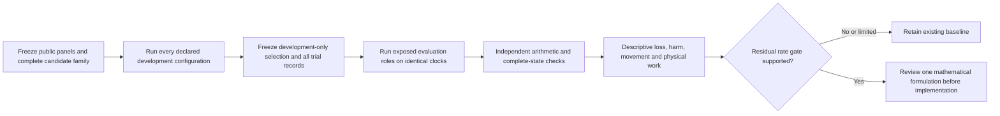

# When would another expert method be worth adding?

Start with the qualified [Hedge and Fixed Share methods](expert-mixtures.md).
An additional method earns a place only when it answers a separate question
under a declared comparison budget. A more adaptive name is insufficient.

This report freezes one public research question and its complete authored
input table. **The experiment has not run, no additional learner is selected,
and the existing baseline remains the supported choice.** The artifact is an
entry protocol for further research, not a performance result or a v5.0
release requirement.

## The question: when does the update clock hide useful information?

Consider three CI recipes with complete synthetic losses between zero and one.
A long sequence of equal losses tells us nothing about their relative quality.
Nevertheless, the accepted-panel clock of decreasing-rate anytime Hedge keeps
advancing. Its next learning rate becomes smaller. Constant-rate Hedge avoids
that particular dependence, but its chosen rate can be too aggressive or too
conservative when the loss contrast changes.

The residual question is therefore:

> After equal development budgets, do noninformative accepted panels and changing
> loss contrast leave a practically material rate-selection gap in the existing
> references and periodic baseline?

This is a **rate** question. Changing the best expert is a separate tracking
question; actual pre-decision inactivity is a separate specialist question.
The experiment includes tracking stress cases and unsupported-activity probes
to prevent either from being mistaken for evidence supporting a rate method.
The inputs are not measured CI durations or native NAPFD/APFDc values.

The [public protocol and all loss panels](https://github.com/jacksonpradolima/coleman/blob/release/v5/examples/research/expert-rate-entry-protocol.json)
have logical identity `coleman-public-expert-rate-entry-v1`. Its `content_digest`
hashes the complete canonical JSON after removing only that digest field.
Each case and the complete case catalogue also have independent content
fingerprints. These establish integrity, not source authentication, unseen
outcomes or experimental independence.
An amendment after outcome inspection requires a new protocol version and
retains the earlier trials and source exposure; it cannot replace this freeze.

## What is already available

The feasibility assessment uses source commit
`6c72ca343efba345a1d540e2473227f047093b58`. The protocol records exact hashes of
the relevant source and guide files, so a later runner must recheck its actual
implementation rather than trusting an illustrative API.

| Existing component | Reuse and boundary |
| --- | --- |
| `ReferenceConfig`, `Hedge`, `AnytimeHedge`, `FixedShare` | Static catalogue, positive prior, complete observed dimensionless losses in `[0,1]`. Direct `observe(panel)` returns an accepted update or explicit numerical failure; it supplies no delivery deduplication. |
| Existing controlled mixtures | Target share, bounds, movement, cadence and L1 solve answer explicit control questions. They stay available; none is silently added to the rate experiment or renamed a new method. |
| Direct protocol, replay and owned state | Use inspected weights before each observation; retain complete sufficient statistics and original feedback. Replay handles delivery; the optional store handles acknowledgement. |
| [Experiment design](evaluation-protocol.md) and [prequential comparisons](prequential-comparisons.md) | Freeze candidate laws, all trials, source exposure and costs. Public constructed evidence remains descriptive even when a future runner uses a protected-role partition. |

The actual anytime rule is proportional to
`prior_i * exp(-eta_t * cumulative_loss_i)`, with
`eta_t = c * sqrt(log(3)/(U+1))` before the next decision. It does not multiply
updates using their historical rates. Fixed Share performs exponential
reweighting followed by **excluding-origin** redistribution; it is not a
declared-target share. Existing schema versions, numerical refusals, checkpoint
meanings and public APIs remain unchanged by this protocol.

## Input: one finite catalogue, two declared roles

The protocol materializes every rational loss as a string such as `"33/64"`.
The future adapter parses it with `Fraction`, verifies `[0,1]`, then converts
once to the declared binary64 profile. There is no learned transform, missing
value imputation, random seed or imported dataset.

| Shape | Authored loss rule before cyclic relabeling | Purpose |
| --- | --- | --- |
| `stationary-gap` | `(0, 1/8, 1/4)` | Stable, useful separation. |
| `stationary-small-gap` | `(1/2, 33/64, 17/32)` | Same best expert with weaker contrast. |
| `neutral-prefix` | One base horizon of `(1/2,1/2,1/2)`, then the stationary-gap path | Pair the informative suffix with `stationary-gap`; count the added physical work. |
| `contrast-pulses` | `(1/4,1/4+d,1/4+2d)`, with `d=1/128` or `1/4` in alternating eight-row blocks | Change contrast while keeping the same best expert. |
| `equal-null` | `(1/2,1/2,1/2)` throughout | Exact ideal-mixture tie; retain any finite binary64 residual. |
| `balanced-cycle` | Rotate `(0,1,1/2)` through three expert orders | No persistent fixed-expert advantage over complete cycles; this deterministic pattern is predictable, not a statistical no-skill theorem. |
| `abrupt-reversal` | `(0,1/2,1)`, then `(1,1/2,0)` halfway | Tracking safety control; cannot admit a rate extension on its own. |
| `gradual-reversal` | `(1/4+s/2,1/2,3/4-s/2)`, `s=t/(n-1)` | Gradual change in the preferred expert; retain harm and valid nonwins. |

Development uses base horizon 24; the exposed evaluation role uses 32.
`neutral-prefix` doubles its actual horizon to 48 or 64, respectively. Each
shape has three cyclic expert relabelings. Thus each configuration consumes
648 development panels and 864 evaluation panels across 24 cases per role.
Rotations are related invariance checks, not three independent observations.
There are **zero declared independent empirical units**.
Each case/configuration and physical repetition starts a fresh complete owner
with the same uniform prior and `D=U=0`. Development state is not carried into
evaluation, and cases do not pool learning. Global work and attempt budgets
still include every case and repetition; initialization does not reset them.

Every generator and outcome is public. The evaluation role enforces separation
of selection from subsequent execution, but cannot establish an unseen
holdout. Record `known_exposed` and `constructed_mechanism`; do not report
confirmatory inference, a p-value, a confidence interval or empirical efficacy.
Future empirical work needs its own source admission and prospective freeze.

## Cycle: keep information, comparison and work separate



At opportunity `t`, record the current weights, emit the mixture, then expose
the complete row `t` and call the actual learner. The incurred loss is the
**before-update** dot product. The accepted update clock `U` increments once
per complete accepted panel. Missing or unavailable active feedback refuses
an update; it is never converted into a zero. Future-row perturbations must
leave earlier outputs unchanged.

The first study is immediate, one-panel-per-update and all-active. Delays,
batching, corrections, dynamic catalogues and controlled-output combinations
are unsupported for any prospective new rate method until their own laws and
continuation state are specified. Existing qualified replay capabilities do
not automatically confer those capabilities on an unimplemented method.

## Matched candidates, tuning and computation

| Family | Development settings, in tie-break order | Status |
| --- | --- | --- |
| Constant Hedge | `eta = 0, 1/8, 1/2, 2` | Actual shipped reference. Zero is a useful endpoint, outside positive-rate divided-by-eta theorems. |
| Cumulative-current-rate anytime Hedge | `c = 1/2, 1, 2, 4` | Actual shipped reference, without reset/doubling substitution. |
| Excluding-origin Fixed Share | Cartesian product `eta = 1/2, 2`; `alpha = 1/64, 1/8` | Actual shipped tracking reference. |
| Periodically refit empirical-best baseline | Trailing windows `8,16,32,64`; refit every eight received rows | Proposed simple host baseline, not a shipped new learner. Start uniform; assign equal mass to exactly tied trailing minimum-loss experts; hold between refits. |
| Fixed uniform | `(1/3,1/3,1/3)` | One untuned deployable baseline; do not invent duplicate trials. |

Periodic trailing sums and actual-score oracles consume the same once-converted
binary64 loss values as the shipped references, using Fraction arithmetic over
those stored values. The independently labeled ideal-rational/Decimal trace is
separate; it cannot silently supply different observations to a baseline.

Each tunable family receives at most four configurations and the same complete
input catalogue. Minimize equal-case mean `mixture_loss / actual_horizon` on
development, with declared setting order resolving ties. Select the deployable
baseline among family winners using the same development score and family
tie order: fixed uniform, constant Hedge, anytime Hedge, Fixed Share, then
periodic refit. Persist that complete selection before evaluation-role execution.
The zero-rate Hedge and literal fixed-uniform routes intentionally provide a
conformance/cost pair with the same coefficients; they are not two independent
pieces of evidence or distinct adaptive capabilities.

Run and retain **all 17 configurations** in both roles, including failures,
unused settings and unfavorable results. A per-evaluation-case best grid
setting is retrospective diagnostic evidence, never a deployed oracle.
Similarly report the best fixed expert and the best path with at most one
switch as separate comparators; neither is an online policy.

One baseline pass contains 25,704 panel opportunities. Three matched-order
physical timing repetitions contain 77,112; they do not create extra scientific
units or extra tuning. The first repetition supplies the correctness/effect
trace; the other two repeat that same frozen selection for timing. There is no
fourth, uncounted pass. Rotate the declared family order by offsets zero, one
and two across those repetitions, and retain warm/cold setup context rather
than claiming that this is a fully balanced hardware study.
Each family has a 180-second wall ceiling, the entire
pass has 900 seconds, and each process has 512 MiB RSS. The three repetitions
together have a 2,700-second cap; independent arithmetic checks have their own
180-second cap. There are at most 15 baseline-family process attempts plus one
oracle process. Timing failures receive no automatic retry; attempted panel
calls, including failed calls, spend the global work budget separately from
accepted `U`. A software correction requires an explicit amended study rather
than resetting an attempt or replaying its work for free.
Maximum state/report size remains 16 MiB, with 64 MiB of total
retained experiment output; no case exceeds 64 panels or three experts. Keep
complete initial, midpoint and final checkpoints and every emitted-state
digest, without requiring an unbounded archive of equivalent state copies.
These are
proposed experiment caps, not a change to any existing repository test, boot,
memory, work or CI fence. The runner must stop at the first applicable cap.

Measure the full driver, construction, actual typed validation and serialization
alongside mathematical work. Record wall/CPU time, lifetime peak RSS, input and
state bytes, successful updates and all attempts. Measure independent-oracle
work separately. Unused tuning allowance is not physical work. A fixed or
parameter-free route need not spend four trials merely to look matched.
Retain unknown resource values with explicit missingness.

## Independent checks before comparing outcomes

One hand trace needs no implementation helper. Starting from uniform weights,
loss `(0,1/2,1)` incurs loss `1/2`. At `eta=log(4)`, the unnormalized exponential
weights have ratios `1 : 1/2 : 1/4`, so the next vector is `(4/7,2/7,1/7)`.
Excluding-origin share with `alpha=1/4` then gives
`(27/56,17/56,12/56)`. Sharing back into the origin is a different recurrence.
These are ideal rational values; the actual logarithm, exponential and emitted
coefficients use the existing finite profile and its explicit error envelope.

The future runner must compare actual shipped methods with a separate
80-digit Decimal exponential calculation and an explicit three-by-three
transition matrix. Use Fraction sums for raw dot products, periodic-baseline
selection and an exhaustive zero/one-switch path oracle. Production private
math helpers cannot supply expected values. Accepted reference weights must
meet the already used absolute `2e-14` and relative `2e-13` comparison envelope;
these are test tolerances, not exact-real-arithmetic claims.
Score actual binary64 inputs and emitted weights with exact Fraction sums and
one final projection, retaining their admitted simplex residual. Do not repair
the score by secretly renormalizing coefficients. The independent ideal-trace
cumulative-score comparison has absolute tolerance `1e-11`; record error and
return insufficient evidence if a threshold decision is numerically ambiguous.

Required metamorphic checks cover expert relabeling, common per-row loss
translations within the admitted range, future perturbations and a neutral
prefix. Constant Hedge preserves the informative coefficient path after equal
rows are removed. Anytime Hedge need not: `U` advanced even though the
cumulative loss differences did not. Do not extend that invariance to Fixed
Share with a nonuniform prior or to a changing-contrast transform.

Keep singleton, alpha-zero and extreme-rate cases outside tuning. For example,
`eta=1e308` and loss `(0,1,1)` must retain the entire prior state on explicit
numerical refusal; finite underflow is not a successful structural zero.
Round-trip and continuation checks compare complete state, not just weights.
The prospective implementation package must also exercise installed direct
use, real interruption, session duplicate delivery and actual concurrent
writers through the existing owned-state boundary. Bare `observe` remains
non-idempotent.

## Literature and the formulation boundary

[Freund and Schapire (JCSS 1997)](https://www.schapire.net/papers/FreundSc95.pdf)
define the bounded linear-mixture comparison with a best fixed expert. It is
not a guarantee about the loss of a combined forecast, a funded portfolio or
an executed CI schedule.

[Mourtada and Gaïffas (JMLR 2019)](https://jmlr.org/papers/v20/18-869.html)
show that a simple decreasing-rate anytime rule already has strong stochastic
and worst-case properties under its assumptions. That is a reason to retain a
serious anytime control rather than assuming a more adaptive method wins.

[De Rooij, van Erven, Grünwald and Koolen (JMLR 2014), sections 2, 4 and 5](https://jmlr.org/papers/volume15/rooij14a/rooij14a.pdf)
motivate examining loss-dependent rates and neutral rounds. If the entry gate
is supported, the **one formulation to consider** is their uniform-prior
AdaHedge: cumulative-loss exponential weights at
`eta_t=log(K)/Delta_(t-1)`, where `Delta` accumulates the actual mixture-loss
minus mix-loss gap. At zero gap use the mathematical infinite-rate limit,
uniform over the cumulative minimizers. This is a formulation proposal only.
It needs a separately named finite numerical profile, precise zero-gap/tie
handling, stored sufficient statistics and refusals before implementation.
An epsilon or arbitrary finite rate cap would be another method, not an
unmentioned implementation detail. The paper also gives cases where AdaHedge
is unnecessarily conservative; its analysis is not a promise of improvement.

Feasibility is conditional rather than a rewrite requirement. The public
protocol, replay, source-access audit and owned-state seams can be reused.
The new mathematical work would be a separately versioned owner of cumulative
losses, mixability-gap statistics, counters, zero-gap limiting-mode state and
the original pending feedback. Its numerical profile must qualify cancellation
in the gap, underflow, ties and restart. Reusing the current constant-rate
configuration with an altered field would not supply that implementation.

| Possible benefit | Added obligation or reason to retain the baseline |
| --- | --- |
| A rate reacts to past loss difficulty instead of only elapsed accepted panels | Anytime Hedge is already a strong control; the proposed finite gap may be absent or immaterial. |
| A parameter-free formulation can reduce manual rate tuning | Additional gap arithmetic, limiting cases, state and tests still consume real computation and maintenance. |
| Neutral-round invariance is a precise, independently testable property | It does not establish better CI results, lower fees, a changing-expert guarantee or empirical superiority. |

[Herbster and Warmuth (Machine Learning 1998)](https://mwarmuth.bitbucket.io/pubs/J39.pdf)
address changing expert paths. Abrupt/gradual tracking alone cannot justify
adding a rate method or a synonymous sharing convention.
[Freund, Schapire, Singer and Warmuth (STOC 1997)](https://www.schapire.net/papers/FreundScSiWa97.pdf)
treat genuinely abstaining experts. Inactive experts and active experts with
missing feedback require different eligibility and comparator rules.

The activity diagnostic deliberately supplies pre-decision sets `{a,b}`, `{}`,
then `{a,b,c}`. Current references must report unsupported rather than invent
losses. A later specialist proposal would need an awake-only comparator
denominator, explicit all-inactive abstention with no eligible update, preserved
latent state on reentry and separate decision/update/maturity clocks. This
protocol does not select that proposal or qualify a specialist capability.

## Output and the retain-baseline decision

Each result must carry the protocol/source/input/configuration fingerprints,
case/role, actual clocks and work, complete checkpoint digest, raw before/after
weights, all trials, exposure and quantities with units/status/reason. Keep
zero and negative comparator excess observed. Use null plus a reason for an
unavailable measurement; executed-book charges are `not_applicable` here.
Coefficient L1 and measured computation are separate from fees.

The entry rule requires the development-selected baseline to exceed the
retrospective best of already-budgeted reference settings by more than `1/64`
mean loss on **at least two distinct primary rate shapes**, averaging rotations
within each shape. A gap occurring only in tracking controls does not pass.
This is a disclosed finite research prioritization threshold, not a statistical
test or a guaranteed remedy.

If there is no such gap, or resource limits prevent a complete comparison,
**retain the qualified baseline and defer the extension**. If the gap is
present, review at most one formulation and its numerical/state/capability
contract before writing a learner. No automatic promotion follows. A later
candidate must clear independent mechanics/recovery first, retain safety-case
harm and actual matched costs, and meet the predeclared finite comparison
criteria. Negative or inconclusive outcomes remain useful.
The prospective extra configuration has the same per-family caps. Reserving
its three physical repetitions gives at most 19 total process attempts,
81,648 panel calls and 3,240 seconds plus the original oracle allowance;
baseline settings, inputs and allowances are preserved.

The current result is therefore:

```json
{"evaluation_status":"not_run","implementation":"deferred","selected_additional_method":null,"baseline_disposition":"retain","evidence_basis":"constructed_mechanism","independent_empirical_units":0}
```

This supplies the previously missing concrete question, input catalogue,
matched budgets and formulation decision rule. Execution and any advanced
method's independent mathematics/state/recovery package remain future work in
the existing research issue; they are not marked delivered by a protocol.

## Regenerate the authored panels

The following complete standard-library program verifies the existing
materialized table and content identities. It does not run learners, read
outcomes from another source or execute code stored in JSON. Run it from the
source checkout with Python 3.14+.

```python
import hashlib
import json
from fractions import Fraction as F
from pathlib import Path


def canonical(value):
    return json.dumps(value, ensure_ascii=False, allow_nan=False,
                      sort_keys=True, separators=(",", ":")).encode()


def digest(value):
    return "sha256:" + hashlib.sha256(canonical(value)).hexdigest()


def loss(shape, t, n):
    if shape == "stationary-gap":
        return F(0), F(1, 8), F(1, 4)
    if shape == "stationary-small-gap":
        return F(1, 2), F(33, 64), F(17, 32)
    if shape == "equal-null":
        return (F(1, 2),) * 3
    if shape == "balanced-cycle":
        return ((F(0), F(1), F(1, 2)),
                (F(1, 2), F(0), F(1)),
                (F(1), F(1, 2), F(0)))[t % 3]
    if shape == "neutral-prefix":
        return (F(1, 2),) * 3 if t < n else (F(0), F(1, 8), F(1, 4))
    if shape == "contrast-pulses":
        d = F(1, 128) if (t // 8) % 2 == 0 else F(1, 4)
        return F(1, 4), F(1, 4) + d, F(1, 4) + 2 * d
    if shape == "abrupt-reversal":
        return (F(0), F(1, 2), F(1)) if t < n // 2 else (F(1), F(1, 2), F(0))
    if shape == "gradual-reversal":
        s = F(t, n - 1)
        return F(1, 4) + s / 2, F(1, 2), F(3, 4) - s / 2
    raise ValueError("Unknown authored shape")


path = Path("examples/research/expert-rate-entry-protocol.json")
protocol = json.loads(path.read_bytes())
assert type(protocol["schema_version"]) is int and protocol["schema_version"] == 1
claimed = protocol.pop("content_digest")
assert claimed == digest(protocol)
document = Path("docs/adaptive-expert-feasibility.md").read_text()
generator = document.split("\n```python\n", 1)[1].rsplit("\n```", 1)[0] + "\n"
assert protocol["source"]["generator_source_sha256"] == hashlib.sha256(generator.encode()).hexdigest()
cases = protocol["cases"]
assert len(cases) == 48
for case in cases:
    n = case["base_horizon"]
    count = 2 * n if case["shape"] == "neutral-prefix" else n
    rows = [[str(x) for x in loss(case["shape"], t, n)] for t in range(count)]
    rotation = case["expert_rotation"]
    expected = [row[rotation:] + row[:rotation] for row in rows]
    assert case["panels"] == expected
    assert case["actual_horizon"] == count
    assert case["panels_digest"] == digest(expected)
    assert all(0 <= F(x) <= 1 for row in expected for x in row)
assert protocol["source"]["all_panels_digest"] == digest(cases)
assert sum(c["actual_horizon"] for c in cases if c["partition"] == "development") == 648
assert sum(c["actual_horizon"] for c in cases if c["partition"] == "evaluation-exposed") == 864
assert sum(len(f["configurations"]) for f in protocol["families"]) == 17
print(claimed)
```
