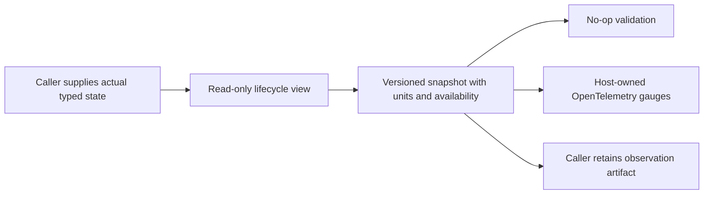

# Lifecycle observations API

Start with [Observe a decision without changing it](../operational-qualification.md)
for a complete installed CI example, metric interpretation, dependency profiles
and finite workload measurements. These APIs belong to the unreleased v5 source.
For native TCPCI result storage and Grafana dashboards, use the
[observability guide](../observability.md).

| Module | Responsibility |
| --- | --- |
| `coleman.telemetry.lifecycle` | Closed version-1 snapshot, metric catalogue, explicit units and separate observed/unknown/unavailable/not-applicable states |
| `coleman.telemetry.views` | Read actual typed action, replay, task and process-resource records without changing their owners |
| `coleman.telemetry.export` | Validate through a no-op observer or record bounded gauges using the host's existing meter |

The same routes in plain text are: supply actual state, construct a typed
snapshot, then validate without export, record through an explicit meter, or
retain the snapshot. None of these routes delivers feedback, acknowledges
scientific state or completes a durable job. A caller still owns the original
operation and its commit boundary.

Metric values use their declared units. A measured zero differs from a null with
its explicit missingness status. Read the availability gauge before using a
numeric gauge: an unavailable reading can leave the preceding numeric sample
stale. Calls through one exporter serialize, but multiple facades and collector
reads do not form an atomic snapshot transaction. Provider lifecycle, resource
cardinality, retention and any network export remain the host's responsibility.

## Versioned observations and metric definitions

::: coleman.telemetry.lifecycle

## Views over existing typed state

::: coleman.telemetry.views

## No-op and host-owned export

::: coleman.telemetry.export
