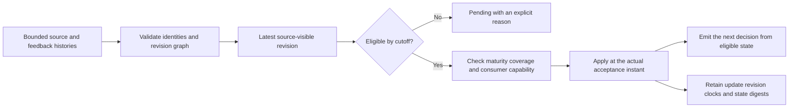

# Replay late CI feedback without learning from the future

A CI result can arrive after the next build has already been ranked. Another
result may arrive promptly but remain provisional, or be corrected after it was
used. Replaying the latest exported table would give earlier decisions knowledge
they did not have.

COLEMAN's optional `coleman.replay` layer separates the information a decision
could use from the instant an update actually runs. It keeps delayed feedback,
corrections and pending values explicit. This API belongs to the **unreleased v5
integration source**. Use its reviewed source wheel and the
[base installation](core-installation.md); replay needs no native CI backend,
database, provider SDK, CLI or MCP service.

The example below uses a small, user-owned consumer and synthetic CI losses.
It qualifies the replay mechanics, not a shipped generic learning method or a
claim that adapting a test schedule improves CI.

## Start with the information you actually have

Keep the producing decision, exact test version, target horizon, value units and
source clocks. A chosen suite's result reveals that suite, even if the original
source has a table of every suite's eventual outcomes.

The example uses `suite-a`, `suite-b` and `suite-c`, all at version `v1`. A supplied
bounded loss has unit `1`, meaning `synthetic-ci-bounded-loss-v1` and range
`[0,1]`; lower is better. Its origin is **synthetic**, with an explicit generator
identity, version and digest. It is neither a calibrated failure probability nor
a measured duration. A duration would be a separate measurement in seconds.
Value availability and origin are separate: the fixture supplies an observed
numeric loss while retaining synthetic origin. Modeled counterfactual values
likewise retain their model/version/definition binding; their presence never
turns them into realized outcomes.

All times below use 2026-01-01 UTC. The target intervals of D0 and D1 overlap;
they do not become independent observations.

| Input | Information cutoff | Decision time | Target interval | Feedback visible to the consumer |
| --- | --- | --- | --- | --- |
| D0 | 10:00 | 10:00 | 10:00–10:02 | No prior loss; choose `suite-a` |
| D1 | 10:01 | 10:01 | 10:01–10:02 | D0 is still pending; choose `suite-a` |
| F0/root for D0 | Bound to D0 | Not another decision | D0's original target | Chosen `suite-a` loss `1` |
| D2 | 10:02 | 10:03 | 10:03–10:04 | F0/root becomes usable; choose `suite-b` |

F0 labels the example's `ci-outcome` feedback for D0, revision `root`.
For F0/root, target completion, event, source availability, maturity and first
receipt are all 10:02. These five readiness instants coincide in this fixture;
the contract retains each one separately. The update is accepted at 10:03.

The reference consumer first chooses a member with no observations, breaking
ties by name. Once every member has observations, it chooses the smallest
observed mean. An unobserved member is explored, never assigned a fictional loss
of zero. The consumer only receives the typed request and admitted feedback;
the complete source history and hidden alternatives stay outside it.

## Run the complete installed example

Install the reviewed source wheel following the
[component guide](core-installation.md). Copy
[`ci.py`](https://github.com/jacksonpradolima/coleman/blob/release/v5/examples/replay/ci.py)
into a directory outside the checkout, then run:

```bash
python ci.py
```

The script contains the complete typed host implementation, loss schema,
capability declarations and source/feedback builders. Its small receipt is:

```json
{
  "accepted_rounds": 1,
  "choices": ["suite-a", "suite-a", "suite-b"],
  "counts": [1, 0, 0],
  "decisions": 3,
  "evidence": "authored_synthetic_ci",
  "execution": "offline_identity_v1",
  "loss_sums": [1.0, 0.0, 0.0]
}
```

With that copied `ci.py` beside your own script, the same cycle makes the library
calls visible:

```python
from ci import CODEC, HostConsumer, HostConsumerState, feedback, history, opportunity, policy
from coleman.replay.engine import CausalReplay

host = HostConsumer()
replay = CausalReplay(host, policy(), state_type=HostConsumerState, state_codec=CODEC)
replay.admit_history(history())
first = replay.emit(replay.prepare(opportunity(0, at=0, end=2)), execution="offline_identity_v1")
second = replay.emit(replay.prepare(opportunity(1, at=1, end=2)), execution="offline_identity_v1")
replay.admit_feedback((feedback(first, (1.0, 0.0, 0.5)),))
third = replay.emit(replay.prepare(opportunity(2, cutoff=2, at=3, end=4)), execution="offline_identity_v1")
print([record.executed.action.chosen.id for record in (first, second, third)])
print(replay.state.causal_prefix_fingerprint)
print(replay.export_continuation().to_json())
```

The three-value tuple belongs to the example driver. The chosen-only feedback
builder retains only a's selected value; b's `0` and c's `0.5` never enter the
host request, feedback or state. Changing those hidden values cannot turn this
run into a full-information experiment. `offline_identity_v1` explicitly
simulates unchanged execution of the proposal; it does not launch a test job or
attest that physical CI execution occurred.

## Follow one decision and its later update

The replay has two monotonic frontiers:

| Frontier | Question it answers |
| --- | --- |
| `eligible_through` | Which supplied information is eligible to affect this state? |
| `apply_at` | When is the selected update actually accepted? |

The information frontier cannot exceed the application frontier. A decision
uses its information cutoff for eligibility and its decision time for actual
acceptance. For example, cutoff 10:08/decision 10:10 followed by cutoff
10:09/decision 10:11 is valid. Receiving something by 10:10 does not make it
eligible for a decision whose cutoff is 10:08.

Before a new decision, eligible feedback for already registered producers is
processed. Selection is ordered by its eligibility instant, then the stable
producer/feedback coordinates for ties. A producer registered at the same
instant can receive feedback only in the later phase. Original observation
queries remain inclusive at their cutoff.



An explicit drain closes that part of the processing schedule, even when no
update is ready. The `closed-drain-v1` profile records those boundaries. It does
not claim that inserting or removing drain calls reproduces continuous
processing, or that arbitrary batching schedules produce the same state.
Permuting equivalent declarations within the same declared schedule is a
different question from changing that schedule.

Admit complete bounded revision graphs before closing the relevant drain.
Exact duplicates are harmless; changed content at the same revision key, missing
parents, forks, cycles and mismatched producing versions reject. Rows supplied
out of order in a complete valid graph use predecessor ancestry rather than
lexical revision names. A repeated delivery retains its original first receipt.

Source-history replacement is append-only: every retained revision keeps its
exact canonical content. Newly backfilled information that would change a closed
eligible prefix rejects. The same-instant post-producer feedback phase is explicit; the
engine does not invent a later timestamp to make a backfill look new.

## Read the timeline and the output together

Decision count **D** counts successful emitted opportunities. Update count **U**
counts completed, accepted logical feedback rounds.

| Step | Action or update | D | U | Observed counts for a, b, c |
| --- | --- | ---: | ---: | --- |
| Emit D0 | Choose `suite-a` | 1 | 0 | `(0,0,0)` |
| Emit D1 | Choose `suite-a`; F0 remains pending | 2 | 0 | `(0,0,0)` |
| Accept F0/root at 10:03 | Observe a's loss `1` | 2 | 1 | `(1,0,0)` |
| Emit D2 | Choose `suite-b` | 3 | 1 | `(1,0,0)` |

Immediately before F0 acceptance there have been two decisions. Its producer
has zero-based index zero, so the additional decision delay is
`2 - 0 - 1 = 1`. This is a count of intervening opportunities, not two minutes of
elapsed time. The batch declares this delay, and the consumer must support it.
An ordinary synchronous method does not acquire asynchronous support by being
placed behind a queue.

Retain the exact executed decision, selected feedback revision, target/horizon,
origin evidence and actual application time alongside the output. The complete
trace distinguishes:

- the whole admitted history/state fingerprint, which can change when future
  evidence is added;
- the selected eligible input view and causal-prefix fingerprints, which exclude
  later knowledge;
- the host-state fingerprints before and after the actual calls;
- decision and completed-update counters, pending facts and their reasons.

A digest checks the consistency of the supplied content. It does not
authenticate a source, prove complete collection or show that an arbitrary
host derived its features honestly. In the example, the host has no source
history or alternative-outcome channel to inspect.

## Keep incomplete and corrected results visible

Unknown receipt remains pending. Maturity alone cannot supply receipt, and a
null value cannot become an observed zero. Observed zero is valid and counts
when all required facts are eligible. Unavailable and not-applicable values
retain their separate meanings.

Correction selection first chooses the latest **source-visible** revision using
source availability, first receipt and the explicit predecessor chain. It then
checks maturity and required values. A visible null, unavailable, immature or
partial successor blocks a previously ready predecessor; replay never revives
the older value merely because it is easier to use.

The `preserve_live_v1` correction policy applies at most one completed feedback
round to each producing execution and target. Before first acceptance, an
eligible successor can be selected. After acceptance, later corrections remain
audit evidence and may inform future eligible input snapshots. They do not
rewrite past decisions or add another loss round for the same target.

| Feedback contract | What permits an update |
| --- | --- |
| Chosen-only | Eligible required values for the actual chosen member |
| Full panel | Eligible required values for every exact declared member/version |
| Selected components | An explicit complete revision covering the selected members |
| Partial components or absence | No completed update; retain the pending/absent fact |

Several metrics for one chosen suite do not reveal other suites. Partial
component revisions are not silently assembled into a complete panel. An
aggregate result is not distributed into invented component outcomes.

The example's other declared profiles illustrate that difference:

| Profile and supplied feedback | Accepted observation counts | Next action |
| --- | --- | --- |
| Chosen a loss `1` | `(1,0,0)` | b, an unobserved member |
| Complete panel a=`1`, b=`0`, c=`0.5` | `(1,1,1)` | b, the smallest observed mean |
| Selected a/b, partial a=`0.5` | `(0,0,0)`; no completed update | Pending |
| Explicit complete successor a=`0.5`, b=`0` | `(1,1,0)` | Subset b/c, including unobserved c |

These are different declared inputs, not alternative interpretations of the
chosen-only run. An explicit active-member/specialist declaration is also
required where that support is used; a changing universe does not confer it.

Raw outcomes, loss transformations and scale choices remain distinct. Late
feedback retains the semantic context and frozen scale chosen for its producing
decision; later data does not refit that scale. See
[outcomes and objectives](objectives.md) for the dimensional and clipping rules.

## Retain and restore the complete state deliberately

The optional session owns its current replay state and checks the host's
declared implementation, codec and complete snapshot before calls. Stale
preparation, changed host state and conflicting logical retries reject. An exact
decision retry returns its retained result without another call or RNG draw.

Use one owner per host/session. Reentrant or concurrent use of that session is
refused; independent sessions need independent hosts. A host call or subsequent
snapshot failure can leave physical mutations behind. The session fails closed
and cannot be reused as though the transition succeeded; no rollback is implied.
Snapshot export is host code and must itself be side-effect-free; a fingerprint
cannot enforce that property.

A continuation combines the typed replay state with a concrete, versioned host
snapshot, including its pending work and any owned RNG/cache. The reader requires
the explicit host state type and compatible codec/implementation; it never
imports a class from supplied data or loads a native pickle. An explicit new
lineage requires a matched complete continuation, or a genuinely fresh origin.
Original lineage evidence remains intact.

`export_continuation()` verifies the actual host before producing that envelope.
`read_continuation(..., state_type=HostConsumerState)` decodes it without restoring
anything. `CausalReplay.from_continuation(...)` restores the matched state into
a fresh independently owned host. To continue from that same prefix under a new
lineage, use `fork_from_continuation(...)` with a new explicit lineage reference.
The child retains parent causal records and original source clocks; it cannot
backdate a later correction or attest that a real action was rolled back.
The complete ordered root-to-parent lineage ancestry is retained, including
ancestors that emitted no decisions; a child cannot reuse any ancestor identity.

Bounded readers accept complete UTF-8 JSON, not paths, with a default 16 MiB
limit and at most 64 nested containers. Typed collections have their own limits;
the example host is deliberately limited to 16 opportunities. Exceeding a
limit is not permission to discard pending or previously applied identities.

The caller may publish one complete continuation envelope with the existing
[immutable artifact writer](api/artifacts.md). That local publication does not
create a generic durable acknowledgement, a multi-store transaction or
exactly-once external effects. Use the separate [owned-state recovery foundation](state-recovery.md)
for complete locally acknowledged component collections. Its opt-in retained
replay is generation2: original v1 traces stay complete and unchanged. Quiescent
seals preserve global counters and expire old producer ordinals explicitly;
they never silently remove pending labels or compact source histories.

## Preserve existing histories and scientific limits

[Observation histories](point-in-time-observations.md), signals, objective
receipts and core v1 records retain their existing readers and meanings. Replay
adds its own explicit versioned records. Missing/unknown/future versions and
conflicting canonical content reject. Signed zero remains significant in exact
content identity. There is no automatic upgrade of native results into a
generic feedback trace, nor an invented historical receipt or maturity time.
Read the [migration policy](v5-compatibility.md) before continuing an older run.

Here, causal means respecting the declared information boundary. It does not
establish causal identification, independent observations, calibrated risk or
an effective policy. Overlapping horizons and dependence groups remain part of
the evidence; replay does not make them independent for
[protected comparisons](protected-evaluation.md).

[Joulani, György and Szepesvári, *Online Learning under Delayed Feedback*
(ICML 2013)](https://proceedings.mlr.press/v28/joulani13.html) motivates distinct
decision/update clocks and delayed-feedback compatibility. Its BOLD/QPM-D
guarantees do not transfer to this generic replay layer or its user-owned
consumer. No learner or distributed stream engine is introduced by this API.

Continue with the [replay API](api/replay.md), the
[decision contract walkthrough](decision-contracts.md) and
[point-in-time observations](point-in-time-observations.md).
