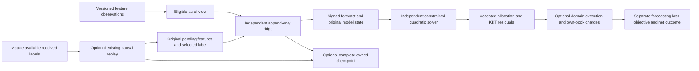

# Learn a forecast, then choose a feasible allocation

Use COLEMAN's small mathematical components independently: learn a signed
response with online ridge, solve a coupled quadratic allocation, or take one
projected gradient step. Compose them when your problem needs both prediction
and constrained decisions. None requires a runner, workspace, registry or MCP.
These APIs belong to the **unreleased v5 integration source**; use its reviewed
wheel, as explained in [component installation](core-installation.md).



## What enters and what comes out

The [complete public examples](https://github.com/jacksonpradolima/coleman/tree/release/v5/examples/continuous)
use one authored four-step path. Feature values are already dimensionless;
each row becomes visible at its decision instant. A label matures one minute
later, arrives another half-minute later, and is applied at the next decision's
closed drain. Future labels belong to the driver and never enter the predictor.

| Decision minute | Original features | Eligible labels before prediction | Ridge prediction | Later signed label |
| --- | --- | --- | --- | --- |
| 0 | `(1, 0)` | none | `0` | `2` |
| 2 | `(1, 1)` | `2` | `1` | `0` |
| 4 | `(2, 1)` | `2, 0` | `6/5` | `-1` |
| 6 | `(0, 1)` | `2, 0, -1` | `-7/12` | `1` |

The table gives ideal arithmetic; emitted values follow the declared binary64
profile. Output retains each pre-label prediction, mean/last/zero controls,
eligible sample count, raw label, squared prediction error and complete state
fingerprint. The ridge mean squared error is approximately **3.08674**, versus
**1.5** for the fixed zero forecast. This negative comparison is retained. Four
constructed steps establish no predictive advantage or independent evidence.

## Use the predictor by itself

Ridge minimizes `sum((y - x @ beta)**2) + lambda * ||beta||²`, with a fixed
positive lambda, zero regularization center and no forgetting. Supply explicit
features for any intercept: **every declared coefficient is penalized**. There
is no implicit centering, learned scaler, intercept or probability calibration.
This is the sum-squared convention in the [official Ridge objective](https://scikit-learn.org/stable/modules/generated/sklearn.linear_model.Ridge.html),
with a separately declared intercept convention.

```python
from coleman.core.identity import Reference
from coleman.core.numeric import Scalar, ScalarSpec
from coleman.core.units import UnitSemantics
from coleman.objectives.bindings import DefinitionBinding, DefinitionLineage
from coleman.prediction import AppendOnlyRidge, RidgeConfig, RidgeInput, RidgeSample

def ref(name):
    return Reference(id=name, version="1")

config = RidgeConfig(
    schema_version=1,
    reference=ref("signed-ci-response-model"),
    lineage=DefinitionLineage(
        source=None, source_fingerprint=None, declared_at=None, supersedes=None,
    ),
    features=tuple(
        ScalarSpec(
            dimension=ref(name), role="feature",
            semantics=UnitSemantics(unit="1", meaning=name + "-v1"),
        )
        for name in ("scaled-change-size", "scaled-prior-instability")
    ),
    target=ScalarSpec(
        dimension=ref("signed-next-build-score"), role="objective",
        semantics=UnitSemantics(unit="1", meaning="declared-ci-score-change-v1"),
    ),
    horizon=ref("next-completed-build"),
    preprocessing=DefinitionBinding(
        reference=ref("development-frozen-feature-transform"),
        definition_fingerprint="sha256:" + "1" * 64,
    ),
    regularization=1.0,
)
model = AppendOnlyRidge(config, owner=ref("ci-predictor"))
features = RidgeInput(schema_version=1, config=config.binding, values=(1.0, 0.0))
forecast = model.predict(features)  # no label or update is implied
assert forecast.value.value == 0.0

# Only the host can establish that this original label is eligible now.
update = model.append(RidgeSample(
    schema_version=1, input=features,
    target=Scalar(spec=config.target, status="observed", value=2.0),
))
assert update.status == "accepted"
snapshot = model.export_state()
restored = AppendOnlyRidge(config, owner=ref("ci-predictor"))
restored.restore_state(snapshot)
assert restored.export_state().to_json() == snapshot.to_json()
```

The example's preprocessing digest is a syntactically complete illustrative
declaration. In an experiment replace it with the digest of your actual frozen
transform, selected using development data only. The mathematical component
checks the binding, not whether your preprocessing was causally fitted.

The sufficient statistics are `A = lambda*I + sum(x*x.T)` and `b = sum(x*y)`;
coefficients come from a checked Cholesky solve. After `(1,0), y=2`, the ideal
coefficients are `(1,0)`. Appending `(1,1), y=0` gives
`A=[[3,1],[1,2]]`, `b=(2,0)` and `beta=(4/5,-2/5)`.
**The zero label changes A.** Null, unknown and unavailable labels reject rather
than becoming zero targets. The [Berkeley least-squares derivation](https://people.eecs.berkeley.edu/~jiantao/225a2020spring/scribe/EECS225A_Lecture_15.pdf)
explains sufficient-statistic updates; this implementation stores no inverse,
uses no silent jitter and does not claim calibrated predictive uncertainty.

The reference admits at most16 features and a declared number/magnitude of
samples. It recomputes a small factorization from accumulated statistics; it
does not promise large-scale recursive-factor update performance. Normal
equations can become ill-conditioned. Nonpositive pivots, range, residual and
capacity failures have typed outcomes, with unavailable predictions or an
unchanged append state. Invalid schemas/units/dimensions raise validation errors.

## Solve only the allocation problem

The continuous capability is deliberately small: **one through four
dimensionless noncash coefficients**, finite boxes, and a strictly
positive-definite coupled quadratic. Signed boxes and a nonnegative simplex are
separate profiles. You declare net exposure, implied cash `1-sum(x)`, optional
gross `sum(abs(x))` and optional leverage `gross+abs(cash)` bounds. These are
mathematical coefficient constraints. A financial adapter must separately model
funding, borrow, collateral, margin and actual trades.

`ContinuousProblem` binds the full feasible-set and objective definitions,
comparator, transition-model identity, absolute numerical tolerances and finite
work limits. `solve_continuous` searches active faces using rational
interpretations of the stored binary64 numbers, rounds the result once and
checks primal, stationarity and complementarity residuals. It returns:

| Status | Meaning |
| --- | --- |
| `optimal` | Accepted emitted point with the original problem and checked KKT certificate |
| `infeasible` | Complete bounded face search proves the well-formed declared set empty |
| `limited` | Face budget exhausted; emptiness and optimality remain unknown |
| `unsupported` | Objective is singular or indefinite under the qualified SPD profile |
| `numerical_failure` | Rational work/finite emission/residual requirements cannot be satisfied |

Malformed versions, units, shapes or reversed individual bounds reject before
solving. No refusal invents a feasible zero vector. No clip-and-renormalize,
hidden diagonal regularization or arbitrary nonlinear constraint is supplied.
Default absolute residual tolerances are `1e-12` primal and `1e-10`
stationarity/complementarity; these do not imply a conditioning-independent
objective-gap guarantee. Work is bounded by both faces and rational integer bits.

The complete `allocation.py` example constructs and solves this independent
coupled problem:

```text
minimize x0² + x0*x1 + x1² - 3*x0 - 3*x1
subject to 0 <= x0 <= 0.5, 0 <= x1 <= 2,
           0 <= net <= 2.5, -1.5 <= cash <= 1,
           gross <= 2.5, leverage <= 4

unconstrained proposal: (1, 1)
coordinate clipping:   (0.5, 1),    objective -2.75
coupled optimum:       (0.5, 1.25), objective -2.8125
gradient:              (-0.75, 0)
active-upper multiplier: 0.75
```

The clipped point is feasible but inferior. Joint optimization accounts for the
coupled term; individual coordinate clipping cannot establish this optimum.
Generic curvature in this example is not called variance, expected target
shortfall or CVaR. Existing [finite scenario allocation](scenario-payoffs.md)
keeps its original exact accounting, assumed/estimated weight distinctions and
conservative fallback. Estimated scenario weights are never silently treated as
qualified continuous-solver inputs.

| Quantity | Definition |
| --- | --- |
| Scenario variance of outcome X | `E[X²] - E[X]²`, in squared outcome units |
| Expected target shortfall | `E[max(target-X,0)]`, in outcome units; the existing finite constraint |
| Upper-tail CVaR of loss L at level alpha | `inf_eta(eta + E[max(L-eta,0)]/(1-alpha))`, for `0 <= alpha < 1`; no CVaR solver profile ships here |

## Compose forecasting, online updates and accounting

`allocation.py` feeds the actual chronological ridge forecast into a separate
simplex solve with `Q=[[2,1],[1,2]]` and `linear=(-forecast,0)`. It compares a
fixed allocation, a two-step periodic release, existing five-point finite
enumeration, forecast-then-continuous optimization, and projected online
updates. Every route sees the same eligible inputs, starts with reference
capital1 and has zero tuning trials; actual arithmetic work differs by method.
Finite objective scores retain the old12-decimal contract, with at most`5e-13`
rounding per candidate; coarse-grid and continuous optima need not coincide.

The online route takes `x_next = project(x - eta*gradient(f_t,x))` only after
receiving the corresponding realized per-round loss. A single projected step
is distinct from iterating a solver to optimize one known objective. Projection
faces do not create labels or independent observations. This follows the
modeling boundary of [Zinkevich's online convex programming](https://www.cs.cmu.edu/~maz/publications/techconvex.pdf):
a compact convex set and comparable per-round convex losses. The emitted
numerical profile and this example make no new regret theorem claim.

The driver retains executed coefficients, same-function realized losses and
own-book L1 changes, with one modeled charge of`0.001 credit` per unit movement.
It reports signed gross credit and net credit separately. These are additive
unit-reference increments on an exogenous constructed path, not compounded
wealth or measured exchange fees. Objective penalties are never paid expenses.
External regret against a fixed vector on the **same realized loss functions**
does not bound a comparator's separate turnover, net wealth or risk path.
[Boyd et al.'s convex trading framework](https://web.stanford.edu/~boyd/papers/cvx_portfolio.html)
similarly separates forecasts, optimization and execution/accounting models;
its financial assumptions do not transfer automatically to this generic solver.

## Resume without learning from future labels

The public host uses the existing [causal replay](causal-replay.md) and
[owned state store](state-recovery.md). Pending state retains original feature
values, prediction/model-state identity and pre-label controls. A delayed label
updates that original pair, even if a newer feature revision has since arrived.
Feature schemas or preprocessing changes require a new model/session lineage;
there is no implicit retraction, reset or codec migration.

Direct `append` is intentionally **non-idempotent**: calling it twice trains
twice. Replay accepts a logical outcome once. Its `preserve_live_v1` rule keeps
already applied labels unchanged when later corrections arrive; corrections
remain auditable. Independent batch oracles use the identical actually accepted
prefix, never future full-sample or retroactively corrected fits.

Checkpoints retain complete statistics, counts, pending/source/revision lineage
and actual replay frontiers. The existing local store publishes an acknowledged
collection only after complete snapshots pass validation. An interrupted or
stale concurrent writer cannot mark its partial state complete. Logical accepted
updates are not exactly-once physical execution. The32-child example verifies
operational recovery; it supplies neither task pooling nor32 independent paths.

Continue with the [API reference](api/continuous.md),
[protected experiment design](evaluation-protocol.md), or the
[worked CI adapter](tcpci-problems.md). The broader synthetic portfolio adapter
and historical risk-matched studies have separate qualification scope.
