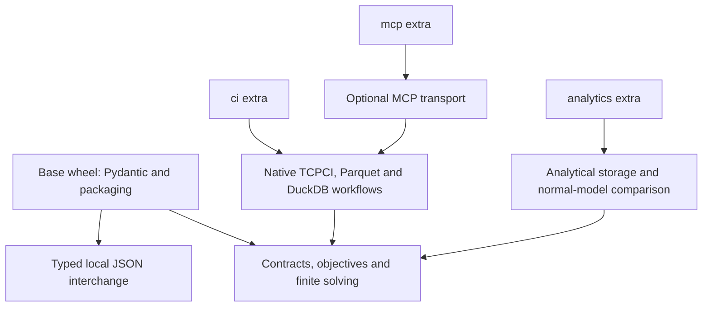

# Install the components you need

Use COLEMAN's mathematical contracts, objective mappings and finite solvers in
an application without installing its CI execution or analytical stack. Add the
capabilities needed by the workflow you actually run.

This page describes the **unreleased v5 integration source**. Published v4 wheels
keep their original dependencies and installation instructions. The package
version remains `4.20.0` during integration; build the reviewed source below
rather than selecting an older wheel with the same filename. The bare PyPI name
`coleman` belongs to another project.

## Choose an installation

One distribution owns the `coleman` namespace. Extras select dependencies; they
do not install a second overlapping package or start a service.

| You want to use | Select | Direct dependencies added |
| --- | --- | --- |
| Core contracts, objectives, host-owned learners, finite solving and JSON codecs | Base wheel | Pydantic and packaging |
| Native TCPCI execution, source/Parquet workflows and DuckDB results | `ci` | DuckDB, NumPy, Polars, PyArrow and PyYAML |
| Analytical Parquet/DuckDB operations and normal-model statistical evaluation | `analytics` | DuckDB, NumPy, Polars, PyArrow, SciPy and scikit-posthocs |
| A native CI experiment followed by normal-model comparison | `ci,analytics` | Union of the two profiles |
| Local MCP tools over native CI | `ci,mcp` | CI dependencies and the MCP SDK |
| Durable CI workflows with bounded protected comparison through MCP | `ci,mcp` | CI dependencies and the MCP SDK |
| Native CI with normal-model inference through MCP | `ci,analytics,mcp` | CI, analytical dependencies and the MCP SDK |
| Native execution with telemetry or a ClickHouse sink | `ci,telemetry` or `ci,clickhouse` | CI dependencies and the selected SDK/driver |

`ci` and `analytics` work independently. Their shared Parquet and DuckDB
dependencies are declared in both profiles. `analytics` alone does not select
the YAML-backed native runner. A pure finite solve or host-owned learning call
needs neither profile. The existing bounded-mean protected method uses its
explicit bounded mathematical contract without SciPy; the native durable workflow
uses that route with `ci`. The normal-model paired method requires `analytics`.

The existing `mcp`, `telemetry` and `clickhouse` extras install their respective
SDKs/drivers. `notebook`, `docs`, `dev` and `release` select tools; they do not
implicitly enable CI or analytical operations. For the complete supplied
notebooks, select `ci,analytics,notebook`. Contributor setup selects the runtime
capabilities exercised by its tests explicitly.



An arrow points toward a component used. The extra packages enable the selected
outer operations; direct mathematics has no dependency on those operations.

Python packaging tools expand the selected extras into dependency requirements;
those requirements are visible in the wheel's `Requires-Dist` metadata. See the
[Python packaging specification](https://packaging.python.org/en/latest/specifications/pyproject-toml/#optional-dependencies)
for that mechanism.

### Observed base installation footprint

The source-wheel qualification on November 6, 2026 used fresh external virtual
environments, normal dependency resolution and `uv pip check` on **macOS arm64
(Darwin 25.6.0), CPython 3.14.6 and uv 0.9.3**:

| Installation | Installed distributions | Regular site-package files | Logical bytes in site-packages |
| --- | ---: | ---: | ---: |
| Earlier source wheel with the scientific stack in its base requirements | 32 | 9,339 | 564,702,594 B |
| Component wheel with no extra selected | 7 | 587 | 11,095,607 B |

This observation is a **98.04% reduction in logical installed file bytes**. Both
wheels contain the complete maintained SDK; the newer wheel has 394 package
resources, compared with 385 before extraction. The difference comes from the
installed dependency closure. The measured component wheel's SHA-256 is
`c7a32229743b54722bf7848c331cc9702f55e52836d93916acfa7b2a9c2adde0`.

The byte count sums regular files' `st_size` beneath the fresh environment's
site-packages, excluding symlinks and directories, before bytecode generation.
It is a disk-footprint observation, not download size, allocated filesystem
blocks, process RSS or evidence of faster execution. Installed versions, platform
wheels and future source changes can change it; repeat the consumer installation
when qualifying another environment.

## Build and install a base wheel

Use CPython 3.14 and uv. From the reviewed contributor checkout, create separate
build and consumer environments so the consumer cannot inherit development
packages:

```bash
UV_PROJECT_ENVIRONMENT=/tmp/coleman-v5-build \
  uv sync --frozen --only-group build --no-install-project
uv build --wheel --no-build-isolation \
  --python /tmp/coleman-v5-build/bin/python --out-dir /tmp/coleman-v5-dist
uv venv /tmp/coleman-v5-base --python 3.14
uv pip install --python /tmp/coleman-v5-base/bin/python \
  /tmp/coleman-v5-dist/coleman-4.20.0-py3-none-any.whl
uv pip check --python /tmp/coleman-v5-base/bin/python
```

Use fresh temporary paths for a new qualification. A reused environment can
contain unrelated packages left by earlier work. Normal dependency resolution
is part of this example: `--no-deps` alone would not prove that the base
installation has an independent dependency closure.

Save this complete example as `/tmp/coleman-v5-base/elapsed.py`:

```python
from coleman.core.identity import Reference
from coleman.core.numeric import Scalar, ScalarSpec
from coleman.core.units import UnitSemantics

elapsed = Scalar(
    spec=ScalarSpec(
        dimension=Reference(id="suite-elapsed", version="v1"),
        semantics=UnitSemantics(unit="s", meaning="observed-suite-duration-v1"),
        role="resource",
        minimum=0.0,
    ),
    value=0.0,
    status="observed",
)
print(elapsed.value, elapsed.spec.semantics.unit, elapsed.status)
```

Run it outside the checkout using the installed interpreter:

```bash
cd /tmp/coleman-v5-base
bin/python -I -B elapsed.py
```

Expected output:

```text
0.0 s observed
```

The input is a known zero-duration observation. Construction checks its explicit
schema and units; it does not execute a suite or infer missing information. A
null observation needs its declared missing state. See [decision contracts](decision-contracts.md)
for the full decision/feedback cycle and [objectives](objectives.md) for complete
conversion, loss and feasibility examples.

## Use a learner, MAB or solver independently

The three standalone examples use the base wheel. Copy them from the same
reviewed checkout into the consumer environment before changing directory:

```bash
cp examples/composition/learning_only.py /tmp/coleman-v5-base/learning_only.py
cp examples/composition/mab_only.py /tmp/coleman-v5-base/mab_only.py
cp examples/composition/solver_only.py /tmp/coleman-v5-base/solver_only.py
cd /tmp/coleman-v5-base
bin/python -I -B learning_only.py
bin/python -I -B mab_only.py
bin/python -I -B solver_only.py
```

If you already changed directory for the scalar example, return to the reviewed
checkout before the copy commands.

| Example and complete source | Input | One cycle | Inspectable output |
| --- | --- | --- | --- |
| [Learning only](https://github.com/jacksonpradolima/coleman/blob/release/v5/examples/composition/learning_only.py) | Two synthetic CI recipes and two complete, dimensionless loss panels: `(1, 0)` then `(0, 1)` | Request a choice, deliver the complete panel, update the host's cumulative losses, export/restore state | Choices `recipe-a`, then `recipe-b`; two accepted panels |
| [MAB only](https://github.com/jacksonpradolima/coleman/blob/release/v5/examples/composition/mab_only.py) | The same two recipes, a declared four-bin selection mechanism and eight synthetic chosen-feedback opportunities | Draw an actual action, expose only its feedback, update the chosen recipe and export/restore the full owned RNG state | Eight choices, their actual mechanism masses (`0.75` or `0.25`) and eight delivered rows |
| [Solver only](https://github.com/jacksonpradolima/coleman/blob/release/v5/examples/composition/solver_only.py) | Three indivisible suites with explicit overlapping coverage, modeled seconds and a three-second budget | Call the existing bounded `branch_bound_v1` solver and compare this tiny fixture with a separate exhaustive calculation | Suites `A` and `C`, cost `3` seconds and covered credit `1.0` |

The learning and MAB classes in these three composition examples belong to the
copied user application. They exercise the public structural protocols and
conformance harness, including restored continuation. The separate
[expert-mixture guide](expert-mixtures.md) uses the actual shipped Hedge, anytime
Hedge, Fixed Share and controlled full-information learners from the base wheel;
it also covers the joint constrained L1 output without a runner or store.
The MAB composition example does not qualify a built-in chosen-feedback method.
The solver calls the existing
production finite solver; its exact-scope result concerns this bounded fixture.
These synthetic examples establish composition and state behavior, without
establishing performance on operational CI data or independent observations.

The MAB example retains all 624 MT words and their index, rather than replacing
restoration with reseeding. Its sampling masses describe the declared selection
mechanism; they are not calibrated outcome probabilities. Direct raw updates are
not durable or automatically idempotent. A host that needs delivery deduplication,
concurrent workers or checkpoint publication must compose the corresponding
outer services explicitly.

## Add CI or analytical capabilities

Install extras against the **same reviewed wheel**. From any directory:

```bash
uv venv /tmp/coleman-v5-ci --python 3.14
uv pip install --python /tmp/coleman-v5-ci/bin/python \
  '/tmp/coleman-v5-dist/coleman-4.20.0-py3-none-any.whl[ci]'
uv pip check --python /tmp/coleman-v5-ci/bin/python

uv venv /tmp/coleman-v5-analytics --python 3.14
uv pip install --python /tmp/coleman-v5-analytics/bin/python \
  '/tmp/coleman-v5-dist/coleman-4.20.0-py3-none-any.whl[analytics]'
uv pip check --python /tmp/coleman-v5-analytics/bin/python
```

For a combined environment, use the same form with `[ci,analytics]` or
`[ci,analytics,mcp]`. Quote the entire wheel requirement so the shell preserves
the brackets. For a published wheel, retain its reviewed URL and SHA-256 fragment
when selecting extras; keep v4 requirements associated with their original v4
wheel instead of adding v5-only extras to an older distribution.

Continue with [native CI examples](getting-started.md), [analytical evaluation](evaluation-guide.md)
or [durable experiments](durable-experiments.md). When following a guide that pins
a published v4 wheel, use that guide's original environment. When using current
source, select the capabilities required by the shown operations.

## Inspect optional availability before starting work

At the application boundary, inspect installation declarations or explicitly
check a chosen capability:

```python
from coleman.capabilities import installation_capabilities, require_capability

print([item.name for item in installation_capabilities()])
require_capability("ci")
```

In the CI environment above, the check completes without loading the numerical,
storage or transport backends. In the base environment it raises
`CapabilityUnavailableError`, naming missing distributions and the wheel-extra
installation route. An unknown capability raises `ValueError`. These calls do
not install dependencies, discover plugins, create a workspace or start a
service. Presence checks are separate from resolver version checks and from
runtime provenance; they do not certify behavior or authenticate a source.

Direct mathematical calls never require this capability table or a global
registry. Missing optional packages do not become invented algorithm results.

## Keep native runtime identities explicit

Durable native workflow plans and baseline matrices record their producing SDK,
interpreter/platform and actual dependency versions. Separating optional profiles
changes which dependencies an experiment consumes, so new native plans use an
explicitly different runtime record:

| Runtime record | Retained meaning | Native execution in this source |
| --- | --- | --- |
| `InstalledRuntime`, schema version 1 | The producing wheel's active **base-only** dependency closure; historical readers and canonical bytes remain unchanged | Historical saved plans/matrices remain readable evidence; this record does not authorize v5 continuation |
| `SelectedInstalledRuntime`, schema version 2 | The producing wheel's active base plus **explicitly selected extras**, including their transitive requirements | New durable workflow plans and baseline matrices require the fixed `("ci",)` selection and a matching actual installed identity |

Version 2 does not mean every package that happens to be installed. Unrelated
analytical, transport and contributor tools stay outside a native CI inventory.
The complete SDK resource fingerprint is still retained; changing SDK bytes can
invalidate execution compatibility even when the selected dependency names agree.
Installed names/versions do not attest every native binary or the hardware.

An old runtime-1 plan or completed matrix can be inspected through its retained
reader. There is no automatic resume, runtime migration, checkpoint conversion or
relabeling as runtime 2. Continue the original executable work using its original
pinned v4 wheel, dependencies, data and trusted workspace. For new work, freeze a
new workflow plan or start a distinct baseline-matrix runtime scope in the v5
environment. The outer native workflow contract remains
version 1, its SQLite store remains version 1 and its existing PCG64 state codec
remains version 1. Those independent versions are not runtime-inventory versions.

This runtime generation applies to the durable native workflow and baseline
matrix routes; it does not silently replace every raw API's identity contract.
See [durable recovery](durable-experiments.md) and
[compatibility and migration](v5-compatibility.md) before reopening historical
executable state.

## Keep consumer compatibility separate from a research lock

The wheel currently declares exact direct dependency pins. The development and
research `uv.lock` additionally freezes transitive versions. A normal consumer
installation resolves those transitive requirements in its own environment;
it does not automatically inherit the contributor lock.

Retain the wheel hash, actual installed distribution versions and input/state
identities for reproducibility. An embedding application's incompatible package
constraints should produce a resolver error; bypassing dependency checks does
not qualify compatibility. Use separate environments and the versioned local
JSON interchange route when the host cannot import this supported runtime.
That route exchanges declarations, inputs and bound outputs; it does not lower
the package's Python minimum or exchange executable pickle state.

## Exchange data with an isolated runtime

`coleman.interchange.contracts` provides schema-version-1 request and response
envelopes for a decision call, feedback call or the existing finite coverage
call. `coleman.interchange.codec` reads their bounded JSON. A request retains the
logical task and exchange ID, physical attempt ID, implementation/version,
explicit nullable state-codec binding and explicit nullable clocks. A response
retains the complete producing request and checked input/reply fingerprints.

The host still makes the actual algorithm call. Decoding does not invoke a
learner, execute an action, restore state or import a callable named in JSON.
`FeedbackReply(disposition="applied")` records a producer's assertion; it does
not prove a durable update or exactly-once delivery. State bindings carry a
codec reference and digest, without executable state bytes.

| Producer/consumer boundary | Required acceptance |
| --- | --- |
| Source schema version 1 to this source's version-1 SDK reader | Typed nested input/output, operation, implementation and canonical digests must agree |
| Missing, future or unknown schema version; unknown fields | Reject; there is no inferred migration |
| Timed exchange | Explicit UTC clocks; the caller supplies the actual receipt to `accept_response(request, response, received_at=...)` and rejects late or mismatched output |
| Untimed exchange | Request creation/deadline, production and supplied receipt are explicitly null; no wall-clock freshness claim |
| Older host runtime or another language | It must separately implement and qualify these JSON contracts; this page does not declare an untested producer compatible |

The supplied [stdlib-only consumer](https://github.com/jacksonpradolima/coleman/blob/release/v5/examples/composition/foreign_consumer.py)
demonstrates one narrower route for the public synthetic finite coverage example.
It requires separately retained request/response wire pins, request/input semantic
pins and an explicit receipt. It checks the producing request, units and declared
result without importing the SDK. It is not a general SDK reader or an independent
validator of the solver's certificate. The
[versioned fixtures](https://github.com/jacksonpradolima/coleman/blob/release/v5/tests/fixtures/interchange/v1/README.md)
provide the complete public examples and explain their independently checked
arithmetic. The producing SDK, copied host learner and foreign consumer remain
separate roles.

Call `accept_response` against the actual retained request even after successful
decoding. An optional `expected_wire_fingerprint` pins exact received bytes;
canonical typed identity is separate from whitespace-dependent wire identity.
Neither digest authenticates a producer. Codecs accept built-in UTF-8 strings or
bytes up to 8 MiB, with JSON nesting bounded at 64, and reject duplicate keys.

For explicit local files, `coleman.interchange.publication` reuses an existing
caller-created `ArtifactWriter`. It publishes immutable request/reply files under
the hashed logical-attempt identity. Same bytes are idempotent; different content
for the same attempt conflicts. A request without a complete response remains
incomplete. Publication follows that writer's trusted-local-parent, filesystem
and platform guarantees; it does not create a transport or a distributed
transaction. Keep using direct mathematical calls when no isolated boundary is
needed.

## Runtime and platform limits

| Boundary | Supported envelope and evidence |
| --- | --- |
| Package interpreter | CPython 3.14 minimum; an older syntax/lint target is not runtime support |
| Core and pure mathematical calls | Noneditable wheel checks outside the checkout, including isolated imports; optional backends may be absent |
| Current automated execution | Linux with Python 3.14; contributor installed-package qualification also runs on macOS arm64 |
| Native local durable workflows | Their documented Linux/macOS process, locking and filesystem assumptions; other platforms do not inherit those guarantees |
| Windows or a lower Python version | No general v5 execution/compatibility promise; qualify a specific route before declaring support |
| External host | Declarative JSON compatibility is independent of whether that host can import COLEMAN |

A `py3-none-any` wheel contains portable Python package files; its selected
third-party dependencies and execution adapters still have their own platform
requirements. Profiler and controlled-source toolchain availability are separate
from package import support. See [compatibility and migration](v5-compatibility.md)
for old artifact/checkpoint routes and [contributing](contributing.md) for the
full developer environment.
