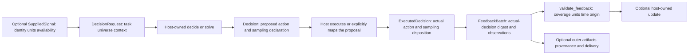

# Describe a decision before choosing an algorithm

A complete test ranking, a selected CI suite and a budget split between test
strategies are different decisions. Observing a chosen suite's fault detection
and elapsed time reveals two dimensions for one suite, without revealing either
dimension for suites that did not run.

The v5 integration source provides immutable contracts in `coleman.core` for
these distinctions. This is an implemented contract layer on `release/v5`,
**not a published v5 wheel or an implementation of the planned generic learners**.
Build this source's wheel to try the examples. Existing TCPCI runs and their
[measurement artifacts](domain-results.md) retain their own contracts.

The [component installation guide](core-installation.md) explains the base wheel,
independent `ci`/`analytics` extras and the supported runtime envelope. Direct
contracts and host-owned consumers below require only the base installation.

## Start from your inputs and observations

The host supplies this declaration for a synthetic CI suite-selection example:

| Input | Example | Meaning |
| --- | --- | --- |
| Task | `ci-suite-selection@v1` | Stable modeled problem |
| Logical opportunity | `build-42`, round `0` | A decision, independent of delivery attempts |
| Feasible universe | `ci-suites@v1` | Exactly `suite-unit@v1` and `suite-integration@v1` |
| Action shape | `choice` | One suite; a different shape from a full ranking |
| Objective | `detect-faults-under-ci-budget@v1` | Objective identity, without executing a transform |
| Feedback coverage | `chosen` | Only the suite actually run is observed |
| Fault-credit dimension | Unit `1`, objective, bounds `[0, 1]` | Binary detected-fault credit |
| Time dimension | Unit `s`, resource, lower bound `0` | Elapsed suite wall time, separate from credit |
| Origin | `synthetic` | Constructed observations, not production measurements |
| Timing | `untimed` | No historical receipt or cutoff facts are fabricated |
| Offered sampling evidence | `not_required` only | Every possible actual selection-evidence status is declared |
| Receipt offer | `unknown` | No guarantee of known receipt is made |

First check `validate_composition(problem, capability)`. A compatible result
means the declared interfaces agree. It does not establish an algorithm's
performance or scientific assumptions.



Validation performs no external action, learning, clock read or artifact write.
The host owns execution and any learner state.

## Run a complete contract cycle

The executable [CI contract example](https://github.com/jacksonpradolima/coleman/blob/release/v5/examples/core_contracts_ci.py)
constructs the declarations above, checks composition, proposes the unit suite,
records its unchanged execution, validates chosen-only feedback and round-trips
its versioned JSON. It calls the actual contract models and validators, using a
fixed host decision to demonstrate the boundary.

From the source checkout:

```bash
uv build --wheel
uv venv /tmp/coleman-v5-contract-demo --python 3.14
uv pip install --python /tmp/coleman-v5-contract-demo/bin/python \
  dist/coleman-4.20.0-py3-none-any.whl
cp examples/core_contracts_ci.py /tmp/coleman-v5-contract-demo/ci_contract.py
cd /tmp/coleman-v5-contract-demo
bin/python -I ci_contract.py
```

The integration wheel retains the current package version until the final
release gate. Use this source's built wheel, rather than an older wheel with
the same version metadata or the unrelated bare PyPI name.

The first output line is:

```text
chosen=suite-unit; credit=1; elapsed=8.5 s; unchosen=unobserved
```

The example also prints logical decision identity and feedback content digest.
Its observed output table is:

| Member | Fault credit (`1`) | Elapsed (`s`) | Coverage |
| --- | --- | --- | --- |
| `suite-unit@v1` | `1.0` | `8.5` | Observed chosen member |
| `suite-integration@v1` | No row | No row | Unobserved alternative |

Adding another measurement to the chosen row keeps its coverage `chosen`.
It does not create a `full_panel`. A full-information consumer instead requires
the complete declared member panel with its required eligible dimensions.
Changing credit's unit to `s`, replacing an objective with a resource, or
supplying an unknown member version fails validation.

## Choose an explicit action shape

| Contract | Invariant |
| --- | --- |
| `RankingAction` | Exact permutation of every declared member; order matters |
| `ChoiceAction` | One exact versioned feasible member |
| `SubsetAction` | Unique unordered members within inclusive cardinality bounds; canonical ID order |
| `SlateAction` | Unique ordered members within inclusive cardinality bounds; order matters |
| `MixtureAction` | Every coordinate, including zeros, with the declared numerical simplex profile |
| `VectorAction` | Every action dimension observed with exact units/bounds; negatives only when signed |
| `AcquisitionAction` | One feasible member and an explicitly admitted fidelity |
| `AbstainAction` | Explicit reason and original space, including an empty universe |

An empty ranking is the permutation of an empty universe. Empty subsets/slates
are valid when their minimum is zero; an empty vector is zero-dimensional.
These remain different from abstention. Empty mixtures fail the simplex check.
Coordinate bounds and cardinality checks do not prove arbitrary joint
constraints; an appropriate solver must establish those.

All references carry an ID and semantic version. Duplicate IDs, including
conflicting versions, reject instead of silently merging. Finite universes are
bounded at 4096 members; scalar dimensions are bounded at 64.

## Keep numbers, units and missingness explicit

`ScalarSpec` identifies a dimension, role, case-sensitive unit, versioned meaning
and optional inclusive bounds. `Scalar` requires both `value` and `status`:

| Value | Status | Interpretation |
| --- | --- | --- |
| `0.0` | `observed` | A mathematical zero |
| `-0.25` | `observed` | Valid when the dimension permits negatives |
| `None` | `unknown` | The value is explicitly unknown |
| `None` | `unavailable` | The value is explicitly unavailable |
| `None` | `not_applicable` | The dimension does not apply |

A missing `value` rejects. `None` with `observed`, a number with a null status,
bool-as-number, NaN and infinity reject. No imputation, clipping or unit conversion
occurs. Outcome coverage remains independent from these states.

The mathematical numeric profile stores binary64. It accepts built-in finite
floats, exactly representable built-in integers, and finite `Decimal` values
projected with binary64 rounding. Inexact integer promotion, overflow, nonzero
Decimal underflow, strings, fractions, subclasses and conversion callbacks reject.
This is not exact decimal accounting. See Python's
[floating-point explanation](https://docs.python.org/3.14/tutorial/floatingpoint.html).

For mixtures, `binary64-simplex-v1` checks every weight in `[0, 1]` and the exact
rational sum of stored binary64 weights against an absolute residual of
`2**-49` (eight ulps at one). Boundary fixtures cover below/at/above that limit
and the 4096-member cap. This fixed profile permits small representation residuals
without normalization. It is a numerical admission policy, **not an exact
simplex theorem or proof of a sampler's support**.

## Separate allocation from actual sampling

`SamplingRecord` identifies a mechanism and the exact action content described.

| Status | Required evidence |
| --- | --- |
| `exact` | Finite observed-action mass in `(0, 1]`; deterministic mass is `1` |
| `qualified_approximation` | Mass, positive absolute error bound and versioned qualification reference |
| `unavailable` | Explicit null probability and a reason |
| `not_required` | Explicit null probability; no error, qualification or reason |

Finite mass is supported for choice, ranking, subset and slate shapes. Mixture
allocations, continuous densities, acquisition requests and abstention do not
inherit that interpretation. A deterministic approximation must contain its
known mass of one within its bound. Declarations do not prove sampler honesty,
support or a later learner's assumptions.

`ExecutedDecision` retains the complete proposal, actual action and mapping.
An `unchanged` mapping must preserve action bytes and sampling bytes. After
filtering, projection or override, evidence must be explicitly preserved (only
for identical content), recomputed and rebound, or invalidated with an unavailable
reason. Capability checks use the actual executed action.

## Match feedback to what was observed

| Feedback | What it says | What it cannot imply |
| --- | --- | --- |
| `FullPanel` | Exact active member coverage | That nulls are observed or modeled values are realized |
| `ChosenFeedback` | Outcomes for the actual single choice | Any unchosen member's outcome |
| `ComponentFeedback` | Observed selected subset/slate/acquisition members | Unselected outcomes or whole-action reward allocation |
| `AggregateFeedback` | Measurements for the whole executed action | Per-member observations |
| `AbsentFeedback` | Explicit absence and reason | A zero outcome or adaptive update |

Each `OutcomeValue` retains its own `realized`, `modeled_counterfactual` or
`synthetic` origin. Loss/reward roles require a transform reference, including
a named identity transform where appropriate. Required dimensions across member
rows use consistent transform identities. A transform reference does not execute
the operation or authenticate lineage.

`FeedbackBatch` binds the **executed-decision fingerprint**, feedback ID, revision
ID, explicit nullable predecessor and horizon. Unknown receipt stays unknown.
Timed feedback needs explicit clocks and an application instant at or after the
originating decision, availability, maturity and known receipt; receipt-dependent
capabilities reject unknown receipt. Earlier observation clocks can be valid for
an ongoing target, but never authorize an update before its decision.
Delays in extra logical rounds require explicit support.
Plain feedback is valid for an untimed direct capability without receipt/envelope
requirements. Full panels of continuous coordinates are unsupported: gradients
need a separately qualified oracle contract.

## Use your own component directly

`Decider[RequestT, OutputT]`, `Updater[FeedbackT, UpdateT]`,
`Stateful[StateT]` and `Solver[ProblemT, ResultT]` in `core.protocols` are structural
protocols. Ordinary classes can satisfy them without inheriting a COLEMAN base.
The host selects mathematical input, output and snapshot types. No RunSpec,
registry, run ID, workspace, application service, transport or DomainRecord is
mandatory. State effects, restore versions and errors belong to each component's
explicit contract.

For users of `Decision`, `Capability` describes supported action/feedback kinds,
required global input and feedback schemas, bounds, origins, timing, state
ownership and sampling evidence. Member context never silently satisfies a
global required input. Composition infers no conversion, missing observation,
calibrated probability or performance guarantee.

The problem offer lists every possible sampling-evidence status and whether
receipt is guaranteed known. An exact-evidence consumer rejects an offer that
can yield unavailable or approximate mass; a receipt-dependent consumer rejects
an unknown-receipt offer. These are checked declarations, not proof: the concrete
decision and feedback validators still check each actual record.

The [shared conformance API](api/core-contracts.md) checks independently authored
host-owned full-information/chosen consumers, typed decisions/feedback and
continuation after state restore. Its public synthetic cases demonstrate
contracts, not a shipped learning method. Later full-information and sampled-action
implementations must run the same conformance against their real components.

## Serialize, retry and migrate deliberately

Top-level contracts require integer `schema_version=1`. Use `to_json()` /
`from_json()` or guarded `model_validate_json()` readers. Missing, older and
future versions, duplicate keys and unknown fields reject. Low-level unchecked
construction and generic Pydantic JSON adapters are not contract readers.
Supported writers revalidate unchecked/copied instances before publication.
Acquisition code separately bounds input bytes and nesting depth.

Canonical COLEMAN JSON v1 uses sorted keys, compact UTF-8 JSON and finite
numbers. Set declarations sort, rankings/slates retain order, and signed binary64
zero remains significant: `-0.0` and `0.0` produce different content digests.
No cross-language RFC 8785 guarantee is made.

Logical identity hashes the versioned task and `decision_id`. Content digests
cover complete records. Physical attempt IDs belong to the host's outer delivery
envelope; retries do not create new opportunities. `deduplicate_decisions` and
`deduplicate_feedback` reconcile bounded exact retries and reject conflicts.
They are pure in-memory helpers, not durable exactly-once delivery or idempotent
learner updates. Crash recovery and durable state frontiers need the separately
qualified session.

Shared legacy primitives retain reexports through their original result,
selection and temporal namespaces. Existing artifacts, run IDs and older numeric
projection retain their bytes and meaning. A legacy result cannot be upgraded
by guessing units, observed alternatives, sampling mass or receipt time. Read it
through its original reader; annotate only from verified metadata, retaining the
source. No executable checkpoint migration or automatic legacy-to-core converter
is supplied here. A future schema needs an explicit reader, reviewed migration
and versioned fixtures.

## Why these distinctions matter

Full-information allocation receives eligible losses for every expert; chosen-action
bandits receive the selected alternative's outcome. These distinctions follow the
formulations: [Freund and Schapire, *Journal of Computer and System Sciences*
(1997)](https://www.schapire.net/papers/FreundSc95.pdf) and
[Auer et al., *SIAM Journal on Computing*
(2002)](https://homepages.math.uic.edu/~lreyzin/papers/auer02.pdf).
The papers motivate this boundary; their guarantees do not certify a consumer.

Continue with the [API](api/core-contracts.md),
[architecture](v5-architecture.md) and [compatibility routes](v5-compatibility.md).
