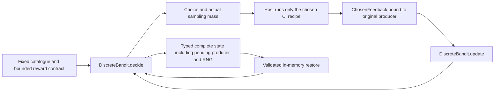

# Learn from the CI recipe you actually run

Suppose a CI build can run either of two fixed test recipes, but the budget
allows only one. After choosing, you observe that recipe's fault-detection credit;
you do not observe what the other recipe would have found. This is a discrete
chosen-feedback problem. COLEMAN supplies two standalone learners for it:

| Profile | Selection | Feedback used | Selection probability |
| --- | --- | --- | --- |
| `exp3-dyadic53-v1` | Owned randomized integer-ticket draw | Only the chosen reward, divided by its actual selection mass | Exact finite-grid mass, all arms supported |
| `ucb1-binary64-v1` | Unobserved arms first, then largest UCB1 index | Only actual chosen counts and reward sums | One for the chosen arm, zero for alternatives |

These are independent methods. The existing TCPCI `EXP3Policy` and UCB ranking
adaptations keep their existing identities and behavior. Ranking scores are not
propensities, and ranking snapshots cannot resume these choice learners.



## Input, cycle and output

| Input | Example | Meaning |
| --- | --- | --- |
| Fixed alternatives | `recipe-a@v1`, `recipe-b@v1` | Canonical exact member versions, unchanged during this learner's lifetime |
| Reward | observed `0.5`, unit `1`, bounds `[0, 1]` | Dimensionless credit to maximize, with declared semantic identity |
| Transform | `identity-credit@v1` | An externally applied transformation; the learner never fits or changes it |
| Opportunity | `build-0`, round `0` | Caller-owned identity; round equals completed chosen observations |
| Exp3 parameter | `gamma=0.5` | Exploration coefficient; the coupled update coefficient is `gamma/K` |

This complete example needs the base package only. It creates no RunSpec,
Parquet file, workspace, application service or TCPCI runner.

```python
from coleman.core.actions import ChoiceSpace
from coleman.core.decisions import DecisionRequest
from coleman.core.feedback import ChosenFeedback, FeedbackBatch, FeedbackRow, OutcomeValue
from coleman.core.identity import Reference
from coleman.core.numeric import ScalarSpec
from coleman.core.units import UnitSemantics
from coleman.learning.discrete import DiscreteBandit, DiscreteConfig, DiscreteState

def ref(name):
    return Reference(id=name, version="v1")

reward = ScalarSpec(
    dimension=ref("fault-credit"),
    semantics=UnitSemantics(unit="1", meaning="observed-fault-credit-v1"),
    role="reward", minimum=0.0, maximum=1.0,
)
config = DiscreteConfig(
    schema_version=1, profile="exp3-dyadic53-v1",
    task=ref("ci-recipe-choice"), objective=ref("maximize-credit"),
    transform=ref("identity-credit"), reward=reward, gamma=0.5,
    space=ChoiceSpace(
        feasible_set=ref("fixed-recipes"),
        members=(ref("recipe-a"), ref("recipe-b")),
    ),
)
learner = DiscreteBandit(config, seed=19)
decision = learner.decide(DecisionRequest(
    schema_version=1, task=config.task, objective=config.objective,
    decision_id="build-0", round=0, space=config.space,
))
print(decision.action.chosen.id, decision.sampling.probability)
# recipe-a 0.5

# The host runs decision.action.chosen. This constructed example supplies its
# observed credit; it supplies no alternative outcome to the learner.
execution = learner.pending_execution
batch = FeedbackBatch(
    schema_version=1, decision_fingerprint=execution.fingerprint,
    feedback_id="credit-build-0", revision_id="root", supersedes=None, horizon=None,
    feedback=ChosenFeedback(row=FeedbackRow(
        member=decision.action.chosen,
        values=(OutcomeValue(
            spec=reward, value=0.5, status="observed", origin="synthetic",
            transform=config.transform,
        ),),
    )),
)

# A checkpoint can be taken after the draw, before its observation arrives.
saved = learner.export_state().to_json()
continued = DiscreteBandit(config, seed=999)
continued.restore_state(DiscreteState.from_json(saved))
learner.update(batch)
continued.update(batch)
assert learner.export_state().to_json() == continued.export_state().to_json()
print(learner.export_state().counts)       # (1, 0)
print(learner.export_state().log_weights)  # (0.0, -0.25)
```

For UCB1 use `profile="ucb1-binary64-v1", gamma=None`; the rest of the cycle is
the same. Run `python examples/discrete/ci.py` for both real eight-round synthetic
CI experiments, including restart after every pending choice. Its receipts show
choices, actual masses and observed counts. They establish mechanics, not an
adaptive performance advantage or physical CI execution.

## Why the sampler uses integer tickets

The reference [Exp3 algorithm, Figure 1](https://doi.org/10.1137/S0097539701398375)
forms `(1-gamma)*w/sum(w) + gamma/K`, samples one arm and updates that arm with
`reward / probability`. A float cumulative-distribution sampler generally does
not sample that exact real-valued formula. Recording the nominal float instead
would give the importance estimator the wrong denominator.

This separately versioned profile exponentiates centered binary64 log weights,
rationalizes those finite values, and constructs the exploration mixture using
exact rational arithmetic. Largest-remainder apportionment assigns exactly
`2**53` tickets; equal remainders favor canonical member order. A complete owned
`Random.getrandbits(53)` draw selects an integer ticket. Recorded probability is
exactly `chosen_tickets / 2**53`, representable in binary64. The importance
estimator uses that same effective probability. Every mass differs from the
rationalized proposal by less than one ticket; this is distinct from a bound on
the host math library's exponential rounding error.

For two initial equal arms, `gamma=0.5`, chosen reward `0.5` and chosen mass
`0.5`, the importance estimate is `1`, the log-weight increment is `0.25`, and
the centered next logs are `(0, -0.25)` when the first arm was chosen. Unchosen
estimated reward is zero; it is not an observed zero or an invented outcome.

The finite sampler's exact mass is conditional on its declared uniform-bit
randomized mechanism. A seed or a publicly known deterministic PRNG state does
not establish independent observations, source authentication, unpredictability
or a calibrated outcome probability. No offline policy evaluation is provided.

## Assumptions and numerical limits

[UCB1](https://doi.org/10.1023/A:1013689704352) initializes by observing every arm
once, then maximizes `mean + sqrt(2*log(t)/count)` with `t` the next one-based
play number. Exact ties choose the first canonical member. Its reference analysis
uses fixed arms and stationary bounded reward laws with the paper's independence
assumptions. Counts increase only after eligible actual chosen observations;
deciding, retrying a pending request, failed feedback and restoring do not add
observations. Deterministic UCB provides no alternative-action support for OPE.

The Exp3 reference comparator is the best fixed arm over the declared reward
sequence, under that paper's bounded-payoff and randomization assumptions. The
shipped finite-grid, binary64 profile changes its arithmetic and sampling, so
COLEMAN does **not** claim the reference real-arithmetic regret bound for it.
Neither profile promises stationary regret for nonstationary, delayed,
cost-coupled, inventory-dependent or reactive environments.

Both profiles admit 1–256 fixed alternatives, observed dimensionless rewards
in `[0, 1]`, and a declared finite horizon up to `2**40` updates. Zero is valid;
null, unknown, unavailable, not applicable, negatives and nonfinite observations
cannot become counted rewards. An external versioned transform can map signed
source quantities to this reward domain; its scientific validity remains the
consumer's responsibility. Transform identity, units, bounds and permitted
origins must match exactly. Only realized or explicitly synthetic origins are
supported. Additional diagnostic quantities do not become reward.

Exp3 requires `gamma >= K/2**53` to retain full exploration support, and centered
logs must stay within `[-700, 0]`. Exceeding that numerical envelope raises
`ValueError` before committing any update; it never clips, resets or declares
success. Parameters should be fixed using development data only. Neither
selection mass nor learner reward is a paid cost, holding, trade or risk bound.

Ordinary binary64 rounding is part of these profiles, including index arithmetic.
A positive reward that disappears when added to its existing reward sum, or a
positive Exp3 update that underflows or is completely absorbed in the retained
log weights, raises `ValueError` atomically. This differs from observing zero;
the pending original producer remains available for an explicit consumer
decision. This finite envelope does not promise exact real-arithmetic updates.

## Continuation, delivery and compatibility

`DiscreteState` schema1 contains exact configuration and profile, Python
interpreter build, implementation, platform, OS release/version and architecture,
all counts/reward sums/log weights, complete owned
MT19937 state and the pending original producer with every arm's tickets and
the actual draw. Export performs no I/O. Canonical JSON and fingerprints are
deterministic content identifiers, not authentication. The public codec rejects
duplicate keys, unsupported versions and nonfinite values.

Restore checks configuration/runtime and recomputes the pending policy,
selection and proposal before replacing live state. Reading a snapshot does
not execute it. No migration from legacy ranking snapshots is supported;
unknown future generations require an explicitly implemented reader. Reading
their existing artifacts is unaffected. Current continuation is qualified for
the same compatible host numerical environment. Its typed runtime binding
rejects a different Python patch/build, operating-system release/version or
architecture. Matching descriptors do not certify arbitrary replaced math
libraries; cross-host/library portability requires separate qualification.

One original decision may await feedback. An identical pending request returns
the same decision without another draw. Different pending work, changed
availability, contexts, temporal requests, delays, absent/full-panel/component
feedback and corrections reject. Feedback must identify the exact unchanged
execution; overriding a sampled action invalidates this route. Consuming its
root observation clears the producer. Repeated raw feedback then rejects with
no second update; it is not a durable idempotent delivery acknowledgement.

Calls serialize within one instance; independent instances own independent
state and RNG. A failed call or failed restore leaves the complete previous
state intact. If persistence or crash recovery is needed, use the existing
[state and session infrastructure](state-recovery.md) with an explicitly
owned concrete codec and delivery adapter. These direct learners write no
artifact, checkpoint file or completion marker and claim no exactly-once
external effect.
