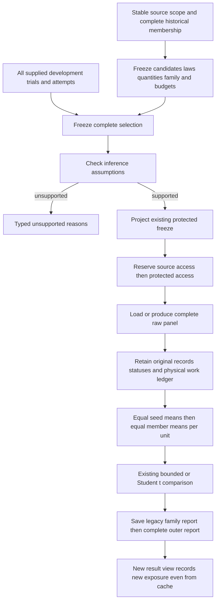

# Design an experiment before reading its results

A useful comparison starts with a question, a fixed source, complete candidate
definitions and a declared inference unit. COLEMAN's experiment-design layer
records those choices before protected outcomes are loaded. It connects raw
observations to the existing [protected comparisons](protected-evaluation.md);
it does not run or select an algorithm for you.

Use this route when a CI study or another application needs a complete record
of what was selected, what was attempted, which observations were available and
what the resulting evidence can support. Direct learners and solvers remain
usable without an experiment design, an audit directory or a transport.

## Start with the input contract

These APIs are available in the v5 integration source. The existing released
protected/corpus workflows retain their own contracts and readers.

The public contracts live in `coleman.evaluation.design`. Import their leaf
modules explicitly: `contracts`, `source_contracts`, `selection`, `cells`,
`panel` and `projection`. Construction and pure projection perform no source
access, clock capture, fitting or file publication.

| Input | What you supply | Why it matters |
| --- | --- | --- |
| `SourceScope` | Stable upstream identity, interpretation, partition definition and declared exposure prehistory | A different file encoding, candidate or protocol must not turn a previously inspected source into a fresh one. An empty audit directory proves no prehistory. |
| `SourceSnapshot` | Selected input fingerprint, interpretation and actual capture/import time, or explicit unknown time | Input identity is separate from scientific admission and historical event time. |
| `SourceMember` catalogue | Every selected source member, original temporal metadata, task/path and independent-unit assignment | Leakage groups, paths and inference units describe different relationships. Keep development and excluded members in the catalogue. |
| `CandidatePlan` | Complete base configuration, role and `StrategyBindings` | Freeze implementation, initialization, update/refit/transform laws, eligibility, accounting and stopping. A method name alone does not define a treatment. |
| `MetricPlan` | Raw quantity, units, meaning, horizon, direction, role and estimand | A bounded learning loss does not make a currency outcome bounded. Raw outcomes, physical costs and uncertainty retain distinct roles. |
| `InferenceRequest` and experiment hypotheses | Complete paired family, independent-unit assumption, method, practical threshold, error level and minimum units | Specify the claim and its assumptions before seeing favorable outcomes. |
| `SelectionManifest` | Exact design fingerprint, all supplied development trials, final candidates, selection rule and actual selection time | Failed, aborted and nonfinalist trials remain visible. Protected execution is recorded separately. |
| Evidence basis | `constructed_mechanism`, `empirical_protected` or `unqualified`; an admission reference when empirical evidence is declared | Constructed mechanics, provenance and genuine empirical qualification remain separate. An admission fingerprint is a supplied reference, not automatic source admission. |
| `ProtocolLimits` and `BudgetPlan` | Finite counts, encoded-byte capacities, trial/work budgets and typed resource allowances | Reject an inadmissible complete envelope before invoking an outcome loader. Unknown cost is not zero cost. |

`ExperimentDesign` binds the source, candidate family, primary metric, seeds,
chronology, inference request and budgets. `SelectionManifest` then binds that
design. `project_frozen(design, selection)` produces the existing
`FrozenEvaluation`, whose candidate configurations reference both earlier
objects. This order avoids a fingerprint depending on itself.

Freeze a **law**, including its initial state or explicit absence, rather than
future realized coefficients or forecasts. Causal state updates within one unit
can follow the declared law. Selecting a different learning rate, transform,
feature definition or refit law after protected inspection is another selection
decision and another exposure; it is not ordinary state continuation.

## Follow the complete cycle



The source-first audit is an optional outer layer. Pure declarations, support
checks and `RawPanel.paired_observations()` need no audit directory. Merely
constructing a valid object proves neither that outcomes were unseen nor that
the declared units are independent.

For a protected run, persist the design and selection before the mediated
outcome access. Reserve source access first, then the protected comparison
access, before loading any result-bearing content. A failed loader, validation
or calculation leaves its reservations visible. Persist the validated legacy
family report before publishing a completed outer report. A source-only artifact
left by an interrupted outer publication is not a completed experiment.

These two access histories are not one atomic transaction. Interleaving can
conservatively leave **zero** new confirmatory evaluations; it must never create
two first accesses. A fresh protocol cannot erase prior source exposure. Reused
source access also prevents the embedded legacy report from claiming a fresh
confirmation.

## CI example: eight raw cells, two inference units

Consider two declared recipes, two constructed CI paths assigned to separate
units and two seed coordinates. The primary measurement is an explicitly defined failure
detection fraction over a fixed test universe, named `ci_detection_fraction`,
with unit `1`, direction `maximize` and known range `[0, 1]`.

The numbers below are constructed mechanics observations. They are not measured
CI improvements, native runner output or independent empirical repositories.
The candidate names do not claim that an additional shipped learner exists.

| Candidate | Member | Declared unit | Seed | Raw value | Status |
| --- | --- | --- | ---: | ---: | --- |
| baseline | build-a | unit-build-a | 0 | 0.5 | observed |
| baseline | build-a | unit-build-a | 1 | 0.5 | observed |
| baseline | build-b | unit-build-b | 0 | 0.4 | observed |
| baseline | build-b | unit-build-b | 1 | 0.6 | observed |
| recipe-a | build-a | unit-build-a | 0 | 0.7 | observed |
| recipe-a | build-a | unit-build-a | 1 | 0.9 | observed |
| recipe-a | build-b | unit-build-b | 0 | 0.6 | observed |
| recipe-a | build-b | unit-build-b | 1 | 0.8 | observed |

Each `RawCell` retains its original `DomainRecord`, logical key, digest and any
supplied reason through `OriginalRecordEvidence`. Produced records bind the
base configuration and the actual projected evaluation. Imported records keep
their historical evaluation binding; importing them does not manufacture new
execution or an unseen source.

The complete grid has `2 × 2 × 2 = 8` logical cells. One actual process may
produce four cells for a candidate, or a process may fail and need several
attempts. The separate `AttemptLedger` records those physical groups, retries
and measured costs. Eight cells do not imply eight jobs, eight independent
observations or eight payments. An empty cost list means no supplied cost
evidence, not free execution.

`maximum_physical_attempts` and `maximum_output_references` apply to the complete
experiment: development **plus** protected work. Separate ledgers retain their
roles; they do not grant two copies of the same budget.

`RawPanel.paired_observations()` first averages seeds within each member, then
averages members equally within each declared unit. Here each unit has one
member, giving:

| Unit | Baseline mean | Recipe mean | Paired raw difference |
| --- | ---: | ---: | ---: |
| unit-build-a | 0.5 | 0.8 | +0.3 |
| unit-build-b | 0.5 | 0.7 | +0.2 |

There are **four candidate/unit records and two paired units**. With a frozen
minimum of 20 units, the comparison retains the signed mean effect, approximately
`+0.25`, and reports `insufficient_evidence` with unavailable uncertainty. Extra
seeds cannot raise the unit count to 20. Even an untouched constructed source
does not turn this small arithmetic example into empirical evidence.

The arithmetic uses exact rational sums of the supplied binary64 inputs and
one final binary64 rounding per mean. It preserves deterministic ordering; it
does not recover exact decimal measurements or certify physical precision.
Multiple members within a unit receive equal weight after their seed means;
this is a named estimand, not an automatic best choice for every study.

For real TCPCI observations, retain the native measurement's documented meaning
through an explicit adapter. Generic metric names cannot impersonate reserved
native output columns. See [metrics and repeated observations](corpus-evaluation.md)
for the existing CI aggregation route.

## Run the complete imported example

The complete [public example](https://github.com/jacksonpradolima/coleman/blob/release/v5/examples/evaluation-protocol/ci.py)
constructs every declaration and raw record shown above using public APIs. It
imports an already visible authored table, declares `known_exposed` prehistory
and `constructed_mechanism` evidence, and records an empty physical-attempt
ledger with no measured costs.
It executes real validation, aggregation, protected inference, immutable
publication and an audited cache view. It imports no test helpers.

From the checkout containing this guide, with Python 3.14+ and uv:

```bash
task_protocol_work="$(mktemp -d /tmp/coleman-protocol-XXXXXX)"
uv build --wheel --out-dir "$task_protocol_work/dist"
uv venv "$task_protocol_work/installed" --python 3.14
uv pip install --python "$task_protocol_work/installed/bin/python" \
  "$task_protocol_work"/dist/*.whl
cp examples/evaluation-protocol/ci.py examples/evaluation-protocol/finance.py \
  examples/evaluation-protocol/native_ci.py "$task_protocol_work/"
cd "$task_protocol_work"
"$task_protocol_work/installed/bin/python" -I -B ci.py ./audit
```

The wheel and copied example come from the same source revision. The example's
output retains two units and an insufficient-evidence conclusion; its cached
delivery does not create another experiment or confirmation.

```json
{"completed": true, "conclusion": "insufficient_evidence", "evidence_basis": "constructed_mechanism", "new_confirmation": false, "original_confirmatory_eligible": false, "paired_units": 2, "raw_cells": 8, "raw_mean_difference": 0.25, "same_original_report": true}
```

| Public operation | Result and side effects |
| --- | --- |
| `ProtocolAudit(root, limits=...)` | Configure a local adapter; construction creates no files. |
| `save_design(design)` | Persist the exact design and complete source metadata; load no outcomes. |
| `save_selection(design, selection)` | Persist the development selection before protected access. |
| `evaluate(design, selection, loader, actor=..., mode=...)` | Return unsupported qualification before loading/persistence, or reserve both access histories, call the loader and publish a validated `ProtocolReport`. |
| `save_report(report)` | Idempotently publish an original object already held by the caller; this is not a new result delivery. |
| `report.locator` and `completed(locator)` | Retain/check result-free publication metadata. Completion metadata does not authenticate arbitrary external changes to body bytes. |
| `read_report(locator, actor=...)` | Reserve new disclosure before reading cached outcomes; return `ReportView` containing the unchanged original and new verification receipts, with `new_confirmation=False`. |

Use `audit.sources` for explicit source reservations before selection, including
imports, inspections and tuning. The host invokes its real source loader only
after reserving the corresponding access; the adapter does not monitor reads
performed elsewhere.

### Run the native TCPCI mechanism

The companion [native CI example](https://github.com/jacksonpradolima/coleman/blob/release/v5/examples/evaluation-protocol/native_ci.py)
executes the actual Random/UCB runner: two methods, two seeds and four authored
build members produce **16 original records**. Four native API invocations run
inside one local driver process; invocation count is not an OS-process count.
The copied histories all belong to **one fixture family**, so the result remains
`insufficient_evidence`.

This route needs the optional CI dependency closure in the same built wheel:

```bash
for task_protocol_wheel in "$task_protocol_work"/dist/*.whl; do
  uv pip install --python "$task_protocol_work/installed/bin/python" \
    "${task_protocol_wheel}[ci]"
done
"$task_protocol_work/installed/bin/python" -I -B native_ci.py ./native-audit
```

The example retains original producer bytes and independently checks the
fixture's metric arithmetic. Its historical source dates are explicitly authored
fiction; actual source creation, selection, computation and result availability
use actual UTC. It measures local replay CPU/wall time separately from modeled
test durations. It executes no subject test commands or external CI jobs, and
the copied fixture is not new empirical repository evidence.

## Preserve missingness and unsuccessful results

| Raw measurement | Meaning in the panel | Effect on its required unit mean |
| --- | --- | --- |
| observed `0.0` | An actual zero observation | Included as zero. |
| observed negative value | An actual signed result, valid when its quantity permits it | Included with its sign. |
| `null`, status `unknown` | Unknown value | The required mean is unavailable. |
| `null`, status `unavailable` | A value could not be supplied | The required mean is unavailable. |
| `null`, status `not_applicable` | The quantity does not apply to this cell | The required mean is unavailable; the original status is retained. |
| failed, aborted or skipped cell | An unsuccessful or deliberately unexecuted cell, with an explicit unavailable primary outcome | The cell and any supplied cost remain; no complete-case deletion. |

Every declared candidate/member/seed cell is required. A nonobserved cell makes
its whole required unit estimate unavailable; COLEMAN creates a **new aggregate**
with that status while retaining the original cell statuses. It does not rename
`not_applicable` to `unknown`, replace nulls with zero, shrink the denominator or
drop an unfavorable comparison from the frozen family. Nonfinite measurements
reject. A completed negative or inconclusive scientific result is not a failed
execution.

## Keep historical clocks and access history separate

`source_plan` determines historical train/validation/test membership and source
label/target eligibility. `comparison_plan` may extend **only** `test_end` to
include actual result production and assembly. Training/validation cutoffs,
field mappings, exclusions and source membership keep their original meanings.

For example, a historical source may end on January 6 while selection and result
assembly occur on November 6. Preserve January source eligibility, provide the
actual November capture/selection/production/assembly instants, and freeze a
comparison deadline that includes them. Do not backdate an access or claim that
the historical partition remained unseen until November.

`SourceScope.prehistory` distinguishes `declared_unexposed`, `known_exposed` and
`unknown`. Receipt order records actual mediated calls, not historical event
order or proof of undisclosed access. An import, tuning access, inspection or
new cached result view can expose protected data. A train/validation-only claim
needs the exact persisted complete partition manifest; absent or unverifiable
membership is treated conservatively.

The receipt records whether that manifest was verified **at reservation**.
Persisting a missing manifest later cannot retroactively clean an earlier
unverified disclosure.

Idempotent publication or receipt reconciliation may return existing metadata
without executing a new physical experiment. Returning the report's outcomes
is a **new disclosure**, even when its bytes come from a cache. Preserve the
old report's original access receipt and scientific status; a later view does
not create a new confirmation or an independent observation.

## Ask the right scientific question

Different objectives can prefer different behavior even on the same input.
Bind the estimand, horizon and quantity explicitly:

| Objective | What a study needs to retain |
| --- | --- |
| Cumulative reward | The complete declared trajectory/accounting horizon; a terminal score alone cannot recover reward earned along the path. |
| Terminal simple regret | A defined terminal recommendation and its comparison target; maximizing reward during exploration is a different objective. |
| Prediction error | Point-in-time forecasts and labels, loss definition and forecast horizon; ranking/reward is not automatically prediction accuracy. |
| Inferential precision | A matched estimator, sampling design and uncertainty target; collecting more of apparently promising outcomes need not improve every estimate. |

The first panel profile averages its supplied member measurements; it does not
infer which of these objectives a caller intended or reconstruct a cumulative
trajectory from unrelated terminal rows.

Historical availability is also distinct from a train/test fold label. A random
fold can describe a legitimate exchangeable-data study without establishing the
information that was available at each decision in a chronological deployment.
Preserve original clocks and justify the study you actually performed.

For randomized solvers, the lowest observed run time across methods can be an
optimistic retrospective target rather than the expected time of the best
deployable solver. [Cameron, Hoos and Leyton-Brown (IJCAI, 2016)](https://ijcai.org/proceedings/2016/107)
demonstrate this virtual-best bias. Retain repetitions and oracle status; this
envelope does not implement their bias correction or turn a noisy minimum into
a deployable baseline.

[Hadad et al. (PNAS, 2021)](https://pmc.ncbi.nlm.nih.gov/articles/PMC8054003/)
show why adaptive data collection can make ordinary sample means or inverse
propensity estimates unsuitable for naive confidence intervals. Their matched
adaptive-inference method is not implemented by this profile. Adaptive partial
assignment and optional stopping therefore return unsupported reasons here;
repeated protected inspection remains recorded rather than being relabeled as
fresh evidence. Their guarantees do not transfer merely because a pipeline
uses a bandit.

## Choose a supported inference request

`qualify_inference(design, selection)` returns an `InferenceQualification` with
either an existing protocol or explicit unsupported reasons. It performs no
inference, source access, normality test or optional capability check.

| Request | Required assumptions | What is available |
| --- | --- | --- |
| `paired_bounded_mean_hoeffding_holm_v1` | Independent complete paired final units; justified, nondegenerate bounds on the **raw target**; fixed final analysis | Conservative paired means, full-family multiplicity and simultaneous intervals without a normality assumption. |
| `paired_t_holm_bonferroni_ci_v1` | Independent complete paired final units; explicitly assumed normal paired differences; fixed final analysis | Existing Student-t procedure; execution additionally needs the optional analytics capability. |
| Serial, clustered or unknown final-unit dependence | A different justified inference model would be needed | Typed unsupported reasons, without fabricated intervals or claims. |
| Adaptive partial assignment, optional stopping or learning across final units | The fixed-independent-unit procedures do not match this design | Typed unsupported reasons. |
| Retrospective oracle in the inferential candidate family | Future information is not a deployable candidate | Unsupported comparison; retain oracle observations as explicitly retrospective evidence. |

Support is distinct from sufficient sample size, source cleanliness and
confirmatory eligibility. A supported calculation can still return insufficient
or inconclusive evidence. Freezing an independence declaration does not make
adjacent CI builds or market days independent. There is no automatic policy
promotion or inference-method search after outcomes.

The bounded route builds on [Hoeffding's bounded-sum inequalities
(Journal of the American Statistical Association, 1963)](https://doi.org/10.1080/01621459.1963.10500830).
The full hypothesis family uses [Holm's multiple-test procedure
(Scandinavian Journal of Statistics, 1979)](https://www.jstor.org/stable/4615733);
simultaneous intervals use the declared Bonferroni family level. The
[bounded-method guide](bounded-paired-evaluation.md) explains COLEMAN's
conservative arithmetic profile, and the [protected-evaluation guide](protected-evaluation.md)
documents the preserved Student-t route and its limitations.

## Apply the same contract to a portfolio question

The input shape can also describe a public constructed portfolio experiment.
The domain changes the quantity and scientific assumptions, not the meaning of
an access receipt or a seed.

| Design choice | Constructed example | Required interpretation |
| --- | --- | --- |
| Primary target | Terminal net P&L, unit `USD`, declared complete-world horizon | Signed raw outcome after the declared accounting law; never a clipped learner loss. |
| Candidate and baseline | Two declared allocation recipes | Freeze their initial state, update/refit rules, information cutoffs, stopping and accounting before evaluation. |
| Source member | One complete synthetic market path | Retain its original event, target and availability clocks. |
| Independent unit | One independently constructed path | More seeds, days or assets within a shared market path do not create independent paths. |
| Physical work | One simulation process can emit several cells | Record actual grouped attempts and supplied compute/cost evidence separately. |
| Matching | Predeclared capital, compute, costs and ex-ante risk conditions | The design records definitions and evidence; it does not construct risk-matched portfolios or enforce trades. |

The [complete constructed finance example](https://github.com/jacksonpradolima/coleman/blob/release/v5/examples/evaluation-protocol/finance.py)
starts each of four declared independent toy worlds with 100 USD. Baseline
gross changes are `(1, 0, -1, 0)` USD; the candidate adds 1/4 USD in every world.
An authored accounting rule charges 1/8 USD per **own modeled trade**: one
baseline trade versus four candidate trades. This gives:

| World | Baseline gross | Candidate gross | Baseline net | Candidate net |
| --- | ---: | ---: | ---: | ---: |
| world-0 | 1 | 1.25 | 0.875 | 0.75 |
| world-1 | 0 | 0.25 | -0.125 | -0.25 |
| world-2 | -1 | -0.75 | -1.125 | -1.25 |
| world-3 | 0 | 0.25 | -0.125 | -0.25 |

All values in this table are USD changes from the common starting capital.
Gross performance improves by 1/4 USD, and the separate dimensionless gross
surrogate `(2 - gross) / 4` improves by 1/16 under minimization. Yet primary
net performance is **worse by 1/8 USD** per world. A favorable surrogate is not
a favorable executed objective.

The declared constructed gross range is `[-2, 2]` USD and modeled own charges
lie in `[0, 1/2]` USD, giving the toy net range `[-5/2, 2]` USD. These are
properties of this constructed case, never bounds inferred for real markets.
The source is visibly exposed, evidence is `constructed_mechanism`, physical
attempts/cost measurements are absent and compute remains explicitly unknown.
Modeled book charges are not paid fees or physical runtime charges.

After the installation/copy commands above, run it from the temporary example
directory; `finance.py` uses the copied sibling `ci.py` declaration builder:

```bash
"$task_protocol_work/installed/bin/python" -B finance.py ./finance-audit
```

It retains **8 cells, 4 paired units and 1 seed coordinate**, with signed net
effect `-0.125` USD, `insufficient_evidence` and no new cached confirmation.
There is no profitability or financial-viability claim. Equal starting capital
alone establishes neither equal compute nor matched ex-ante risk; a real
comparison must justify those conditions separately.

A volatility-scaled clipped learning loss in `[0, 1]` does not justify applying
the bounded procedure to unbounded net P&L. Use justified raw target bounds or
an independently justified supported inference request; otherwise keep the
request unsupported. Historical market trajectories generally need a separate
dependence/evaluation justification, not invented independent unit labels.

## Limits, trust and compatibility

The default profile admits a 2 MiB complete envelope, at most 128 raw cells and
128 derived inputs, with 128 source and protected-access receipts per chain.
Original raw records default to 2 KiB and base configurations to 4 KiB. Count,
graph, directory and complete encoded-byte budgets are checked together: all
individual maxima need not fit their Cartesian product. A larger profile is an
explicit new declaration within fixed hard caps, not an implicit unlimited mode.

These limits bound data and mediated work. They do not preallocate disk space,
limit arbitrary callback CPU, sandbox Python or certify free memory. The local
immutable writer requires trusted parent directories and a suitable filesystem;
its process-interruption contract is not a network-filesystem or power-loss
guarantee. A full valid audit prefix remains readable when a new append is
refused. Nothing deletes old exposure to make room for a favorable result.

The host remains responsible for complete source identity, exposure prehistory,
snapshot completeness, truthful time/cost evidence and scientific assumptions.
Receipts and fingerprints are consistency evidence, not authentication or proof
that nobody inspected externally readable data. Whole-store removal/rollback
cannot be detected from that store alone.

New design/panel envelopes require their explicit version. Unknown future
versions reject; old protected/corpus artifacts retain their existing meanings,
readers and absent-versus-null fields. No old artifact is silently migrated,
assigned bounds or upgraded to an unseen-source claim.

Continue with [source and observation preparation](input-data.md),
[protected comparisons](protected-evaluation.md),
[bounded paired means](bounded-paired-evaluation.md) and
[complete decision-state recovery](state-recovery.md).
