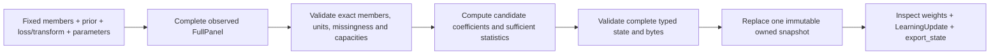

# Learn coefficients from complete expert losses

A reference learner consumes one complete bounded loss vector and emits expert
coefficients. It needs no runner, registry, replay session or local store. The
controlled learner adds an explicit target, boxes, movement and release policy
under a separately bound mathematical law. These APIs are part of the unreleased
v5 source; they do not execute CI jobs or establish that adaptation improves them.

Start with the [standalone reference example](https://github.com/jacksonpradolima/coleman/blob/release/v5/examples/learning/references.py).
It constructs all three reference methods, applies the same public synthetic
losses, reads a complete bounded snapshot and verifies identical continuation.
Run the file against the base installation:

```console
python examples/learning/references.py
```

For an installed run without checkout shadowing, follow the
[base installation guide](core-installation.md), copy that public file to a
directory outside the checkout, and use the selected consumer interpreter:

```console
/path/to/consumer/bin/python -I -B /tmp/learning-example/references.py
```

For a small direct call, put the copied `references.py` beside your consumer
script. Its explicitly linked helpers construct the complete typed inputs:

```python
from references import configuration, panel, reference
from coleman.learning.contracts import ReferencePayload
from coleman.learning.reference import Hedge
from coleman.state.codec import read_algorithm_state

config = configuration("hedge-constant")
learner = Hedge(config, owner=reference("my-reference-owner"))
result = learner.observe(panel(config, (0.0, 1.0, 1.0)))
print(result.status, tuple(weight.value for weight in learner.weights))
snapshot = learner.export_state()
checked = read_algorithm_state(
    snapshot.to_json(), payload_type=ReferencePayload, expected=learner.binding,
    maximum_bytes=config.limits.maximum_bytes,
)
restored = Hedge(config, owner=learner.binding.owner)
restored.restore_state(checked)
assert restored.export_state().to_json() == snapshot.to_json()
```

The [CI example](https://github.com/jacksonpradolima/coleman/blob/release/v5/examples/learning/ci.py)
adds actual typed decisions, delayed panels and controlled release clocks. The
[32-owner example](https://github.com/jacksonpradolima/coleman/blob/release/v5/examples/learning/collection.py)
uses independently owned actual learners with registry and checkpoint composition.
See the [API reference](api/learning.md) for concrete constructors and records.

## Supply the complete mathematical input

| Input | Example | Meaning |
| --- | --- | --- |
| Fixed members | `expert-a`, `expert-b`, `expert-c`, each version `1` | Exact identities in canonical ID order |
| Initial prior | `(0.5, 0.25, 0.25)` | Positive reference coefficients; controlled initialization also permits structural zeros |
| Scalar loss specification | role `loss`, dimensionless unit `1`, minimum `0.0`, maximum `1.0` | One fixed interpretation for every row |
| Transform | Complete `DefinitionBinding` | Pins the declared normalization/fit interpretation; no transform is fitted here |
| Constant rate | `eta=log(2)` | Exponential sensitivity per accepted loss, or per released sum-loss block |
| Reference share | `alpha=0.1` | Excluding-origin redistribution for Fixed Share |
| Owner | Exact `Reference` | Logical continuation owner, independent from the method identity |
| Limits | Selected member/update/byte capacities | Finite admission bounds, included in the configuration binding |

Every `FullPanel` has exactly one observed, non-null scalar loss per configured
member. Each row retains the exact scalar specification and transform reference.
A missing, unavailable, nonfinite or out-of-range value rejects; an observed zero
is valid. Origins such as `synthetic` describe supplied values, not their source
authenticity. The pure kernels do not accept changing catalogues or sleeping
experts by silently omitting their losses.

The standalone example uses this table:

| Accepted panel | expert-a | expert-b | expert-c |
| --- | ---: | ---: | ---: |
| 1 | 0 | 1 | 1 |
| 2 | 1 | 0 | 0 |
| 3 | 0.25 | 0.75 | 0.5 |

For constant Hedge the first unnormalized vector is
`(0.5, 0.25/2, 0.25/2)`. Dividing by `0.75` gives the ideal vector
`(2/3, 1/6, 1/6)`. Actual binary64 output prints approximately
`(0.6666666666666666, 0.1666666666666667, 0.1666666666666667)`.
The example reports all three U-clocked vectors, method identities, final state
fingerprints and `restored_continuation_equal: true` for each method.



## Select the precise reference rule

For the following formulas, `p_t` is the vector used before synchronous round
`t`, `ell_t` is its complete loss vector, and `L_t` is cumulative past loss.

| Constructor / profile | Next-coefficient rule | Complete mathematical state |
| --- | --- | --- |
| `Hedge` / `hedge-constant` | `p_(t+1),i ∝ p_t,i exp(-eta ell_t,i)` | Actual emitted coefficients, U, configuration and cumulative diagnostic statistics |
| `AnytimeHedge` / `hedge-anytime-cumulative` | `p_t,i ∝ pi_i exp(-eta_t L_(t-1),i)` | Prior, compensated cumulative losses, U and fixed schedule multiplier |
| `FixedShare` / `fixed-share-excluding-origin` | Exponential normalization to `q`, then `(1-alpha)q_i + alpha sum_(j!=i)(q_j)/(n-1)` | Actual emitted coefficients, U, alpha, constant eta and configuration |

The anytime schedule is `eta_t = c sqrt(log(n)/t)`, with default `c=2`.
After U accepted panels its emitted vector uses `eta_(U+1)` on their cumulative
loss. Multiplying historical updates by their old rates defines another method.
In the table above, the first two cumulative loss vectors become equal, so the
ideal anytime vector returns to the prior despite its changed rate. A product
of unequal historical rates generally does not.
The cumulative-current-rate formulation and uniform-prior schedule follow
[Mourtada and Gaïffas, equations 2/4 and section 2](https://jmlr.org/papers/volume20/18-869/18-869.pdf).
Their additional stochastic conclusions require the stated distribution and gap
assumptions; those assumptions are not supplied by a typed panel.

Fixed Share uses the excluding-origin convention in
[Herbster and Warmuth, Figure 1](https://mwarmuth.bitbucket.io/pubs/J39.pdf).
For `n>1`, alpha zero is exactly the constant Hedge recurrence on the same emitted
state; alpha one sends all mass to other members. With two members it swaps the
normalized exponential weights. With one member every reference returns weight
one, including both endpoints, without dividing by `n-1`. Its redistribution is
order dependent and need not preserve prior ratios under equal losses.

## Interpret the comparison, prior and finite arithmetic

The reference comparator uses **linear mixture loss** `p_t · ell_t` against an
expert or expert path. This is the bounded full-information decision problem in
[Freund and Schapire, section 1](https://www.schapire.net/papers/FreundSc95.pdf).
It is separate from the loss of a forecast formed by aggregating predictions,
a realized CI result, or a cost of executing another action.

For example, forecasts `(0,1)`, weights `(1/2,1/2)` and observation `1/2` have
squared expert losses `(1/4,1/4)`. Their linear mixture loss is `1/4`; the
aggregate forecast is `1/2` and its squared loss is zero. Convexity gives the
corresponding inequality when the selected prediction/loss domains permit it.
[Devaine et al.'s electricity-forecasting study](https://arxiv.org/abs/1207.1965)
is a literature application of specialist aggregation, not an implemented
forecast-data adapter or evidence for this fixed-catalogue API's efficacy.

Here are the exact-arithmetic comparisons used to interpret these references.
They assume synchronous complete losses in `[0,1]`, a fixed catalogue, a strictly
positive exactly normalized prior `pi`, and finite positive rates. They are
mathematical comparator statements; no bound on actual delayed D-clocked actions
or controlled outputs follows from them.

For constant eta and any fixed member i, the exponential-potential argument gives

```text
sum_t p_t · ell_t - sum_t ell_t,i
    <= log(1/pi_i)/eta + eta*T/8.
```

For the cumulative-current-rate rule with nonincreasing positive `eta_t`, define
`A_t(eta) = -log(sum_i pi_i exp(-eta L_t,i))/eta`.
Its variational form makes `A_t` nonincreasing in eta. Telescoping the mix losses,
then applying the bounded-loss Hoeffding gap, gives the separately derived bound

```text
sum_t p_t · ell_t - L_T,i
    <= log(1/pi_i)/eta_T + sum_t eta_t/8.
```

For excluding-origin Fixed Share, use the Markov prior with probability
`1-alpha` of staying and `alpha/(n-1)` of moving to each other member. Applying
the same bounded-mixture potential argument to expert paths gives

```text
mixture cumulative loss - chosen path loss
    <= -log(P(path))/eta + eta*T/8.

-log(P(path)) = log(1/pi_first)
             + (T-1-k)*log(1/(1-alpha))
             + k*log((n-1)/alpha)          # n>1, 0<alpha<1, k switches
```

This is a bounded-vector derivation, separate from the original paper's
forecasting/realizability theorem. At alpha zero only constant paths have positive
prior probability; at alpha one only paths switching at every transition do.
Zero-probability paths yield no finite comparison from this formula. Rate zero
and the singleton are admitted algorithmic endpoints, without invoking formulas
that divide by their zero rate. No retrospective path is selected for the user.

Stored binary64 simplex entries can sum to a tolerated residual. If their exact
sum is C, the ideal theorem uses `pi_i=a_i/C`, not the raw entries `a_i` as exact
probabilities. Initialization deterministically normalizes positive stored mass
using `fsum`; emitted binary64 values remain a numerical approximation to the
ideal recurrence. Constant Hedge and Fixed Share subsequently use the actual
emitted vector. Anytime Hedge recomputes from its deterministic emitted initial
prior and compensated totals. Checkpoints retain these distinctions.

The `centered-binary64-v1` profile subtracts a common active-support loss before
multiplication by eta, then normalizes log scores. Equal huge losses therefore
preserve the current proportions instead of erasing them through overflow.
Required positive mass underflow, nonfinite intermediates and normalization
failures are explicit `LearningFailure` outcomes. The reference kernel leaves
its entire state and U unchanged on numerical failure. It introduces no epsilon
or persisted infinity. Binary64 simplex admission uses the existing absolute
sum residual `2**-49`; it is not a proof that every emitted recurrence is exact.

## Add target, constraints and one selected output law

`ControlledHedge` binds constant eta, exact `MixtureControls`, scalar loss,
transform, lineage and capacities in one immutable `ControlledConfig`. The
profiles `controlled-hedge-projection` and `controlled-hedge-l1-movement` are
separate identities. Bounds disabled means explicit `[0,1]` boxes; target disabled
means `target=None`; movement disabled means `movement=None`.

At a nonempty release, let `p_old` be the actual last committed coefficients:

1. Sum each member's retained bounded losses over the selected panel block.
2. Compute `q_i ∝ p_old,i exp(-eta sum_loss_i)` once.
3. Apply the declared target once: `r=(1-alpha)q+alpha*a`, when present.
4. Solve one selected constrained output against the original exact geometry.
5. Commit coefficients, support, moving origin, consumed block, R and any ledger
   together, after validating the whole candidate snapshot.

Target share includes the originating coordinate and differs from reference
Fixed Share: `q=(0.7,0.3)`, alpha `0.1`, target `(0.4,0.6)` gives `(0.67,0.33)`;
excluding-origin sharing gives `(0.66,0.34)`. Alpha zero leaves q; alpha one gives
the declared target before the selected constrained output. Zeros in the target
are explicit. An output constraint or positive penalty can override the target's
preferred movement; this is not inferred preference learning.

With static boxes and per-release movement, the exact feasible set is
`S={p: sum(p)=1, L_i<=p_i<=U_i}`, with
`L_i=max(l_i,p_old,i-d_i)` and `U_i=min(u_i,p_old,i+d_i)`.
The projection profile minimizes `0.5*||p-r||²` over S. The L1 profile minimizes

```text
0.5*||p-r||² + lambda*||p-p_old||_1, subject to p in S.
```

The full L1 term is coefficient movement, and lambda is the declared finite
nonnegative coefficient-scale strength. Neither is an executed-book fee,
transaction, holding or risk limit. Select/tune parameters on development data
and retain the selected law and rejected/infeasible candidates with a protected
evaluation. A held vector is not evidence that expected domain benefit is below
its actual execution cost.

The scalar KKT form is
`p_i(nu)=clip(p_old,i+soft(r_i-nu-p_old,i,lambda), L_i,U_i)`.
Here `soft(x,lambda)=sign(x)*max(abs(x)-lambda,0)` and clipping uses the original
effective lower/upper bounds. The scalar function `F(nu)=sum_i p_i(nu)-1` is
continuous and nonincreasing. A root gives the exact unique primal minimizer by
strict convexity; a plateau can leave nu nonunique. The implementation sweeps
exact grouped binary64-grid breakpoints, then rounds once and checks the original
rational boxes. Its named profile is `binary64-grid-breakpoint-kkt-v1`, with at
most 4n events, O(n log n) sorting and 4096-bit rational work guards. The emitted
sum residual is at most `2**-49`; its largest coordinate/proximal-stationarity
error is at most `2**-53`, with a separate lambda-scaled objective-error
certificate. These are qualified finite emissions, not exact binary64 solutions.
[Parikh and Boyd](https://stanford.edu/~boyd/papers/pdf/prox_algs.pdf) explain the
scalar soft threshold; this controller's shifted boxed-simplex KKT problem is
its own derivation.

For proposal `(0.9,0.1)` with first upper bound `0.6`, projection gives
`(0.6,0.4)`. Independent clipping and renormalization gives `(6/7,1/7)`, violating
that bound. Sequential unconstrained L1 proximity followed by projection is also
a different optimization problem. No post-solve renormalization is performed.
Lambda zero uses the same geometry and qualification path as projection.

For an independently hand-checkable **rational** problem, take
`r=(1/2,3/10,1/5)`, `p_old=(1/3,1/3,1/3)`, lambda `1/20` and unrestricted boxes.
The scalar root nu `1/60` gives `(13/30,10/30,7/30)`: the middle coordinate holds.
Full L1 movement is `1/5`, versus `1/3` at lambda zero, and the penalized objective
is `1/75`. Adding `U_1=2/5` gives `(2/5,1/3,4/15)` with nu `-1/60` and objective
`13/900`; the first bound is active while the middle coordinate still holds.
These exact substitutions explain the stated continuous problem. Binary64
representations of thirds and fifths have their separate qualified emission
envelope. At lambda `1/5` the unrestricted rational optimum holds the entire old
vector, with a nonunique dual interval `[-1/30,1/15]` and a unique primal vector.

A well-formed empty exact S produces typed `infeasible`, retaining the proposal
when available. This can coexist with legacy `MixtureIntersection.status` equal
to `feasible` and `exact_feasible=False`; its older residual admission is not
rewritten. Failure to emit a qualified finite vector is `numerical_failure`.
Neither case consumes the failed block or increments R. The explicit
`unresolved_failure` frontier survives later held/empty receipts and new periods;
the scheduled decision adapter abstains until a successful nonempty release
clears it. A successful optimal hold still consumes the block and release point,
with zero movement. No hidden reattempt occurs in an empty interval.

## Choose release and movement clocks explicitly

| Clock / state | Meaning |
| --- | --- |
| D | Actual accepted decisions in the optional producer/replay adapter |
| U | Accepted complete panels; a held controlled panel still advances U |
| R | Successful nonempty controlled releases, including optimal holds |
| `RoundCadence(panels=k)` | Release one whole block of k accepted panels; retain a partial or failed block |
| `IntervalCadence(calendar=...)` | At one explicit release point consume eligible retained panels, without a k threshold |
| `eligible_at` / `apply_at` | Separate supplied eligibility and actual processing instants |
| `MovementPeriod` | Separate host-declared UTC half-open budget period |

The round and interval gates are distinct selections. They are not implicitly
AND-composed. A block uses **sum loss**, not mean loss, and applies eta, target
share and the selected penalty once. Held panels receive no hidden per-panel
coefficient step. A daily claim requires an explicitly daily host calendar.

An interval declares its identity, start/end, cutoff and release time. Included
panels must have eligibility no later than the cutoff and actual application no
later than the release point. Processing can occur after the information cutoff
and still be included in that closed drain. A panel ineligible at the cutoff or
admitted after that point has closed remains for a later release; retrying the
exact old interval returns its original result. Conflicting interval content rejects.
Budget periods cannot flush a partial k-block. A duplicate old period cannot
reset accounting; admission of a new period retains the actual emitted origin.

For per-period net displacement, geometry derives displacement from the full
period-start and current origins. For accumulated absolute movement,
`ExactPathUsage` records each actual emitted coordinate's exact absolute changes
in integer atoms of `2**-1074`, bound to complete member/law/period/origin/release
identities. Canonical decimal counts have at most 632 digits per coordinate and
must fit the selected complete bytes. The solver uses that exact ledger, not a
repeatedly rounded usage sum. Exact retained interval/period retries and duplicate
feedback rejected by the outer delivery boundary do not spend or reset it;
failed and held mathematical operations also do not spend it. Repeating a raw
`FullPanel` call is a new mathematical observation and can cause another release
and movement charge. Imported complete usage is an attestation, not authenticated history.

To reproduce an earlier constrained output, retain its `ControlOutcome` together
with the complete bound `ControlledConfig`. The receipt stores the original
proposal, emitted origin and output law, plus `movement_usage` for period-net
control or `exact_path_before` for accumulated movement. These describe the
feasible set **before** that attempt; the continuation's current ledger describes
later progress. A subsequent release or period reset therefore does not erase
the inputs needed to reproduce the earlier KKT calculation. Held/empty receipts
have both context fields explicitly null. A numerical refusal before proposal
construction retains available movement context without fabricated solver data.
Readers check geometry/status consistency and original hard boxes; those checks
do not authenticate the supplied observation history.

Controlled initialization permits a normalized nonnegative emitted vector that
already satisfies the static boxes; invalid initialization is rejected rather
than projected. A required boolean `support` tuple names its exact positive
coordinates. Exponential updating preserves structural zeros; target share or a
qualified constrained output can restore mass. Numerical underflow is distinct
from a structural zero. No hidden epsilon or negative infinity is checkpointed.

## Supported combinations and boundaries

| Mode | Target | Boxes / movement | Cadence | Output |
| --- | --- | --- | --- | --- |
| Constant reference | No | No added controls | Every complete panel | Exponential weights |
| Anytime reference | No | No added controls | Every complete panel | Current-rate cumulative exponential weights |
| Fixed Share reference | Excluding-origin only | No added controls | Every complete panel | Constant exponential update + reference share |
| Plain controlled | Optional | Explicit unrestricted boxes, movement absent | k=1 | Projection |
| Declared-target controlled | Nonuniform and zero-support targets allowed | Optional boxes/movement | k=1 | Projection |
| Bounded controlled | Optional | Static boxes and optional hard movement | k=1 | Projection |
| Cadence controlled | Optional | Optional boxes/movement | k-block or interval | Projection |
| Required target + bounded + interval | Yes | Yes | Interval | Projection, penalty disabled |
| Immediate L1 controlled | Optional, including disabled | Optional, including unrestricted | k=1 | Joint L1 output, lambda>=0 |
| Required target + bounded + interval + L1 | Yes | Yes | Interval | Joint L1 output with positive lambda |
| Budget-period controls | Optional | Net or exact accumulated per-period movement | k-block or interval | Projection or joint L1 |

On their common positive-prior domain, unrestricted boxes, no movement, target
alpha zero and k=1 reduce the projection controller to the constant reference
under the declared numerical envelope. The penalized controller additionally
needs lambda zero. Neither reduction equates the complete method identities or
state codecs. Lambda zero alone does not remove other controls.

Changing/specialist catalogues, partial feedback, automatic missing-label
imputation, target/penalty controls on anytime or excluding-origin references,
implicit combined cadence gates and squared-movement penalties are unsupported
by these selected profiles. A new target, eta, strength, profile or bounds version
requires an explicit compatible future lineage/transition, keeping original
pending-feedback ownership. Restore rejects a changed configuration; it is not
an in-place parameter setter. These controlled variants have their own declared
objective and feasibility limits; the reference regret statements above are not
inherited.

## Add decisions, replay or durable checkpointing when needed

`DirectMixture` accepts the structural `MixtureLearner` protocol, including the
three concrete references and independently authored host-owned learners. It
validates exact static `MixtureSpace` requests and full `FeedbackBatch` producer
joins, retains original pending executions and supplies coefficient actions.
It does not sample an expert or execute an external job. Never mutate its owned
learner through another path.

`ControlledDirect(learner, schedule, options)` adds an immutable `ControlSchedule`
and typed `DirectOptions(task, objective, horizon, maximum_pending,
maximum_bytes)`. It admits covering movement periods and invokes interval release
at a matching decision/cutoff barrier. `ReplayMixture` then adapts the actual
`ReplayApplication` to that direct application; `CausalReplay` owns closed-drain
ordering and retained logical delivery. Decision receipt order is not an
arbitrary commutative update order, especially for Fixed Share. Pending feedback
creates no observed zero, and older-feedback decisions do not acquire a
synchronous regret theorem.

A bare mathematical update or JSON round trip supplies no durable exactly-once
guarantee. Calls on one pure learner or direct application owner must be
sequential: these objects are not thread-synchronized, and one immutable payload
assignment does not prevent concurrent lost updates. Independent owners and the
existing replay busy guard/store compare-and-swap boundary provide their own
qualified concurrency profiles; they do not add locks to raw mathematical calls.
Optional [state checkpoints](api/state.md) publish complete component
frontiers; [registry ownership](api/registry.md) checks declared actual live roots
inside accepted staging. The collection example captures real learners and their
outer producer/replay/schedule owners. Immutable tuple payloads remove the need
to invent mutable RNG/vector roots, but every actual mutable enclosing owner
still needs its own complete claim. Shared canonical configuration bytes are a
narrow immutable sharing profile. Checked declared roots are not discovery of
hidden/native aliases or proof of statistical independence.

Read untrusted mathematical snapshots with `read_algorithm_state`, an explicit
concrete payload type and expected complete `StateBinding`; bound file/network
acquisition before giving it content. New learning readers enforce strict v1,
unknown-field rejection, duplicate-safe JSON, a hard 16 MiB ceiling and lexical
depth 64. Selected caps may be smaller. References retain at most 4096 members
and 1,048,576 accepted updates; controlled state additionally bounds pending
panels and retained interval/period declarations to at most 4096 each. Their
Cartesian product need not fit one checkpoint. Full original pending inputs,
configuration, moving origins, support, negative frontier, counters, schedules
and exact budget usage are continuation state beyond the weights alone.
