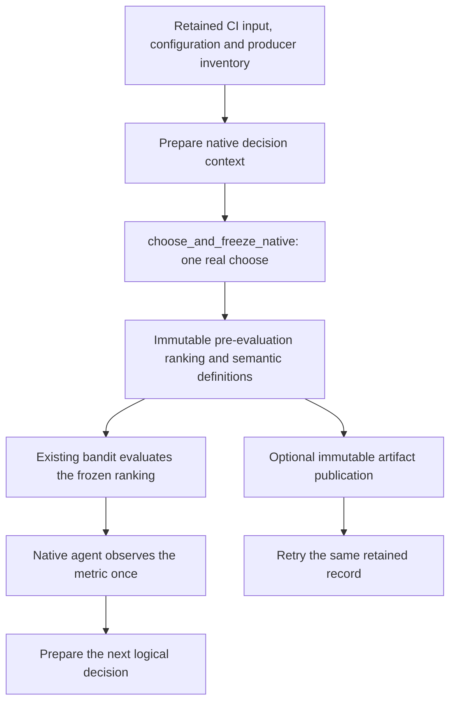

# Understand a native CI policy decision

COLEMAN's native policies turn test history into a complete test ranking. The
native semantics catalog lets you inspect the mechanism behind each of the
**37 configuration names**, choose the right comparison, and retain the actual
ranking before evaluating it. It preserves the existing CI algorithms while
making their feedback, state and interpretation explicit.

This guide describes the **unreleased v5 integration source**. Catalog inspection
uses the base installation; running native agents requires its `ci` extra. Use
the [component installation guide](core-installation.md) for a reviewed source
wheel. These APIs are not present in the published v4.20.0 wheel.

For ordinary experiments, start with [policies and rewards](policies.md) and
[configuration](configuration.md). Use this page when a comparison or integration
needs to know what was chosen, which native semantics applied, and what the
retained evidence can support.

## Follow one CI decision

Consider a synthetic CI build with three tests and a **3-second execution
budget**. Durations and verdicts are supplied replay data; future verdicts are
used by the evaluator after ranking, never as pre-decision policy features.

| Native test name | Recorded duration (s) | Synthetic replay verdict | Meaning |
| --- | ---: | ---: | --- |
| `unit` | 1.0 | 0 | Passing test in the replay source |
| `integration` | 2.0 | 1 | Failing test in the replay source |
| `system` | 3.0 | 1 | Failing test in the replay source |

The host also retains its policy/reward configuration, input data and producer
inventory. It assigns stable run, execution and decision identifiers, then
declares their content digests in a `NativeDecisionContext`. The observation
counter is the expected `agent.t` **before** evaluation, in accepted-observation
steps. It is neither elapsed time nor a source-availability timestamp.



Replace the host's ordinary `agent.choose()` with `choose_and_freeze_native`.
Calling both would make two choices. The wrapper checks the declared built-in
agent/policy/reward route and round, calls the actual chooser once, and copies its
complete returned order immediately. It does not evaluate, observe, reset, reseed
or publish. An ordinary `Environment` run is unchanged and does **not** acquire
these records automatically.

### Run the complete cycle

The following example uses the actual native EXP3 ranking adaptation, RNFail
reward, verdict-based metric and bandit. The first choice is the ordinary
agent-local initial shuffle; subsequent choices use the native policy. A
producer inventory here deliberately records only the listed facts. Retaining
its digest does not make it a complete dependency or source attestation.

```python
import importlib.metadata
import platform
import sys
from pathlib import Path

from coleman.agent import RewardAgent
from coleman.artifacts import ArtifactWriter
from coleman.bandit import EvaluationMetricBandit
from coleman.core.identity import Reference
from coleman.core.primitives import canonical_json, fingerprint
from coleman.evaluation import NAPFDVerdictMetric
from coleman.native.capture import choose_and_freeze_native
from coleman.native.decisions import NativeDecisionContext, native_binding
from coleman.native.publication import (
    publish_native_decision,
    read_native_decision,
)
from coleman.policy.mab.adversarial import EXP3Policy
from coleman.reward import RNFailReward

arms = [
    {
        "Name": name,
        "Duration": duration,
        "CalcPrio": 0,
        "LastRun": "",
        "NumRan": 0,
        "NumErrors": verdict,
        "Verdict": verdict,
        "LastResults": "",
    }
    for name, duration, verdict in (
        ("unit", 1.0, 0),
        ("integration", 2.0, 1),
        ("system", 3.0, 1),
    )
]
configuration = {
    "policy": "EXP3",
    "gamma": 0.2,
    "reward": "RNFail",
    "agent_seed": 17,
    "available_time_seconds": 3.0,
}
producer = {
    "coleman": importlib.metadata.version("coleman"),
    "python": sys.version,
    "platform": platform.platform(),
    "inventory_scope": "package version, interpreter and platform only",
}

root = Path("native-ci-evidence")
root.mkdir(exist_ok=True)
for name, payload in (
    ("input.json", arms),
    ("configuration.json", configuration),
    ("producer.json", producer),
):
    (root / name).write_text(canonical_json(payload), encoding="utf-8")

metric = NAPFDVerdictMetric()
metric.update_available_time(configuration["available_time_seconds"])
bandit = EvaluationMetricBandit(arms, metric)
agent = RewardAgent(EXP3Policy(gamma=0.2), RNFailReward(), seed=17)
agent.update_bandit(bandit)
context = NativeDecisionContext(
    schema_version=1,
    run=Reference(id="ci.example", version="1"),
    execution_id="execution-1",
    decision_id="build-1",
    purpose="evaluation_ranking",
    expected_round=agent.t,
    binding=native_binding("EXP3", "RNFail", route="factory"),
    configuration_fingerprint=fingerprint(configuration),
    input_fingerprint=fingerprint(arms),
    producer_fingerprint=fingerprint(producer),
    policy_state_group=None,
)

record = choose_and_freeze_native(agent, context=context)
result = bandit.pull(list(record.ranking))
agent.observe(result)

path = publish_native_decision(record, ArtifactWriter(root))
restored = read_native_decision(path.read_bytes())
assert restored.to_json() == record.to_json()
assert publish_native_decision(record, ArtifactWriter(root)) == path

print("ranking:", record.ranking)
print("phase:", record.phase)
print("scheduled:", result.scheduled_testcases)
print("unscheduled:", result.unscheduled_testcases)
print("RNFail credits:", agent.last_reward)
print("NAPFD:", result.fitness)
print("APFDc:", result.cost)
print("observation round:", record.observation_round, "->", agent.t)
print("logical identity:", record.logical_identity)
print("content fingerprint:", record.fingerprint)
print("complete record:", path)
```

The synthetic example produces the following ranking, scheduling and learning
output in the qualified local environment:

```text
ranking: ('unit', 'integration', 'system')
phase: initial_shuffle
scheduled: ['unit', 'integration']
unscheduled: ['system']
RNFail credits: [0.0, 1.0, 0.0]
NAPFD: 0.25
APFDc: 0.3333333333333333
observation round: 0 -> 1
```

The printed logical identity identifies the declared CI decision. Its separate
content fingerprint also binds the retained producer inventory and catalog;
changing those facts changes that digest. Use your actual printed values rather
than copying a fingerprint from another environment.

The artifact contains the **complete** canonical record, including the selected
policy, route and reward definitions with their source pins. The separate input,
configuration and producer files are retained alongside it. They are host-owned
evidence, not automatically authenticated or jointly committed with the record.

### Interpret every part of the output

| Output | Meaning and limits |
| --- | --- |
| `schema_version` | Record generation `1`; required independently of the native semantic version |
| `context` | Stable run/execution/decision coordinates, purpose, expected round, full semantic binding and declared retained-artifact digests |
| `candidates` | Current native action-table names in their original order |
| `ranking` | The exact returned full permutation, highest priority first; no sorting, trimming, deduplication or generic-ID conversion |
| `observation_round` / `observation_semantics` | Actual pre-observe count with unit `step` and meaning `coleman.native.accepted_observation_count.v1` |
| `window_size` | Actual agent history window in observation/build steps, or explicit `null` for a non-window route |
| `phase` | `initial_shuffle` or `policy_ranking`; contextual agents use their policy even at round zero |
| `sampling` | `status="not_recorded"`, `value=null` and a reason; native scores do not supply the actual joint ranking probability |
| `loss` | `status="not_defined"`, `value=null` and a reason; no automatic `1 - reward` conversion |
| `logical_identity` | Derived stable publication key for this run/execution/decision; different content under the same key conflicts |
| `fingerprint` | Derived content digest over COLEMAN canonical JSON v1; ranking order and declared semantics affect it |
| Metric and RNFail output | Later evaluation/update facts printed separately; they are **not** fields of this pre-evaluation record |

A zero RNFail credit is a real native learning value. It can mean that a test
was unscheduled; it does not prove an observed pass. An undefined loss and an
unrecorded sampling mass are explicit absences, distinct from numerical zero.
NAPFD and APFDc are prioritization-quality metrics, with higher values preferred;
the legacy metric attribute `cost` holds APFDc, not physical execution cost.

## Inspect the catalog without running a policy

```python
from coleman.native.semantics import get_native_policy, get_native_reward

policy = get_native_policy("EXP3")
reward = get_native_reward("RNFail")
print(policy.semantic_ref)
print(policy.constructor)
print(policy.action_definition)
print(policy.counter_definition)
print(policy.routes)
print(reward.formula)
print(reward.semantics)
```

`list_native_policies()` and `list_native_rewards()` return immutable typed
definitions. Reading the bundled catalog performs local resource I/O on first
use, without importing native algorithms, optional CI dependencies, transports
or telemetry. Entries retain exact constructor defaults, required parameters,
parameter units, feedback, RNG, tie behavior, reset/discovery/retirement rules
and public source references. These declarations do not instantiate classes or
turn their recorded constraints into a new universal constructor validator.

Every entry has `theory_status="not_claimed"`. A supported native route means
that its stated legacy mechanism is admitted; it is not proof of its namesake
paper's assumptions or regret guarantee. For example,
`get_native_policy("EXP3", use="sampled_choice")` refuses that stronger generic
interpretation explicitly.

## The 37 native ranking mechanisms

The table describes the actual configured runner/factory path, **after any
ordinary agent warmup**. Most rows use `RewardAgent`: its reward vector updates
all ranked names, while `ActionAttempts` increases by rank weights from `1` to
`1e-12`. That counter measures weighted exposure, not chosen-arm pulls.
Contextual and window routes have their own feedback/state rules below.

The bounded synthetic qualification uses four builds, three tests with recorded
durations 1/2/3 seconds, RNFail, a 3-second budget, explicit contextual inputs and
configured factory windows. **34 names complete this recipe; three fail their
actual factory route.** This establishes the stated mechanism/profile, not
effectiveness across CI repositories or every parameter combination. The catalog
pins the underlying public [4.20.0 source](https://github.com/jacksonpradolima/coleman/tree/1edbee874129aa85e26e592d9649826e85e1ac6b/coleman).

| Native name | Ranking and update actually used | Factory disposition |
| --- | --- | --- |
| `Random` | Shuffle the complete list; inherited reward updates still run | Preserved |
| `Greedy` | Descending native mean score; inherited chooser still consumes uniform draws | Preserved |
| `EpsilonGreedy` | Per-name random promotion, then a complete score order | Preserved |
| `DecayEpsilonGreedy` | The per-name promotion threshold decays with the observation counter | Preserved |
| `OptimisticGreedy` | Greedy order with an optimistic score for zero-exposure rows | Preserved |
| `EpsilonDecreasing` | One coin selects either a whole-list shuffle or descending scores | Preserved |
| `UCB` | Native mean plus a confidence-style bonus using rank-weighted exposure | Preserved |
| `UCB1` | Native mean plus an exposure/observation-count term with exponent `1/c` | Preserved |
| `UCB2` | Geometric-epoch-inspired score; no chosen-arm epoch-holding protocol | Preserved |
| `KLUCB` | 32-step numerical KL-index bisection using bounded native means and weighted exposure | Preserved |
| `UCBTuned` | Welford mean/variance statistics updated for every current name | Preserved |
| `UCBV` | Variance-plus-scale bonus over those all-name statistics | Preserved |
| `MOSSUCB` | MOSS-style index using native weighted exposure | Preserved |
| `ThompsonSampling` | Draw one Beta score per name; update every current name from bounded native value deltas | Preserved |
| `BayesianUCB` | Rank Beta mean plus `c` times its standard deviation; same all-name updates | Preserved |
| `BootstrappedThompson` | Choose one bootstrap head for the whole ranking; Poisson-weighted all-name credit updates | Preserved |
| `Softmax` | Sort exponentiated scores; no draw from the resulting preferences | Preserved |
| `Pursuit` | Sort maintained preferences; move them toward the empirical argmax on credit | Preserved |
| `PHE` | Rank with binomial pseudo-successes; update all current names from bounded deltas | Preserved |
| `EXP3` | Sort mixed exponential weights; importance-style updates apply to every current name | Preserved |
| `EXP3IX` | Inherit that sorting, with an offset-denominator exponential update | Preserved |
| `SlidingWindowUCB` | Factory constructs ordinary `RewardAgent`; credit falls back to mean ranking and ignores requested windows | Preserved fallback; manual window route is distinct |
| `DiscountedUCB` | Discount retained per-name counts/sums each credit call, then update all current names | Preserved |
| `ChangeDetectionUCB` | Compare halves of per-name credit history and conditionally discard older statistics | Preserved; no detector error guarantee claimed |
| `FRRMAB` | Rank grouped window reward/history; multiple factory windows share one policy/cache | Restricted: ties, retired names and repeat variability |
| `SlMAB` | Class requires window history, but factory supplies ordinary `RewardAgent` | Refused by capture: factory observe lacks `history` |
| `LinUCB` | Rank linear confidence scores; all-name matrix updates consume cumulative native values | Preserved contextual route |
| `SWLinUCB` | Discount contextual scores by window frequency; matrices retain earlier updates and are shared across factory windows | Preserved; not a finite-window refit |
| `LinTS` | Sample a linear coefficient per name; use the same cumulative contextual update | Preserved contextual route |
| `SWLinTS` | Class requires a window contextual agent, but factory supplies ordinary `ContextualAgent` | Refused by capture: factory class mismatch |
| `ContextualEpsilonGreedy` | One coin chooses full shuffle or linear-score order; cumulative contextual updates | Preserved contextual route |
| `SWContextualEpsilonGreedy` | Window-frequency contextual class receives the wrong factory agent type | Refused by capture: factory class mismatch |
| `CombinatorialUCB` | Return `ordered[:k] + ordered[k:]`, the same complete UCB order for every valid `k` | Preserved full ranking; no subset action |
| `CombinatorialThompson` | The same full-list concatenation after Beta-score sorting | Preserved full ranking; no subset action |
| `DuelingUCB` | Rank pair estimates; pair wins/counts come from its own previous order | Preserved; no observed duel feedback |
| `PairwiseThompsonRanking` | Sample pair preferences; update pair pseudo-counts from its own order | Preserved non-durable recipe; ordinary pickle unsupported |
| `PortfolioUCB` | Select a candidate ranking policy using recent changes in native total value; children share the same agent | Preserved ranking selector; not independent learners or a mixture |

Consult each typed entry's `routes`, `migration` and `guidance` before capture.
An explicitly constructed window agent is a separate `manual-window` binding;
it does not repair or relabel the factory path. The unrestricted old classes and
factory behavior remain unchanged.

### Six reward definitions

The catalog separately describes `RNFail`, `TimeRank`, `APFDc`, `TopKRNFail`,
`DiscountedFailure` and `ReciprocalRank`: exact formula, input fields, constructor
defaults, dimensionless credit meaning and coverage. A reward's configured name
and native `get_name()` spelling are retained separately. Use the
[reward API](api/reward.md) for actual evaluation classes. None of these names
defines a generic bounded loss or an observation-availability rule.

## Check the differences with small calculations

For **EXP3** with two equal weights and `gamma=0.2`, the native internal scores
are `(0.5, 0.5)`. Its post-warmup chooser sorts them; it does not draw one action
with those masses. With bounded value deltas `(1, 1)`, both weights multiply by
`exp(0.2)`. A chosen-only importance-weighted estimator would require an actual
draw, its probability and only the chosen feedback. Those are different inputs.
See the pinned [native implementation](https://github.com/jacksonpradolima/coleman/blob/1edbee874129aa85e26e592d9649826e85e1ac6b/coleman/policy/mab/adversarial.py).

For a **combinatorial** native order `[a, b, c]`, `k=1` returns
`[a] + [b, c]`, while `k=2` returns `[a, b] + [c]`. Both produce `[a, b, c]`.
The evaluator's later budget selection is separate from choosing a subset.
For the **dueling** classes, keeping the produced order fixed while reversing
the measured failure outcomes leaves the pairwise credit update unchanged:
that update reads order positions, not an observed pair preference.

For a one-dimensional **contextual** update with `x=1`, initial `A=1, b=0`
and successive build credits `1, 0`, ordinary contextual cumulative values
are `1, 1`. The native update gives `A=3, b=2`. An update using only each new
build's credit would give `b=1`; the catalog records the former semantics.

Several native methods update from the change in each name's cumulative value.
Their legacy `bounded_reward` keeps finite values in `[0, 1]`, maps nonfinite
values to zero, and maps other finite values through `0.5 * (tanh(value) + 1)`.
Thus an out-of-range negative delta can become positive fractional credit.
This retained transform is separate from [explicit v5 loss mappings](objectives.md):
it does not preserve nonfinite input as missingness or establish a calibrated
probability. The pinned [shared helper](https://github.com/jacksonpradolima/coleman/blob/1edbee874129aa85e26e592d9649826e85e1ac6b/coleman/policy/mab/shared.py)
defines the exact native behavior.

## Own the state and know what a retry means

The ordinary first-round shuffle uses the agent's NumPy generator. Native policy
draws share a separate module-global generator. Greedy can consume that shared
generator despite ranking only by scores. A seed alone does not retain all
state, backend tie behavior or dependencies, and repeated seeds are not
independent CI observations.

`agent.reset()` zeros current native values, attempts, scores and the observation
counter. It retains names, the policy object and its internal state, the agent
RNG and caches; window history is not universally cleared. Some policy dictionaries
retain retired names, while contextual re-entry overwrites that name's matrices.
Construct a complete fresh recipe when independent native lifetimes are required.
FRRMAB and SWLinUCB factory window cohorts share policy state: separate window
labels do not establish independent experiments.

In the authored FRRMAB controls, four predetermined fresh-process runs produced
four distinct mathematical traces **within each** of the baseline and integration
revisions under the same declared seed/hash-seed/thread/dependency envelope.
Those diagnostic launches used Python `-I`, which ignores `PYTHONHASHSEED`:
the requested hash seed was recorded, but Python hash randomization was not
controlled in that observation.
That observation does not identify one sole cause or establish a regression.
The retained route makes no stronger single-trace determinism promise. If cached
retired names violate the current-candidate permutation, capture refuses that
emission instead of silently filtering or repairing it.

The host needs exclusive ownership of the agent, shared policy cohort and RNG
during capture. The wrapper is a state-changing operation, not a thread-safe or
idempotent execution API. Validation happens before choice where possible, but
a chooser or final validation can fail **after** state/RNG changes. No rollback
or checkpoint is implied; abandon that lifetime or use its separately qualified
recovery route. `purpose="forecast"` also performs a real choice and may consume
RNG or overwrite caches. Give it a separate decision ID and retain the evaluated
record first.

### Publish evidence without claiming completed execution

Immutable publication uses a fixed native-record family and hashed logical key
under the caller-owned `ArtifactWriter` root. Identical bytes at the same key
are an idempotent retry; changed content raises `NativeDecisionConflictError`.
Retry publication of the **retained record**, without choosing or observing again.
The publication boundary uses the existing immutable artifact writer; a temporary
file is not a completed record.

Readers apply an explicit positive byte bound (8 MiB by default), reject duplicate
JSON keys, unknown/coerced schema versions and invalid nested definitions, and
preserve native name strings and order. The format is COLEMAN canonical JSON v1,
not RFC 8785. The in-memory reader is bounded, not streaming. A larger complete
ranking requires a deliberately larger bound, never truncation.
The caller must also bound file/network acquisition when reading an untrusted
source; passing a bounded reader an already unbounded `read_bytes()` result does
not bound that earlier allocation. The example reads its own local artifact.

This file is not an executable checkpoint or a transaction spanning choice,
evaluation, observation, native results and RNG state. The 37-name ranking recipe
does not qualify checkpoint recovery for all 37 policies. One actual ordinary
`LocalCheckpointStore` check of a freshly chosen `PairwiseThompsonRanking` agent
fails with `pickle.PicklingError`, leaving no completed progress marker; its local
defaultdict lambda is not picklable. A matching DuelingUCB constructor-state
control saves and loads, which still does not certify every later state. Existing
[durable workflows](durable-experiments.md) have their own narrower recovery
contract and supported policy set.

Old native results remain readable with their native schemas. Missing semantic
records stay missing: readers do not backfill a historical loss, propensity,
source clock, state snapshot or verified choose event from a policy name.

## Relate the implementation to the literature

The [original TCPCI study](https://doi.org/10.1109/TSE.2020.2992428)
(*IEEE Transactions on Software Engineering*) motivates adaptive ranking in CI.
The later infrastructure makes these mechanisms easier to configure, compare
and inspect. Mathematical guarantees still depend on each method's actual
action, observation and update contract.

| Primary source | Boundary to check in an implementation |
| --- | --- |
| Auer et al., [*The Nonstochastic Multiarmed Bandit Problem*](https://homepages.math.uic.edu/~lreyzin/papers/auer02.pdf), *SIAM Journal on Computing*, 2002 | Actual randomized arm selection and the corresponding chosen-payoff estimator; native EXP3 sorting does not supply these facts |
| Li et al., [*A Contextual-Bandit Approach to Personalized News Article Recommendation*](https://arxiv.org/abs/1003.0146), WWW 2010 | Contextual action selection and feedback; native cumulative all-name targets have their own interpretation |
| Chen et al., [*Combinatorial Multi-Armed Bandit: General Framework and Applications*](https://proceedings.mlr.press/v28/chen13a.html), ICML 2013 | Super-arm selection, component observations and an explicit optimization oracle; a full-list concatenation is insufficient |
| Zoghi et al., [*Relative Upper Confidence Bound for the K-Armed Dueling Bandit Problem*](https://proceedings.mlr.press/v32/zoghi14.html), ICML 2014 | Observed relative feedback about pairs; deriving wins from one's own order does not establish that input |

These papers explain the distinctions; their results are not efficacy or regret
evidence for the native adaptations. New generic sampled-choice, subset,
full-information mixture and pairwise methods require separate implementation
identities and independent qualification. Use [generic decision contracts](decision-contracts.md)
and [objective mappings](objectives.md) when composing such a problem, and the
[compatibility guide](v5-compatibility.md) when continuing existing experiments.
