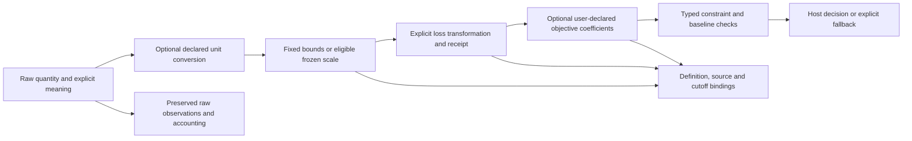

# Turn outcomes into explicit objectives

A CI strategy can detect more faults and take longer to execute. A resource
allocation can produce a negative net outcome even when its gross outcome is
positive. Keep those observations intact, then declare the direction, units,
limits and tradeoff used to make a decision.

The v5 integration source supplies this mathematical boundary in
`coleman.objectives`. These APIs are **unreleased**; build this source's wheel to
run the examples. Existing TCPCI rewards, result artifacts and their meanings
remain unchanged. Start with [decision contracts](decision-contracts.md) to
describe actions and observations; use this page to specify what their values
mean and how an explicitly selected transformation operates.

## Start with the quantities you actually have

| Value | Example | What the declaration preserves |
| --- | --- | --- |
| Raw outcome | Detected-fault credit, or signed net resource credit | Original value, units, horizon and origin |
| Resource | Elapsed suite duration in milliseconds | Physical meaning, independently from a score |
| Priority score | A model's ordering score | A score without a calibrated-probability claim |
| Probability estimate | An explicitly declared value in `[0,1]` | Its distinct interpretation; the label supplies no calibration evidence |
| Learner loss | Duration mapped into `[0,1]` | Direction, bound basis, parameters and clipping receipt |
| Subjective objective | `0.75 × detection loss + 0.25 × duration loss` | The supplied tradeoff, separate from empirical evidence |
| Risk measure | A named measure with an exact definition | Its own units and definition; no automatic CVaR or risk certificate |

Matching numbers or unit `1` do not make these quantities interchangeable.
`QuantityMeaning` pairs the exact scalar schema with its interpretation and
horizon. Each definition has a semantic reference, explicit source lineage and a
content binding covering its parameters. Changing parameters changes that
binding even when the underlying mathematical operator keeps the same version.



In plain text: retain the raw input, perform only the requested conversion and
transformation, optionally combine declared losses, and check the supplied
constraints before the host selects a result. None of these calls creates a
runner, reads a clock, writes an artifact or learns a policy.

## Run complete examples from a built package

From a contributor checkout with its locked build tools installed:

```bash
uv build --wheel --no-build-isolation
uv venv /tmp/coleman-objectives-demo --python 3.14
UV_PROJECT_ENVIRONMENT=/tmp/coleman-objectives-demo \
  uv sync --frozen --no-default-groups --no-dev --no-install-project
uv pip install --no-deps --python /tmp/coleman-objectives-demo/bin/python \
  dist/coleman-4.20.0-py3-none-any.whl
cp examples/objectives/ci.py /tmp/coleman-objectives-demo/ci.py
cp examples/objectives/allocation.py /tmp/coleman-objectives-demo/allocation.py
cd /tmp/coleman-objectives-demo
bin/python -I ci.py
bin/python -I allocation.py
```

The integration wheel retains the package version until the final release gate.
Use the wheel built from this source, rather than another wheel carrying the
same version or the unrelated bare PyPI project name. These examples use public,
authored synthetic inputs and the actual operations; they make no effectiveness
claim about a production system.

Read the complete [CI source](https://github.com/jacksonpradolima/coleman/blob/release/v5/examples/objectives/ci.py)
and [allocation source](https://github.com/jacksonpradolima/coleman/blob/release/v5/examples/objectives/allocation.py)
alongside the worked tables below. Both scripts print deterministic JSON to
standard output and require no runtime, transport or artifact service.

## Compare CI goals without losing their meaning

The CI example starts from two complete, synthetic suite observations:

| Suite | Detected-fault credit (`1`) | Elapsed duration (`ms`) |
| --- | --- | --- |
| Unit | `0.8` | `2000` |
| Integration | `1.0` | `4000` |

It explicitly converts milliseconds to seconds, maximizes detection credit with
assumed bounds `[0,1]`, and minimizes duration with assumed bounds `[0,4] s`.
For a raw value `x` and bounds `L < U`, the affine loss is:

```text
minimize: loss = (x-L)/(U-L)
maximize: loss = (U-x)/(U-L)
```

The bounds are modeling assumptions in this example. They are neither measured
confidence bounds nor a justification for statistical inference over another
quantity. An out-of-range input follows the definition's explicit `reject` or
`clip` policy. A clipping receipt retains the original value and distinguishes
an unchanged endpoint from a value actually changed by clipping.

With user-declared weights `0.75` for detection and `0.25` for duration:

| Suite | Detection loss | Duration loss | Weighted objective | Meets `duration ≤ 3 s` |
| --- | --- | --- | --- | --- |
| Unit | `0.2` | `0.5` | `0.275` | Yes |
| Integration | `0` | `1` | `0.25` | No |

The integration suite has the lower subjective objective but violates the
declared duration ceiling. The host retains the feasible unit baseline. A missing
duration would be insufficient evidence, rather than a free execution or proof
of infeasibility. The finite check evaluates supplied alternatives; it does not
discover alternatives or solve an arbitrary optimization problem.

The supported conversion catalogue is deliberately bounded: time scales
`us`, `ms`, `s`, `min`, and separately `byte`, `KiB`, `MiB`. Unknown pairs reject;
opaque custom units remain valid raw declarations and admit identity only.
The API uses the explicit ASCII spellings `us` for microseconds and `byte` for
bytes; it does not discover aliases. No factor is inferred from a unit's spelling. Conversion changes neither
the quantity's role nor its meaning. The
[BIPM SI Brochure](https://www.bipm.org/en/publications/si-brochure) defines decimal
prefix conventions; [NIST's IEC binary-prefix explanation](https://physics.nist.gov/cuu/Units/binary.html)
distinguishes binary multiples, including `1 MiB = 1048576 B`.

## Preserve signed outcomes when producing bounded losses

The allocation example preserves gross credit, paid cost and signed net credit
separately: gross `-2` minus paid cost `0.5` gives net `-2.5` credit. Its assumed
`[-5,5]` affine maximize mapping yields loss `0.75`; a separately named
volatility mapping yields loss `1`, with upper clipping. These are different
surrogates with distinct output meanings, not interchangeable estimates.

The volatility surrogate uses net outcome `x`, a strictly positive
pre-decision scale `s` in the **same units and horizon**, and a declared `c > 0`:

```text
z = x/s
preclipped_loss = (1-z/c)/2
loss = clip(preclipped_loss, 0, 1)
```

The rolling reference uses a declared window and sample standard deviation,
with denominator `n-1`, following the
[NIST reference formula](https://www.itl.nist.gov/div898/software/dataplot/refman2/ch2/standevi.pdf).
It subtracts the historical mean when estimating the scale; it does **not**
subtract that mean from the new signed outcome. This arithmetic convention does
not establish stationarity, calibrated risk or a profitable decision rule.

For eligible history `[-1,0,1]`, the sample scale is `1`. With `c=2`:

| Net outcome | `z` | Pre-clipped loss | Final loss | Changed by clipping |
| --- | --- | --- | --- | --- |
| `-3` | `-3` | `1.25` | `1` | Upper |
| `-2` | `-2` | `1` | `1` | No |
| `-1` | `-1` | `0.75` | `0.75` | No |
| `0` | `0` | `0.5` | `0.5` | No |
| `1` | `1` | `0.25` | `0.25` | No |
| `2` | `2` | `0` | `0` | No |
| `3` | `3` | `-0.25` | `0` | Lower |

Fit and freeze the scale before its producing decision, then bind that frozen
scale to the decision, member/horizon and eventual outcome. Event, availability,
maturity and known receipt clocks determine eligibility; later observations or
corrections cannot enter the already selected fit. Supplying a scale requires
equivalent explicit lineage. Metadata checks establish consistency of the
supplied evidence, not authenticity or proof that hidden data was excluded.

Zero scale, insufficient support and stale scale produce explicit noncomputable
states. Unknown, unavailable and not-applicable outcomes retain their distinct
null states. No case silently divides by zero, introduces epsilon, fabricates a
loss of zero or creates a complete learner update. Clipping rates declare their
denominators and keep missing/noncomputable cases visible.

Currency P&L cannot be divided directly by dimensionless return volatility. Use a
same-unit scale, or perform an explicit pre-decision notional/NAV mapping with
its own units and lineage. The normalized loss is a surrogate; raw negative and
inconclusive outcomes remain results.

## Keep preferences and mixture controls separate

| Declaration | Intended meaning | Application in this source |
| --- | --- | --- |
| Initial prior | Initialize named-member weights once | Typed simplex and support checks |
| Declared-target share | Persistently mix toward a supplied distribution using `alpha ∈ [0,1]` | Contract; the actual learner is qualified separately |
| Static quadratic anchor | Evaluate `strength × sum((weight-anchor)²)` | Explicit pure penalty evaluation |
| Objective coefficients | Combine declared normalized objective terms | Explicit weighted-loss evaluation |
| Expert bounds and movement allowance | Constrain emitted coefficients with a declared origin and clock | Contract and feasibility declaration |
| Cadence | Release after accepted panels or a declared interval | Contract; no ambient calendar |
| L1 movement profile | Declare `0.5‖p-r‖² + λ‖p-p_old‖₁` on the constrained simplex | Versioned contract; the joint optimizer is later method work |
| Reference point or human judgment | Record supplied targets or ordinal preferences | Distinct declarations, without inferred cardinal reward |

For losses `(0.2,0.6)`, coefficients `(0.75,0.25)` give `0.3`, while
`(0.25,0.75)` give `0.5`. These are supplied subjective objectives, not
probabilities or measured predictive gains. Without a preference, retain the
explicit baseline; do not manufacture equal weights or a missing-judgment event.

An initial prior `(0.75,0.25)` adds no recurring objective term. A static anchor
at that vector, strength `0.4`, evaluated at `(0.5,0.5)` contributes `0.05` on
each explicit evaluation. Rescaling the base objective requires a corresponding
strength change to preserve that tradeoff; it does not preserve an old learner
loss bound automatically.

The moving L1 origin is the previously committed emitted vector, independently
of that static anchor, prior and declared share target. Lambda is finite and
nonnegative in canonical coefficient-fraction units, and may exceed one. Its
full L1 coefficient movement is not a paid fee, half-L1 turnover or a holdings
risk bound. Strength selection uses development data only. The declaration
retains profile/origin/selection versions and release lineage; it neither runs a
controlled Hedge update nor supplies a checkpoint transaction. Original and
unpenalized methods retain their meanings; unknown or unsupported profiles reject.

`check_mixture_intersection` checks the declared coefficient boxes and movement
allowance without emitting new weights. It derives the original rational
effective limits from the supplied stored numbers before rounding display
endpoints. Its named binary64 numerical profile can admit a small **sum**
residual; `exact_feasible` separately identifies exact sum-one feasibility of
that original intersection. An empty coordinate or exceeded period budget stays
infeasible even when its displayed endpoints round to the same value. This
check performs no projection, constraint repair or KKT solve.

## Bind definitions and preserve earlier results

Direct conversion, loss and preference operations take typed mathematical
inputs without a run ID, dataset registry, workspace, transport or artifact.
When joining them to an experiment, the semantic request binds the complete
objective context to a decision. A same-named transform with changed parameters
has different content and cannot qualify as the same contextual retry.

For a timed `SemanticRequest`, every supplied **known** definition declaration
instant must be no later than the producing information cutoff, including nested
control and scale definitions. An unknown declaration time stays unknown; passing
this consistency check does not prove when a definition was created. Each
signed-volatility objective requires one global shared scale selection, or
complete coverage of the exact declared members. A shared scale indexed by
member must reuse the same frozen scale; partial coverage, mixed global/member
choices and selections for another request or clock boundary reject.

Top-level records use explicit schema version 1 and the guarded canonical JSON
readers. Missing/future versions, duplicate keys and unknown fields reject.
Round-tripping retains null status, raw values, units and definition bindings.
Operation receipts retain the full typed definitions or request needed to
recompute their arithmetic and classifications when read; changing an output
while retaining its binding is rejected. Correct recomputation does not
authenticate the supplied observations, clock facts or period-usage attestations.
Content digests identify bytes; they authenticate neither a source nor a causal
claim. Binary64 arithmetic is explicit mathematical projection, separate from
the existing exact Decimal accounting ledgers.

An objective/preference change declares its old and new bindings and a future
effective position, with an explicit restart or supported migration. Validating
the declaration checks the actual supplied stream/current binding and a strictly
future frontier. A known change declaration cannot follow its effective instant.
It does not apply the change, rewrite feedback or commit recovery state.
Preference history remains separate from outcome-feedback history. See
[compatibility](v5-compatibility.md) for retained formats and
[the evidence guide](evaluation-guide.md) for comparisons beyond this boundary.

## Look up the contracts and operations

::: coleman.objectives.bindings

::: coleman.objectives.units

::: coleman.objectives.transforms

::: coleman.objectives.volatility

::: coleman.objectives.preferences

::: coleman.objectives.controls

::: coleman.objectives.feasibility

::: coleman.objectives.context

::: coleman.objectives.changes
