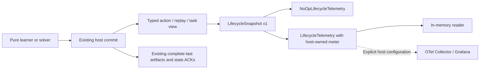

# Observe a decision without changing it

COLEMAN separates mathematical decisions, delivery, durable acknowledgement and
physical work. Operational observations help you see those boundaries. They do
not manufacture feedback, settle trades, acknowledge a checkpoint or turn an
unfinished job into a completed result.

This guide describes the v5 source revision. Build or obtain its reviewed wheel
using the [installation profiles](core-installation.md); these APIs are not a
claim that v5 has already been released. Native TCPCI dashboards and result
storage remain in the [observability guide](observability.md).

## A complete local CI cycle

Copy `examples/operational/ci.py` outside your checkout and run it with the
noneditable wheel. The example uses shipped constant Hedge on two deliberately
authored CI expert loss panels. These are coefficient updates, not physical
test executions or evidence that an adaptive method wins.

| Input | CI rule 00 | CI rule 01 | Meaning |
| --- | --- | --- | --- |
| Initial coefficients | 0.5 | 0.5 | Dimensionless expert mixture, not calibrated failure probabilities |
| Panel 0 | 0 | 1 | Complete synthetic bounded loss, both observed |
| Panel 1 | 1 | 0 | Next complete synthetic panel; supplied only at its update |

```bash
python ci.py --mode noop
python ci.py --mode off
```

After the first update, rule 00 receives `1 / (1 + exp(-0.5))` and rule 01
receives the remainder. After the opposite panel, both return to 0.5 within
the learner's declared binary64 envelope. The output is one complete JSON
receipt with the full versioned learner states and, when enabled, two typed
snapshots. Their `updates` values are 1 and 2; final `concentration` is 0.5.
The off/noop/memory profiles must produce **identical complete learner states**.
The published [learner guide](expert-mixtures.md) specifies its actual numerical
assumptions; observing a coefficient adds no risk or execution guarantee.

With the optional telemetry extra installed, this uses a real SDK in-memory
reader, without starting a collector, exporter thread or network connection:

```bash
python ci.py --mode memory
```

The result additionally names `coleman.lifecycle.updates`,
`coleman.lifecycle.concentration` and `coleman.lifecycle.availability`.

## Connect an existing host



For an existing full-history `CausalReplay` session, inspect the explicit current
state after your own operation. Supply a real operational clock; the mapper does
not read a wall clock or drain feedback:

```python
from datetime import UTC, datetime
from coleman.telemetry.export import NoOpLifecycleTelemetry
from coleman.telemetry.views import replay_snapshot

observer = NoOpLifecycleTelemetry()
# replay is your already configured CausalReplay with its real host.
observation = replay_snapshot(replay.state, at=datetime.now(UTC))
observer.record(observation)
print(observation.to_json())
```

`action_snapshot(executed, at=..., outcome=...)` inspects the **actual**
`ExecutedDecision`, preserving its original proposal and implementation.
The caller supplies a closed operational outcome; the mapper does not guess
feasibility from weights. `task_snapshot(job, plan, at=...)` checks the original
retained `TaskJobRecord` against its exact `TaskPlan`. Obtain those views from
your existing host; telemetry starts no worker or provider.

The replay mapper accepts the original full-history `ReplayState` v1 and known
`RetainedReplayState` v2. The latter's explicitly sealed prefix is quiescent:
lifetime D/U include it, while pending decisions remain in the retained tail.
When compaction retired the actual last-update clock, its age is unavailable;
the potentially later last-drain clock is not substituted. Unknown generations
reject instead of being silently treated as complete histories.
Observation timestamps cannot precede retained decisions, updates or drains.
Empty update/pending ages are not applicable. A newly admitted future revision
does not become an accepted update merely because it is visible in metadata.

For a collector, explicitly construct your existing `Telemetry` facade and pass
its `meter` to `LifecycleTelemetry`. Alternatively supply any correctly configured
SDK meter, including the memory example. Constructing an exporter is a deliberate
host side effect. Handle exporter failures after scientific state commits: export
is neither atomic nor durable and cannot undo a decision or acknowledge a job.

## Interpret every measurement

`metric_catalog()` returns the closed v1 contract with each metric's units,
population, owner and suggested response. Snapshots retain exact algorithm and
state-codec versions as annotations. The most common observations are:

| Coordinates | Units | Meaning and response |
| --- | --- | --- |
| `decisions`, `updates`, `pending` | count (`1`) | Separate logical opportunities and accepted updates; inspect delivery rather than inventing labels |
| `pending_age`, `update_age` | seconds (`s`) | Explicit observation clock minus actual retained decision/update clocks; inspect source clocks and cadence |
| `missing_feedback` | count (`1`) | Pending decisions without **any admitted revision**; does not count absent/null coordinates inside a revision, and does not mean failure |
| `concentration` | dimensionless (`1`) | Sum of squared emitted expert coefficients, not consumer risk, holdings or sampling probability |
| `constraint`, `fallback` | indicator (`1`) | Caller-declared infeasible/fallback outcomes; inspect the original typed diagnostics |
| `rss`, `peak_rss` | MiB | Existing current-executable sampled/lifetime measurements; inspect attribution and the existing guard |
| `cpu_time`, `wall_time`, `cpu_utilization` | seconds, seconds, percent | Existing process-tracker observations; CPU percent can exceed 100 with threads |
| `task_progress`, `attempts`, `invocations` | ratio/count/count (`1`) | Original durable progress and physical retry/start counters |
| `output_usage`, `queue_usage` | ratio (`1`) | Explicit host-supplied observed usage divided by its actual cap; values above one remain visible |

Observed zero is distinct from `unknown`, `unavailable` and `not_applicable`,
each represented by null with its own status. Nonfinite, negative operational
readings, fractional counts and incompatible units reject. Missing process RSS
on an unsupported platform stays unavailable. Signed financial returns belong
to their own typed domain contract, not a nonnegative operational counter.
Lifetime counts retain signed-int64 integers, including values beyond `2**53`;
their v1 wire values require integer tokens and reject floating/decimal count
tokens instead of rounding. The snapshot and SDK retain them exactly. A backend that projects integers to
floating-point cannot provide that same guarantee: use artifacts for exact counts.

Metric labels are restricted to four routes and nineteen names; the availability
gauge adds four statuses. There are at most 76 numeric and 304 availability
combinations **per resource**, below the qualified SDK's default per-instrument
cardinality limit. Outcomes, timestamps, task/user/run IDs, versions and
fingerprints remain snapshot annotations. Arbitrarily many host resources
can still create arbitrarily many series; configure backend retention and
resource selection separately. Legacy native metric labels retain their existing
meaning and cardinality; no old series is silently rewritten.

Each observed coordinate has a numeric gauge and a one-hot availability gauge.
When a later reading is unavailable, its previous numeric gauge remains stale:
query its current availability before displaying a value. Coordinates omitted
from a snapshot are not refreshed. Use a consistent coordinate set for a live
dashboard. Gauge timestamps are SDK recording instants; the source observation
clock remains in the artifact. Gauge retries overwrite observations; they are not counted as new
decisions, fees or independent samples. These choices follow the official
[OTel metric API](https://opentelemetry.io/docs/specs/otel/metrics/api/) and
[cardinality model](https://opentelemetry.io/docs/specs/otel/metrics/sdk/).

One facade serializes its writers. Coordinate distinct facades sharing the same
meter/instrument names. Collector reads and exporter failures are not atomic
cross-instrument transactions; use typed snapshot artifacts for joined evidence.

## Preserve existing operational guards

| Existing boundary | What it actually limits |
| --- | --- |
| `TaskLimits` | Coordinates, named work units, attempts, worker invocations, attempt wall seconds, sampled process memory and output bytes |
| `TaskHostPolicy` / shared `HostPolicy` | Running workers, queued jobs, retained jobs/plans/data, registration and active-memory pools |
| Worker resource/output guards | Actual cooperative checks under their existing deadlines and caps; not a hostile-code sandbox or whole-process-tree reservation |
| Typed state/bundle readers | Declared byte/depth/component/version bounds before unsafe restoration or execution |
| Approved executor capture | Explicit registered recipe, installed source/dependency image and qualified runtime; not arbitrary untrusted plugin discovery |
| Complete-last publication / SQLite ACK | Logical completion and durable recovery; a directory, metric or progress label proves neither physical exactly-once execution nor complete artifacts |

CPU time is measured, not a new CPU-quota guarantee. Physical subject work,
configured model costs, coefficient movement, solver penalty and paid charges
remain separate. Telemetry does not add a second queue or scheduler or alter the
existing cancellation/death/SQLite-contention recovery behavior.

## Measure overhead with a reproducible finite workload

Copy `measure.py` beside `ci.py`, then run outside the checkout with the reviewed
telemetry wheel. Start with the quick case; the full grid is eight workload
cells and three profiles, each in a fresh sequential process:

```bash
python measure.py --quick --output operational-quick
python measure.py --output operational-matrix
```

The versioned report retains CPU/wall seconds, actual accepted updates and
updates/second (unavailable at observed zero duration), current/lifetime-peak RSS, exact
mathematical-output digests, snapshot bytes, process/import elapsed time,
hardware/OS/interpreter/base identity, the actual selected telemetry dependency
closure (including SDK/API versions), source hashes and actual native-thread
environment values. Each child has a declared 30-second measurement fence;
the report is bounded to 2 MiB. Only every matched case/profile with identical
math can publish the immutable final JSON. A failed child or interrupted suite
produces no falsely completed report. The real writer retains its existing
identical-write idempotency/concurrent-publication contract.

Subtract matched off/noop/memory measurements to inspect snapshot-validation
and SDK setup, recording, readout and shutdown overhead. The inner clock includes
these operations; the parent clock additionally includes fresh process/import time.
The peak RSS includes that executable's earlier imports and is not an exclusive
learner allocation. These are finite local measurements, not independent
scientific histories, a portable throughput promise or evidence of method
superiority. Run without coverage/profilers for performance evidence and retain
their configuration if instrumented. Network-export overhead needs a separately
declared collector/backend workload; the memory profile does not measure it.

## Know what the runtime identity establishes

| Tier | Supported interpretation |
| --- | --- |
| Recorded observation | Read strict supported JSON/Parquet and inspect its original provenance; this does not permit checkpoint execution |
| Pinned continuation | Resume only under the exact selected owner's compatibility binding, source image/runtime and complete state; exact RNG state does not establish cross-platform transcendental math |
| Qualified tolerance | Compare declared quantities under an independently tested numerical envelope on explicitly listed runtimes/hardware; no automatic bitwise portability |

Base installation includes only the mathematical contract dependencies. CI,
analytics, MCP, telemetry, ClickHouse and notebook tooling are optional; docs,
development and release tooling add separate dependency surfaces. The installed
qualification checks a fresh minimal wheel and all declared extras, including
cold imports that forbid optional providers/transports and external effects.
Selecting an extra installs it; it does not authorize provider execution.

The source lock includes real Pylint4.1.3/astroid4.3.4 and Twine7.0.0 in their
development/build tool profiles, so qualification does not depend on a personal
tool cache. The optional MkDocs dependency uses Watchdog7.1.0: the older locked
6.0.0 had no CPython3.14 macOS wheel under the existing no-build installation
policy. Its upstream glob/attribute-event changes do not affect COLEMAN's
mathematical core; MkDocs1.6.1 uses a polling `on_any_event` handler. This is an
installation/compatibility qualification, not a claim that every third-party
interactive watcher is portable across all platforms.

Existing `InstalledRuntime` covers the complete SDK resource fingerprint and
active base dependency closure. Selected runtime/executor contracts explicitly
cover their selected extras and provider images. An unrelated optional installed
package does not silently join the base closure. A changed SDK resource image
intentionally invalidates exact continuation, even if a human expects similar
math: retain readable old evidence, then use an explicit qualified migration or
a new execution. Do not weaken that policy by changing a recorded fingerprint.
These digests establish content identity, not source authentication, hardware
attestation, data integrity beyond the checked bytes, or absence of vulnerabilities.

## Audit current dependencies and reporting policy

The lock-wide audit covers every registry pin across optional extras/platforms,
not only packages active on the current machine. It does not install the audited
packages or suppress advisories. Reproduce the existing workflow:

```bash
python scripts/audit_lock.py > audit-requirements.txt
python -m pip_audit --strict --no-deps --disable-pip \
  --requirement audit-requirements.txt --format json --output audit.json
```

This revision updates the coordinated OpenTelemetry family to 1.45.2/0.66b2,
Soup Sieve to 4.0 and Tornado to 6.6.1 for the upstream
[trace-context ReDoS](https://github.com/open-telemetry/opentelemetry-python/security/advisories/GHSA-mf5v-w3w3-f6cg),
[descendant-selector DoS](https://github.com/facelessuser/soupsieve/security/advisories/GHSA-mmhr-3c5m-f64f)
and [redirect fix](https://github.com/tornadoweb/tornado/security/advisories/GHSA-5cjw-f85j-cv6r).
An affected dependency does not prove every COLEMAN route is exploitable; an old
clean audit is not a current vulnerability-free claim. Retain audit date, source
and exact lock digest. Security-tab counts and release-era counts are not
interchangeable with the current all-lock audit.

The complete repository gate keeps four workers with `--dist=loadfile`, followed
by only the original `test_installed_public_ci.py` and `test_installed_westermo.py`
serial modules. It preserves all tests, subprocess/thread coverage, existing
resource/deadline fences and the actual unrounded **>=95%** threshold. Coverage
reports use precision 8, while CI prints the raw percentage, configured
`fail_under=95`, precision and the authoritative unrounded PASS/FAIL separately.
Historical 94.94% observations do not become 95% measurements through rounding.

Coverage and JUnit are separate submissions through the reviewed Node24
[Codecov v6 action schema](https://github.com/codecov/codecov-action/blob/v6.0.0/action.yml).
Test results use `report_type: test_results`. After a failed parallel phase,
the serial report can be absent: CI warns for each missing expected file and
uploads only actual reports. Cancellation still suppresses JUnit upload. Neither
an uploaded JUnit file nor a successful export turns a failed test gate green.

For release qualification, the same reviewed source can run a bounded uploader
probe on the exact refs `qualification/v5-372-uploader-success` and
`qualification/v5-372-uploader-failure`. The coordinator publishes those refs
only after local review/gates. Both must identify the same qualified commit.
[GitHub push workflows](https://docs.github.com/en/actions/reference/workflows-and-actions/events-that-trigger-workflows#push)
can execute the reviewed workflow from these refs without changing main or
depending on a newly enabled manual-dispatch trigger.

The probe uses actual tiny pytest cases in the runner's temporary directory,
outside product test collection. The positive run produces two real JUnit files;
the deliberate negative run fails its primary phase and leaves the second file
absent. Its overall failure is expected and remains a failure. The shared reporter
and uploader use the exact same YAML-anchored steps as the normal suite, with a
distinct `uploader-qualification-*` upload name. Probe upload errors fail the
step explicitly; ordinary uploader error/cancellation policy remains unchanged.
Normal pull-request check names, the 120-minute product job, four-worker/serial
profile, inventory and raw coverage gate retain their original behavior. A
probe's skipped product job has a distinct name and provides no full-suite pass.

Close this acceptance evidence only after inspecting both actual GitHub runs:
the intended pytest outcomes, both/absent JUnit files and retained SHA/checksums,
the Codecov uploader step outcome **and accepted server receipt/report URL**.
An action's default exit zero alone does not establish a successful upload.
Local tests execute the actual reporter and real success/failure pytest cases;
they cannot certify the external service. Remove only the temporary qualification
refs after their evidence is retained; these runs publish no package or release.
