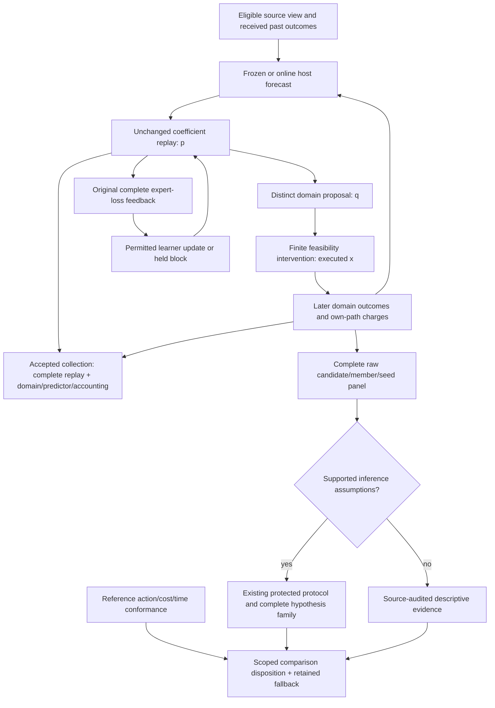

# Compare adaptive decisions with a conservative fallback

An adaptive method can improve its learning score while producing a worse CI
decision after constraints and costs. Compare the complete procedure: eligible
inputs, forecasts, coefficients, feasible actions and the outcomes on each
method's own path. Retain the existing workflow when the evidence does not
justify a change.

This guide connects [expert mixtures](expert-mixtures.md),
[causal replay](causal-replay.md) and the
[frozen evaluation protocol](evaluation-protocol.md). The initial execution
profile maps full-information expert coefficients to a **separate deterministic
finite choice**, with explicit feasibility and offline modeled execution.

## Begin with complete inputs

The runnable example contains four authored worlds. Each pair is the modeled
duration of the `fast` and `full` expert plans, in seconds:

| World | First outcome | Second outcome | Final outcome |
| --- | --- | --- | --- |
| `world-0` | `(2, 6)` | `(2, 6)` | `(6, 2)` |
| `world-1` | `(6, 2)` | `(6, 2)` | `(2, 6)` |
| `world-2` | `(4, 4)` | `(4, 4)` | `(4, 4)` |
| `world-3` | `(1, 7)` | `(7, 1)` | `(3, 5)` |

These are deliberately published model inputs. They are neither recorded CI
executions nor independent historical repositories. The driver retains the
complete table; each decision receives its permitted past inputs. The public
source is declared already exposed.

Each world starts with fresh complete owners and equal expert coefficients.
The learning loss is duration divided by a declared eight-second scale. That
dimensionless loss is separate from seconds, confidence and probability.
The primary comparison observes **one named final decision per world**. Prefix
decisions remain inspectable; they do not become extra independent observations
or silently enter a cumulative primary metric.

The fixed predictor supplies `(4, 4)` seconds. Its online counterpart updates an
expanding mean from earlier mature, received complete panels. The host owns that
predictor and includes its state in the checkpoint.

## Freeze the treatment and its component comparisons

The example declares these modes before loading protected outcomes:

| Mode | Controlled change |
| --- | --- |
| `fixed` | Keep equal coefficients through the zero-rate endpoint |
| `plain` | Apply constant-rate Hedge |
| `target` | Add the declared-target share |
| `bounded` | Add expert coefficient bounds |
| `movement` | Add hard movement allowances |
| `cadence` | Release a sum-loss block every two accepted panels |
| `penalized` | Add positive L1 under the same hard controls |
| `online` | Change only the supplied predictor to a past-panel online predictor |
| `accounting_off` | Keep the matched controller and predictor, with zero modeled reconfiguration charge |

Named matched pairs isolate the intended component. They do not establish a
complete factorial study. The no-intervention proposal is a named diagnostic
counterfactual: an infeasible proposed plan is never a deployable candidate or a
falsely feasible execution.

Freeze the complete family, BASE configurations, initialization, target-share
strength, bounds, movement allowances, cadence, lambda, predictor updates,
execution/accounting rules and tuning/resource budgets. Retain every inspected
development setting, including unsuccessful ones. Choose lambda on development
evidence and bind it to the selected rule.

The example uses round cadence. UTC interval cadence and its required
target/bounds/L1 combinations have a separate
[expert-mixture execution qualification](expert-mixtures.md); a round comparison
does not establish interval-controlled domain accounting.

## Follow one causal cycle



1. Apply feedback only under its declared availability, maturity, first receipt
   and application clocks. Derive forecasts from that past.
2. Emit the expert coefficients through the existing causal engine. Its complete
   expert-loss feedback still belongs to the original coefficient action.
3. Pass the complete earlier record to the separate domain owner. It proposes a
   finite CI plan, checks resource constraints and records its modeled execution
   and intervention. Ties use the example's declared full-plan tie-break.
4. Retain later outcomes separately. A scalar outcome for the chosen plan cannot
   supply the complete losses of every expert.
5. Acknowledge complete replay and domain owners through the existing local
   state store, including predictor state, pending outputs and accounting usage.

`execute_prequential_step` supplies the typed two-stage call. Direct calls mutate
owners in order; a later failure may follow an emitted coefficient. Durable use
places the calls on fresh owners inside `LocalStateStore.commit_transition`.
Failed staging retains the old accepted head. External commands need their own
host reconciliation; the offline callback does not promise exactly-once
external execution.

## Keep loss, outcome and charges separate

An independent calculation illustrates why the distinction matters:

| Quantity | Fixed `(1/2, 1/2)` | Changed `(3/4, 1/4)` |
| --- | --- | --- |
| Linear combination of modeled `(2, 6)` seconds | `4 s` | `3 s` |
| Common affine loss at an `8 s` scale | `1/2` | `3/8` |
| Full coefficient L1 from the fixed origin | `0` | `1/2` |
| Reconfiguration model at `4 s / full L1` | `0 s` | `2 s` |
| Modeled seconds including that charge | `4 s` | `5 s` |

The gross improvement becomes net harm under this declared model. This is an
arithmetic fixture, not a physical CI charge. The learner's `lambda * L1` stays
inside its objective; it is never a paid fee, measured CPU time or executed-book
turnover.

The affine equality requires a common fixed scale and a linear quantity. A
nonlinear loss can instead give an inequality: the square of the mean of
`(0, 1)` is `1/4`, while the mean square is `1/2`. Constraints, clipping,
different fitted scales and path costs need their own derivation. For signed
outcomes, use the existing [past-only transform](objectives.md), bind the
producing scale and report clipping. A bounded surrogate cannot supply bounds
for a raw or net target.

## Run the public flow outside the checkout

Use CPython 3.14 and a noneditable wheel from this source. The
[base installation guide](core-installation.md) explains the dependency boundary.
From the checkout:

```bash
work=$(mktemp -d)
uv build --wheel --python 3.14 --out-dir "$work/wheels"
uv venv --python 3.14 "$work/env"
uv pip install --python "$work/env/bin/python" "$work"/wheels/*.whl
mkdir "$work/example"
cp examples/prequential/*.py "$work/example/"
cd "$work/example"
"$work/env/bin/python" -I -B ci.py "$work/evidence"
```

The [complete six-file example](https://github.com/jacksonpradolima/coleman/tree/release/v5/examples/prequential)
retains nine modes, four worlds, three decisions per world and **36 raw final
cells**. Physical resource costs remain unavailable without measurements.

Read the output on separate axes:

| Output | Meaning in this example |
| --- | --- |
| Source scope | Constructed, publicly exposed model inputs |
| Reference conformance | Proposal/action, feasibility, component and clock checks |
| Primary metric | Final decision's modeled net seconds, minimize |
| Independent-unit declaration | Four authored worlds; seeds and rounds add no units |
| Comparison scope | Descriptive only because the public source is already exposed |
| Family conclusions | Insufficient evidence for the declared minimum |
| Eligible candidate list | Empty |
| Retained fallback | The exact frozen `fixed` baseline |
| Adoption | No automatic switch |

A deliberately divergent action, cost or time mapping blocks conformance even
when the final score agrees. Complete discrepancies stay inspectable. Numerical
reference tolerances are frozen per quantity, with exact comparison by default;
they are separate from scientific practical-equivalence margins.

## Resume the original comparison

Retain the original design, selected rule, full family and source-clock tape.
Resume both owners, including pending feedback and predictor/accounting history.
Exact retries must neither invoke another decision nor charge a logical action
twice.

Reopening checks the original source, method definitions, copied example code
and selected runtime, including a header saved before the first state store
existed. Changed definitions reject continuation. Reading original artifacts is
separate from executing them in a compatible environment or a reviewed new
experiment lineage.

The tape retains original decision and observation clocks. Those same inputs can
reproduce complete logical state; a new process's OS timestamps and resource
use are separate observations. Imports and reproductions preserve original
provenance and exposure. They do not create another fresh confirmation.

Source-access and checkpoint publication use separate existing ledgers. An
interruption may consume access without completing a report. Keep that history
through failures, resume, imports and cached disclosure. Consult
[state recovery](state-recovery.md) for acknowledgements and
[the protocol](evaluation-protocol.md) for access reservations.

## Return a conclusion that matches the evidence

`ReferenceConformancePlan` freezes the reference recipe, complete opportunity
catalogue, quantities and tolerances before reading protected reference outputs.
The later report embeds both actual traces and rederives every check.
`ComparisonPlan` binds the design, exact BASE baseline, required contrasts,
terminal cell mapping and fallback. `SelectionManifest.rule` binds that plan
before the existing protected freeze, avoiding a circular identity.

For supported independent-unit assumptions, `ProtocolAudit` retains the complete
panel and applies the existing bounded or explicitly justified paired-t route.
It preserves the complete multiple-testing family. A qualified positive
comparison may identify candidates within its declared scope; harm, equivalence
and inconclusive results remain valid outcomes.

For unsupported dependence, assignment, stopping or bounds, use `DiagnosticAudit`.
It reserves source access before loading a bounded complete `DiagnosticPanel`.
It invents no protected freeze, confidence interval or p-value. Later supported
use sees the same retained exposure. Existing unsupported `ProtocolAudit`
requests still return before invoking their loader.

`assess_comparison` separates conformance, source/access eligibility, inference,
eligible candidates and fallback. Persisted consumers call
`ComparisonDisposition.validate_for` with the complete original inputs. A valid
schema or admission fingerprint cannot prove scientific independence, source
authenticity or empirical usefulness. The disposition performs no production
action.

Continue with the [evaluation API](api/evaluation.md),
[bounded paired assumptions](bounded-paired-evaluation.md),
[source admission](corpus-admission.md) and
[research reading path](research.md#sequential-evaluation-and-selection).
