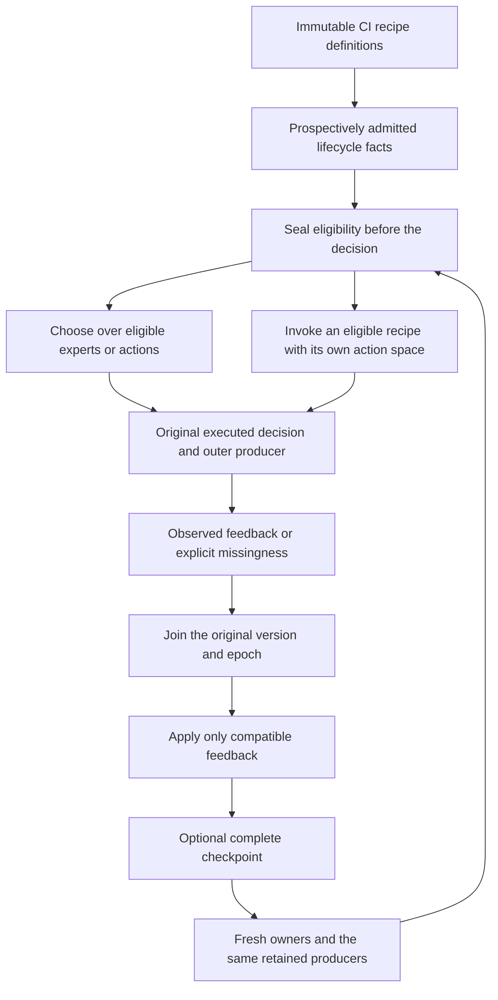

# Keep CI recipes eligible and independent

A CI plan can stop participating before a build, return after maintenance, or
be replaced by a new implementation. Its old outcomes still belong to the
version that produced them. COLEMAN's optional registry makes those boundaries
explicit and helps keep one adaptive recipe's state separate from another's.

Start here when composing several plans or independently evolving learners.
Ordinary [direct decision calls](decision-contracts.md) need no registry. These
APIs require the **unreleased v5 source wheel**; stable v4 installation and native
policy behavior retain their existing contracts.

## From input to a decision

| Input | What to supply | What it establishes |
| --- | --- | --- |
| Definition catalogue | Expert/action namespace, stable member ID/version, implementation digest and complete configuration digest | Immutable declared content; performance updates do not change it |
| Population policy | Population/task IDs, expert or action members, timed or untimed clocks | One fixed eligibility interpretation |
| Lifecycle facts | Acceptance sequence, event ID, exact definition, effective and admission rounds, explicit knowledge time and reason | Prospective introduction, inactivity, unavailability, retirement and reentry |
| Recipe binding | Child/task, expert definition, state epoch, exact state owners, objective and optional target/transform/controls | Declared mathematical identity and one owner for each state component |
| Host inventory | Actual mutable root objects and any explicit shared-predictor discipline | Checks of declared roots and bindings; the host must expose the complete inventory |
| Feedback | Original outer producer plus unchanged inner execution, values, units and statuses | Outcomes for the original eligible members/version/epoch |



There are two useful compositions. `RegistryRequest` binds a decision **over**
the active expert/action members. `RecipeExecution` binds eligibility of a
selected recipe **to** its own inner decision: an eligible CI recipe can choose
between test plans A and B. The expert ID and those action IDs have separate
meanings. Existing inner request/execution/feedback bytes remain unchanged.

## A complete direct example

This creates one eligible CI plan without a store, runner, workflow or transport.
The explicit null clock selects the untimed logical-round profile.

```python
from coleman.core.identity import Reference
from coleman.core.primitives import fingerprint
from coleman.objectives.bindings import DefinitionBinding
from coleman.registry.definitions import Catalogue, MemberDefinition
from coleman.registry.lifecycle import LifecycleFact, PopulationPolicy, RegistryState
from coleman.registry.limits import RegistryLimits

def ref(name):
    return Reference(id=name, version="v1")

plan = MemberDefinition(
    schema_version=1, kind="expert", member=ref("ci-plan-a"),
    implementation=DefinitionBinding(
        reference=ref("constructed-ci-plan"),
        definition_fingerprint=fingerprint({"implementation": "constructed-ci-plan-v1"}),
    ),
    configuration_fingerprint=fingerprint({"plan": "a", "budget_seconds": 30}),
)
state = RegistryState(
    schema_version=1,
    catalogue=Catalogue(schema_version=1, reference=ref("ci-plans"), definitions=(plan,)),
    policy=PopulationPolicy(population=ref("ci-population"), task=ref("ci-builds"),
                            kind="expert", clock="untimed"),
    limits=RegistryLimits(),
)
state = state.append(LifecycleFact(
    schema_version=1, event_id="introduce-plan-a", sequence=0,
    member=plan.member, definition_fingerprint=plan.fingerprint,
    operation="introduce", effective_from_round=0, admitted_before_round=0,
    known_at=None, reason="constructed-ci-example",
    state_epoch=ref("ci-plan-a-epoch-0"), predecessor_epoch=None, disposition=None,
))
view = state.snapshot(0)
print([member.id for member in view.active])
print(view.feasible_set("ci-plan-space").version == view.active_contract_fingerprint)
```

Output:

```text
['ci-plan-a']
True
```

Use `require_recipe_eligibility(snapshot, recipe, request)` before preparing or
calling an inner host. Inactive, unavailable, retired, unknown or mismatched
recipes reject before consuming a decision, RNG value or path charge. The
actual output is then retained as `RecipeExecution`; its implementation
reference is checked too. Digests identify supplied content, without proving
that an implementation ran or authenticating its source.

## See sleeping, missing and restarted plans together

The complete [six-round CI example](https://github.com/jacksonpradolima/coleman/blob/release/v5/examples/registry/ci.py)
uses the actual registry, action and feedback contracts. Run it from a matching
source checkout with the base package installed:

```bash
python examples/registry/ci.py
```

Its uniform presentation host shows eligibility; it performs no adaptive update
or physical test execution. Losses are explicitly synthetic, dimensionless and
bounded in `[0, 1]`. The complete-observed consumer contract stays fixed across
all rounds; a separate fixed audit contract retains missing values.

| Round | Change before the decision | Active plans | Loss panel | Complete-observed update eligible? |
| --- | --- | --- | --- | --- |
| 0 | Introduce A and B | A, B | `0.25, 0.75` | Yes |
| 1 | B becomes inactive | A | `0.5` | Yes; B has no invented zero row |
| 2 | Resume B | A, B | `0.25, null/unavailable` | No; B remains part of the original active panel |
| 3 | Introduce C and retire B | A, C | `0.25, 0.5` | Yes; C receives no earlier live outcomes |
| 4 | Restart B with a new epoch | A, B, C | `0.25, 0.75, 0.0` | Yes; C's zero is observed |
| 5 | Retire every plan | Empty | Explicit absence | No; the action is `AbstainAction` |

The completed round-2 revision is subsequently audited against its original
producer, with `revision_id="completed"`, `supersedes="initial"` and explicit
`delay_rounds=3`. It retains B's `epoch-0` even though B has entered `epoch-1`.
The example declares that old feedback audit-only and applies no update to the
replacement. A real delayed-capable host can instead retain a separate old owner
and explicitly deliver to that owner. Display-name matching never transfers state.

`RegistryState` retains full-content and history digests. Each eligibility
snapshot additionally exposes its active-contract digest. A new cutoff or unrelated catalogue publication changes provenance;
it does not reidentify an unchanged active universe. Active definition/configuration
or state-epoch changes do change that universe.

## Keep a collection's whole state together

The [32-child collection example](https://github.com/jacksonpradolima/coleman/blob/release/v5/examples/registry/collection.py)
reuses the complete [owned CI consumers](state-recovery.md). It adds one registry
component to the same existing state store: 32 replay owners, one applied-domain
owner and one registry owner, with 98 declared mutable roots.

Each recipe retains its learner statistics, predictor/cache, pending labels,
cadence, virtual path and buffered owned RNG. The actual host reconstructs a
temporary RNG from its complete immutable state; the root inventory names the
real mutable owner, host and session objects. It does not fabricate a persistent
Random object. Shared immutable inputs can use verified canonical JSON bytes.
An intentionally shared predictor needs one declared writer, ordered consumers,
an update/snapshot barrier and a coherent snapshot version.

```mermaid
flowchart LR
    A[Actual current compatibility and command] --> Q[Existing store owns the accepted transition]
    Q --> L[Inspect retained live roots lazily]
    L --> F[Create fresh component owners]
    F --> B[Check complete roots before restore]
    B --> R[Restore and recheck replaced roots]
    R --> T[Bounded local transition]
    T --> X[Check roots and export every owner]
    X --> M[Publish immutable blobs and complete manifest]
    M --> K[SQLite COMMIT acknowledges the collection]
```



`OwnedBindings` calls factories and root inspectors only inside accepted staging.
Stale requests and exact acknowledged retries keep the existing zero-callback
behavior. Fresh wrappers sharing a retained live weights list, RNG or predictor
reject before restore; post-restore replacements are checked again. The check
covers declared roots. Omitted fields, hidden closure/native/external aliases and
arbitrary callback side effects remain trusted-host responsibilities.

For a small runnable durable example, put the public collection adapter and
unchanged state host beside your script:

```bash
cp examples/registry/collection.py collection.py
cp examples/state/ci.py owned_ci.py
```

The following uses a new empty `ci-registry-state` directory and two of those
actual consumers. The same adapter defaults to all 32.

```python
from pathlib import Path
import collection
from coleman.core.primitives import fingerprint
from coleman.state.local import LocalStateStore
from coleman.state.storage_contracts import CommitIntent, CommitRequest

layout = collection.collection_layout((0, 1))
live, values = collection.pending_values(layout)
compatibility = layout.compatibility()
store = LocalStateStore.create(Path("ci-registry-state"), layout.definition, compatibility)
initial = layout.owned(live=live)
initialized = store.initialize(
    CommitRequest(schema_version=1, expected=None, intent=CommitIntent(
        schema_version=1, generation=0, kind="initialize", content_fingerprint=fingerprint("pending-ci"))),
    values, initial.bindings, compatibility=compatibility,
)
owned = layout.owned(live=live)
request = CommitRequest(schema_version=1, expected=initialized.current_head, intent=CommitIntent(
    schema_version=1, generation=1, kind="transition", content_fingerprint=fingerprint("finish-ci")))

def finish(stage):
    owners = tuple(owned.owner(stage, binding) for binding in layout.bindings)
    collection.complete_pending(layout, owners)

accepted = store.commit_transition(request, owned.bindings, finish, compatibility=compatibility)
retry = store.commit_transition(request, owned.bindings, finish, compatibility=compatibility)
complete = store.load(layout.bindings, compatibility=compatibility)
registry = complete.component(layout.bindings[-1].codec)
print(accepted.status, retry.status, len(registry.executions))
```

Output is `new retained 5`. A repeated accepted request runs neither the
transition nor its fresh factories/inspectors again. Create new `OwnedBindings`
for each factory staging attempt, including a retry after failed staging. Trusted callbacks must be bounded, local
and free of external effects; logical acceptance is separate from physical work.

The full 32-child input has **95 decisions, 48 applied updates and 47 pending
labels**, with cadence count 42. Its constructed paths account for 389 virtual
seconds and 351 applied-domain seconds separately. Completing those same labels
produces 95 updates and total normalized loss 35.5, without another decision,
RNG draw, cadence advance or path charge. The same transition also prospectively
inactivates child 0 for its next round, retaining the 95 original producer joins.
Interrupted publication must restore the old complete collection or the newly
acknowledged one, including that changed registry component.

These are constructed mechanics. Operational isolation of 32 consumers does
not create 32 independent CI projects, performance superiority or measured CPU
cost evidence. In this reused host, optional target/loss-transform/mixture-control
bindings are explicit nulls; its actual replay target, bounded loss, two-release
cadence and pending/RNG/path state remain bound by the unchanged host source,
configuration and original replay records.

## Choose a supported profile

| Composition | Supported boundary |
| --- | --- |
| Direct catalogue/lifecycle/feedback | Timed or untimed finite expert/action populations; explicit empty abstention |
| `RegistryRequest` recipes | Expert populations only; action consumers bind their independently evolving recipe through ownership/composition |
| Static registered replay | Stable active contract and complete SemanticContext; existing ordinal/source/capability checks still apply |
| Specialist registered replay | Changing finite spaces under the real host declaration; SemanticContext still fixed, with no inferred comparator guarantee |
| Synchronous empty registered replay | Rejected by `RegisteredReplayOpportunity` before a host call; absence cannot close an existing synchronous opportunity |
| Delayed empty registered replay | Compatible hosts may emit it; explicit absent feedback remains pending and creates no update |
| `RegistryCheckpoint`, `owned-recipes-v1` | One fixed complete recipe binding per task, original recipe-execution origins and retained catalogue publications; standalone registered-request seals are a separate profile |
| Epoch/control/code/layout change in that checkpoint | Explicit new compatible collection/lineage, with old owners/checkpoints retained for old feedback; no automatic in-place migration |

The lifecycle profile defines activation as the later of `effective_from_round`
and `admitted_before_round`, and requires nondecreasing activation rounds and actionable
knowledge times in acceptance order. It deliberately rejects out-of-order future
schedules, including otherwise feasible ones. Timed populations always require
a cutoff; unknown knowledge remains audit-only until a new prospective fact is
admitted. An untimed request cannot relax a timed population's knowledge policy.

Retain means the exact definition and epoch. Reset/restart needs a fresh epoch;
changing versions never inherits history by a display label. The pure lifecycle
contracts describe those transitions; a particular learner may reject dynamic
populations or require a separate comparator and qualified restart protocol.

## Bounds, artifacts and compatibility

All new wire roots require explicit schema 1. Missing/future/unknown versions
reject; no migration is inferred from matching field names. Existing native
catalogues, PortfolioUCB behavior, v4 results and core v1 wires keep their meanings.
Portable registry JSON does not deserialize native pickle checkpoints.

Canonical JSON and fingerprints retain exact original producer content, including
signed zero in existing numeric fields. Versioned golden fixtures cover catalogue,
history/seals, request/execution/feedback and complete recipe checkpoints. A
deduplicated publication pool retains historical preimages; current catalogue
bodies also remain in their registry states, and byte admission counts all copies.
A reader can verify old full catalogue bindings after unrelated growth. Digests provide content
identity and integrity checks, without authentication or statistical admission.

Limits couple retained definitions/facts/producers, resource claims, publications,
prefix/checkpoint validation work and UTF-8 bytes. Selected state/checkpoint and
ownership-guard defaults include 2 MiB, 256 resource claims/publications and
65,536 work occurrences. Standalone request/execution DTO readers and writers
have a 16-MiB hard cap until a selected containing boundary admits tighter limits.
These limits are separate from the existing 32-child/128-owner/64-MiB collection
ceilings. Excess capacity rejects without silently deleting pending origins or
history. CPU callbacks are not preempted, disk space is not reserved, and whole-
store rollback still needs an independently retained trusted minimum to detect.

## Why the distinctions matter

[Freund and Schapire (Journal of Computer and System Sciences, 1997)](https://www.schapire.net/papers/FreundSc95.pdf)
formulate a bounded-loss comparison against a fixed expert. [Herbster and Warmuth
(Machine Learning, 1998)](https://mwarmuth.bitbucket.io/pubs/J39.pdf) study a tracking
comparator with expert switches. A registry's ability to describe sleeping,
retired or newly introduced members establishes neither algorithm's guarantee.
Keep the actual learner, feedback assumptions and comparator explicit.

Continue with the [registry API](api/registry.md), [causal feedback replay](causal-replay.md),
[complete recovery](state-recovery.md) and [frozen evaluation protocol](evaluation-protocol.md).
