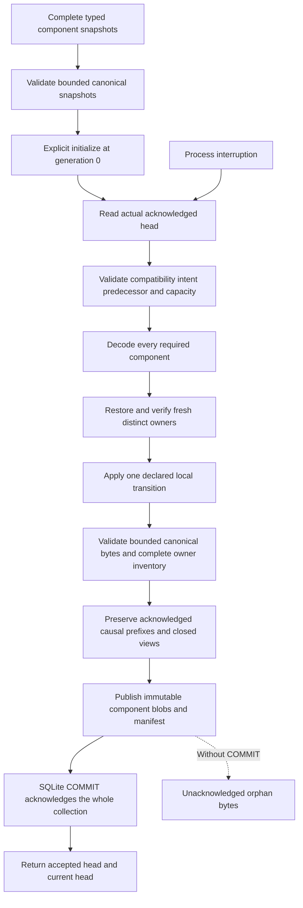

# Resume the whole decision, not just its weights

A CI experiment can stop after a decision, while labels are still pending, or
halfway through saving several independent recipes. Restoring only the latest
weights can lose the random stream, a warm predictor cache, the previous applied
plan or the fact that a label was already accepted.

COLEMAN separates **direct component state**, **replay acceptance** and an
optional **local acknowledged checkpoint**. Use the smallest boundary your
application needs. These APIs belong to the **unreleased v5 integration source**
and use the [base installation](core-installation.md); no native CI backend,
provider SDK, CLI or MCP service is required.

## Choose what you need to recover

| Boundary | Retains | What remains your responsibility |
| --- | --- | --- |
| Direct `AlgorithmState[YourPayload]` | Concrete versioned statistics, parameters, transforms, counters and owned RNG/cache/pending state | Complete, honest snapshots and the meaning of a raw update |
| `RetainedReplay` | Exact producing decisions, eligible feedback, explicit processing clocks, accepted rounds and an opt-in retired ordinal floor | Declared source identity, compatible host state and explicit processing calls |
| `LocalStateStore` | One acknowledged manifest over all required components, runtime/code/codec bindings and bounded commit receipts | Trusted local filesystem, finite codecs, complete ownership and external-effect reconciliation |

A direct learner implements the existing [state protocol](decision-contracts.md).
It need not open a database or adopt replay. Calling its raw update twice follows
that method's mathematical semantics; it does not silently become idempotent.
The optional replay layer accepts a logical feedback round once under its
declared contract. The local store protects acknowledged progress across
process interruption.

## Continue one consumer before adding a store

Install the reviewed source wheel using the
[component installation guide](core-installation.md), then copy the complete
[`ci.py` example](https://github.com/jacksonpradolima/coleman/blob/release/v5/examples/state/ci.py)
beside your own script, outside the checkout. It defines an independently owned
consumer, exact CI action/loss schemas and small source/feedback builders.
It is a recovery example, not a shipped learning algorithm.

This cycle emits A,A, accepts their two authored losses, exports the complete
continuation, and restores it into a fresh consumer before choosing again:

```python
from ci import CODEC, HostConsumer, HostState, feedback, instant, make_replay, opportunity
from coleman.replay.retained import RetainedReplay
from coleman.replay.retained_codec import read_retained_continuation

replay, host = make_replay(0)
for ordinal in range(2):
    record = replay.emit(replay.prepare(opportunity(0, ordinal)), execution="offline_identity_v1")
    replay.admit_feedback((feedback(record, decisions=ordinal + 1, available=ordinal, value=ordinal / 4),))
    replay.advance(eligible_through=instant(ordinal), apply_at=instant(ordinal))

wire = replay.export_continuation().to_json()
saved = read_retained_continuation(wire, state_type=HostState)
fresh_host = HostConsumer(0)
resumed = RetainedReplay.from_continuation(
    fresh_host, saved, state_type=HostState, state_codec=CODEC
)
third = resumed.emit(resumed.prepare(opportunity(0, 2)), execution="offline_identity_v1")
print(third.executed.action.chosen.id, resumed.state.decision_count, resumed.state.update_count)
```

The expected output is `ci-plan-b 3 2`: the third action is B and its label is
still pending. The checkpoint retained the one remaining preloaded reservoir
bit, actual RNG state, predictor/cache, counters and previous applied path.
`offline_identity_v1` simulates unchanged execution of a proposal; no CI job is
launched. Reading `wire` validates data without restoring anything; the explicit
`from_continuation` call performs the fresh-host restore.

Running `python ci.py` completes that third round too. The example's small
receipt reports three decisions, three updates, loss sum `0.75`, virtual cost
`13 s` and zero backend refills: the three initial action bits were explicitly
preloaded. A fresh seed is not substituted for those partially consumed bits.

## Name every owner before taking a checkpoint

The public synthetic CI example uses 32 independently owned consumers. Each
chooses between plan A and plan B. Its observations are authored bounded losses,
not failure probabilities or measured production outcomes.

| Input or owner | Explicit interpretation | Why recovery needs it |
| --- | --- | --- |
| `recipe-00` … `recipe-31` | Stable child references with implementation/configuration/state-codec bindings | Similar local event IDs must not suppress another child's update |
| Loss `y(i,j) = ((i+j) mod 4) / 4` | Unit `1`, bounded `[0,1]`, synthetic origin; lower is better | Zero is an observed loss, not a missing label |
| Child decisions `D_i = 2 + (i mod 3)` | Logical release counts | Counters differ legitimately across children |
| Accepted rounds `U_i = 1 + (i mod 2)` | Completed feedback, separate from decisions | Remaining labels survive checkpointing |
| Predictor and transform | Authored score `2*x + U`, definition version, bounded warm cache and counters | Restoring weights alone can change the next score or inference charge |
| Owned random stream | Full stdlib generator state plus the actual partially consumed 32-bit reservoir | Reseeding cannot reproduce the next buffered choice |
| Applied path | Previous plan and sufficient resource/switch counters | A proposed plan is not an applied action |
| Independent virtual paths | Separate prior plan, counters and bounded audit rings | One recipe's retry must not charge another recipe |

Keep each field under one authority. A replay envelope may refer to learner-owned
pending information without creating a competing copy of its mathematical
state. A complete collection includes its actual domain/applied path as well as
every required algorithm, predictor, transform and virtual-path owner.

The example's plan A costs **3 s**, plan B **5 s**, and changing the applied plan
adds **2 s**. The path A,A,B,B,A therefore costs `3+3+5+5+3 + 2+2 = 23 s`.
For any fixed path, the independent check is
`3*D + 2*count(B) + 2*count(adjacent changes)`, in seconds. These are declared
synthetic resource charges, separate from a dimensionless movement penalty or
observed infrastructure billing.

## Follow one complete save and recovery cycle

The application supplies concrete snapshots and a finite set of trusted codecs
and fresh-owner factories. A codec reference never selects a class by importing
an artifact's string.



`initialize` takes the supplied states, including already-running consumers. It
does not replace a D95/U48 collection with factory defaults. A normal transition
requires a current acknowledged head; a missing head in an initialized store is
corruption, not permission to start over.

Freeze the explicit command content and bind its complete input fingerprint in
`CommitIntent`. The store compares that declaration and its original predecessor;
it does not infer a command from a Python callback closure or its name.

Before any restore, decision, update or RNG callback, the store owns one
`BEGIN IMMEDIATE` transaction and verifies the actual current header/head,
runtime/code compatibility, command identity and expected predecessor. It
decodes **every** required component before creating fresh staging owners.
Every restored owner's exported snapshot must match. A failure at the last
child discards the staged collection, leaving the acknowledged one intact.

Only then does the application receive the fresh staged owners for one local
transition. Publication uses content-addressed immutable blobs and one complete
manifest. SQLite **COMMIT is the sole acknowledgement point**. A complete
manifest on disk before COMMIT remains an orphan; it is not a completed run.
The next transition again starts from the acknowledged collection.

Before publishing a replay successor, the store also compares its source history
with the actual acknowledged predecessor. It preserves every existing source
revision and every emitted decision view. A newly admitted history must preserve
the selected source view at the previously closed information cutoff, including
that exact instant. Restoring an individually valid snapshot cannot bypass the
same history-admission rules enforced by live replay. New feedback revisions
also obey the acknowledged producer cohort's visibility boundary, even when a
correction would leave a previously applied numeric value unchanged. Future
information remains admissible when those earlier views stay unchanged; a new
producer after the last drain can still receive feedback in its later causal
phase at the same clock instant. These checks inspect the callback's exported
successor before publication; rejection preserves the acknowledged predecessor.

The store serializes these local callbacks. It does not prevent arbitrary
out-of-band use of caller-owned objects or sandbox custom Python. Codecs,
factories and snapshot completeness are explicit trusted-host obligations.

## Make one local transition durable

With the same copied `ci.py`, this complete example saves one recipe together
with its actual domain book, accepts one synthetic loss, retries that exact
command, then reopens the acknowledged collection:

```python
import json
from pathlib import Path
from tempfile import TemporaryDirectory

from ci import collection_layout, execution_compatibility, origin_values
from coleman.core.primitives import fingerprint
from coleman.state.local import LocalStateStore
from coleman.state.storage_contracts import CommitIntent, CommitRequest

definition, bindings = collection_layout(children=(0,))
values = origin_values(bindings)
compatibility = execution_compatibility()
initialize = CommitRequest(
    schema_version=1,
    expected=None,
    intent=CommitIntent(
        schema_version=1, generation=0, kind="initialize",
        content_fingerprint=fingerprint([item.codec.encode(item.value).fingerprint for item in values]),
    ),
)

def apply_one(stage):
    action = stage.owner(bindings[0]).step(0.25)
    stage.owner(bindings[-1]).apply(action.chosen)

with TemporaryDirectory(prefix="coleman-state-") as directory:
    root = Path(directory) / "checkpoints"
    store = LocalStateStore.create(root, definition, compatibility)
    first = store.initialize(initialize, values, bindings, compatibility=compatibility)
    request = CommitRequest(
        schema_version=1,
        expected=first.current_head,
        intent=CommitIntent(
            schema_version=1, generation=1, kind="transition",
            content_fingerprint=fingerprint({"child": 0, "synthetic_loss": 0.25}),
        ),
    )
    store.commit_transition(request, bindings, apply_one, compatibility=compatibility)
    retry = store.commit_transition(request, bindings, apply_one, compatibility=compatibility)
    loaded = LocalStateStore.open(root).load(bindings, compatibility=compatibility)
    child = loaded.component(bindings[0].codec)
    domain = loaded.component(bindings[-1].codec)
    print(json.dumps({
        "D": child.state.decision_count, "U": child.state.update_count,
        "actual_seconds": domain.book.spent_seconds,
        "generation": retry.current_head.generation, "retry": retry.status,
    }, sort_keys=True))
```

Expected output:

```json
{"D": 1, "U": 1, "actual_seconds": 3, "generation": 1, "retry": "retained"}
```

The identical retry performs no second decision, update or domain charge.
`load` returns validated immutable values without activating live owners; the
next transition restores fresh owners from that acknowledged collection.
The example explicitly creates its origin snapshots before persistence. Already
running consumers instead supply their actual complete snapshots, including
pending work. The store's pre-callback checks apply to callbacks it invokes,
not arbitrary work a caller performs while constructing input arguments.

`collection_layout(children=tuple(range(32)))` declares all 32 recipes and the
shared actual-domain component through the same finite API. Each retains its
own replay/host snapshot and virtual book. The application still declares which
children receive each transition; checkpointing them does not pool their losses
or turn them into one learner.

## Read the output without pooling the children

The fixture's independent arithmetic distinguishes a pending checkpoint from a
quiescent seal:

| Quantity | Pending checkpoint | After completing the same 47 pending labels |
| --- | ---: | ---: |
| Emitted decisions D | 95 | 95 |
| Completed rounds U | 48 | 95 |
| Pending labels | 47 | 0 |
| Sum of authored losses | 16 | 35.5 |
| Completed two-release cadence intervals | 42 | 42 |

Finishing feedback changes the declared statistics/predictor state. It does not
draw another action, advance release cadence or charge another applied plan in
this example. These sums check mechanics; they are not a pooled estimator,
independent replications or evidence that a learning method improves CI.

The manifest binds all component references, exact payload fingerprints/lengths,
implementation/configuration/codec versions, actual per-child frontiers,
predecessor and runtime compatibility. `accepted_head` identifies the particular
accepted command; `current_head` identifies the actual latest acknowledged
collection. An old retained receipt can be returned after newer work without
restoring or relabeling that old state as current.

## Keep a long replay bounded without forgetting acceptance

The [original replay generation](causal-replay.md) retains a complete bounded
trace. Its records and readers remain unchanged. New sessions can explicitly
choose `RetainedReplay`, generation 2, with the `quiescent-ordinal-v1` profile.

Each source assigns a fixed epoch and a stable ordinal **before first delivery**.
The decision ID is derived from that epoch and global round; retries reuse it.
Minting a fresh ordinal for each receipt of the same business message is not
deduplication. Child/source namespaces remain separate.

A seal requires a closed drain, D==U and no unresolved producer. It retains the
first complete opportunity, lineage ancestry, actual clocks, full source-history
anchor, global counters, host binding and a named prefix commitment. It does
not reseed RNG, reset a learning/cadence counter or silently remove pending work.
Every durable seal is a separate accepted command.

The retired floor is **exclusive**: a D64 seal expires ordinals 0…63; ordinal 64 is
the next valid producer. Exact retries can return only retained tail records.
An older producer/feedback/correction rejects before host calls, without claiming
to compare discarded payload bytes. Commit receipt retention is a separate
store setting.

The first post-seal producer can receive feedback at the same clock instant in
its later processing phase. The replay compares the sealed last drain and
global D/U, not timestamps alone. A later D65 drain can then accept that round
with delay 0. This does not permit backfilled source-history facts that were
already available at or before the sealed information floor.

The prefix commitment uses its own chained-record profile, distinct from v1's
complete-trace digest and independent of where seals are placed. A fingerprint
is consistency evidence, not authentication of discarded history.

The long-run witness uses **one** bounded host for 4,352 direct replay decisions,
with explicit small compactions and complete round-trip/fresh restores at
decisions 2,048 and 4,096. Those in-memory compactions publish no durable
acknowledgement. A separate local-store handoff initializes the actual advanced
D4352/U4352 snapshot, continues two real rounds and acknowledges an explicit
seal. The 32-child/fault/concurrency qualifications remain separate. This does
not sum 32 short traces or keep an ever-growing action list inside the host. The
source `ObservationHistory` remains complete and bounded at 4,096 revisions. This
profile compacts replay tails, not arbitrary source histories. Unresolved work
that fills the tail refuses explicitly; no arbitrary-delay progress is promised.

## Handle retries, interruptions and incompatible state

| Situation | Recovery behavior |
| --- | --- |
| Same retained command and original predecessor | Return its accepted receipt and the current head; no new callback |
| Same command key with changed content | Reject the conflict |
| Competing writer with an obsolete predecessor | Reject before owner/restore/update/RNG calls |
| Crash during child or manifest publication, before COMMIT | Keep the previous complete acknowledged collection; new bytes are orphans |
| COMMIT succeeds but the response is lost | New collection remains accepted; reconcile the actual head/receipt |
| COMMIT or response raises ambiguously | Discard the attempt; do not assume rollback or automatically rerun its callback |
| Missing/corrupt/future/incompatible current component | Refuse recovery; do not silently choose an older generation |
| Receipt or event older than its retained fence | Report expired/rejected rather than reapplying it |

A pre-COMMIT crash may repeat physical local computation from the old snapshot.
This is different from accepting the same logical update twice. External test
jobs, trades or remote writes require their own effect receipts and
reconciliation. This offline profile supplies no exactly-once external effect.

## Declare compatibility and migration explicitly

Pure readers require concrete payload types and exact expected state bindings.
They read bounded UTF-8 JSON, not paths, Python import names or native pickle.
Capture selected runtime/dependency and copied-owner code bindings explicitly
at the outer boundary; direct state round trips do not scan the environment.
Matching field names, a digest or a package version alone proves neither
semantic compatibility nor binary/ABI equivalence.

A known migration preserves child/owner/source identities, all acceptance
fences, statistics, RNG buffers, caches, pending data and domain/virtual books.
It publishes a new complete acknowledged collection with a migration receipt.
Supply the actual target runtime, every target owner definition and the known
mapping's code binding explicitly. That environment may differ from the
historical source environment: finite known codecs read the old data without
restoring or executing the incompatible old implementation. A retained
operational migration receipt still requires compatibility with the actual
current acknowledged collection.
Direct host codecs may map their typed pending data. Replay host-codec migration
is restricted to a quiescent generation 2 seal with an empty tail; it uses at
most 64 linked rebind receipts and preserves historical last-drain bytes.

A later real closed drain and seal may reset that bounded rebind chain without
resetting D/U or the retired floor. Recompacting an identical empty tail cannot
bypass the 64-link limit. `RetainedReplay` refuses forks throughout this profile;
the original complete v1 matched-fork route remains separate. There is no automatic conversion of a
freeform v1 trace, a native pickle or an existing workflow workspace.

## Use the local storage profile within its limits

| Bound | Default/profile ceiling |
| --- | --- |
| Children / components | At most 32 / 128 |
| Declared implementation/mapping code identities | At most 256, separate from the component count |
| Component / full collection / manifest | 16 MiB / 64 MiB / 2 MiB |
| Component JSON lexical depth | At most 64 nested containers, including the complete envelope |
| Retained commit receipts | 8 by default, at most 64 |
| Root / entries | 1 GiB / 4,096 by default; at most 8 GiB / 16,384 |
| Orphan bytes / entries | 128 MiB / 512 by default |
| Ownership acquisition | 5 s by default; finite monotonic deadline |
| Full retained replay continuation | 16 MiB, including source anchor and host state |

A model can pass field validation while exceeding the encoded byte or depth
limit, or use a serializer its reader cannot reverse. `ComponentCodec.encode`
checks the complete canonical envelope through its actual decoder and requires
the same declared field values and types before publication. This also preserves
signed zero and Decimal precision. Validators and serializers must be pure and
deterministic; the host still owns snapshot completeness. An invalid initial
snapshot receives no acknowledgement; an invalid successor leaves the previous
acknowledged head intact.

Passing `encode` establishes in-process admission; it cannot certify an
arbitrary host serializer across future processes. In particular, Pydantic
[serializes sets as JSON arrays](https://docs.pydantic.dev/latest/api/standard_library_types/#sets),
and Python's [hash randomization](https://docs.python.org/3.14/using/cmdline.html#envvar-PYTHONHASHSEED)
can change default `set`/`frozenset` iteration order. For custom unordered fields,
use an explicitly normalized tuple or a reversible serializer with a declared
stable ordering. For homogeneous string identifiers, a `field_serializer` that
emits `sorted(value)` can retain the typed frozenset on reading. Qualify the
selected codec in fresh processes with different hash seeds; retain the order
of ordinary sequence fields. Changing an already used wire ordering requires
a new codec version and an explicit migration.

Limits are validated together. A larger receipt window needs a correspondingly
larger root quota. Capacity counts DB/WAL/SHM, recognized orphan blobs and owned
temporary files. Before callbacks, the store reserves candidate/temp headroom
or refuses until safe cleanup. Cleanup takes the same ownership boundary,
preserves all current/retained references and never advances child acceptance
floors. The store reserves digest-named JSON files and temporary names consisting
of `tmp`, eight lowercase letters/digits/underscores, and `.tmp`. Other files,
such as `notes.tmp`, remain foreign and are left alone. Use a separate location
for application files; a name in the reserved namespace belongs to the store.
Quotas are not disk preallocation or
assurance that a write cannot fail.

The local profile pins and reads back
[WAL](https://www.sqlite.org/wal.html)/FULL. Its single-writer transaction
follows [SQLite's transaction semantics](https://www.sqlite.org/lang_transaction.html)
and [synchronous settings](https://www.sqlite.org/pragma.html#pragma_synchronous).
It records the actually linked SQLite version and requires a WAL-reset fix:
3.51.3 or later, or the documented 3.50.7+ / 3.44.6+ backports within those
release lines. A Python version alone does not identify its linked SQLite.
Atomicity still depends on the
[filesystem/hardware assumptions documented by SQLite](https://www.sqlite.org/atomiccommit.html).
Process-death tests do not certify power-loss, network-filesystem or distributed
safety. An acquisition timeout bounds waiting for ownership, not arbitrary
trusted Python callback CPU time.

The acknowledgement database and its artifacts form the local trust anchor.
Rolling back that **entire** store cannot be detected without an independently
retained external minimum. State this boundary when archiving or copying runs.

For direct RNG ownership, Python documents
[independent `Random` instances and getstate/setstate](https://docs.python.org/3.14/library/random.html#random.getstate).
COLEMAN retains the actual state and buffered bits in the qualified interpreter;
neither a seed nor this codec promises every sampling algorithm is portable
across arbitrary Python versions. Owned streams do not establish independent
scientific observations.

Continue with the [state API](api/state.md),
[delayed-feedback timeline](causal-replay.md),
[point-in-time inputs](point-in-time-observations.md) and
[compatibility policy](v5-compatibility.md).
