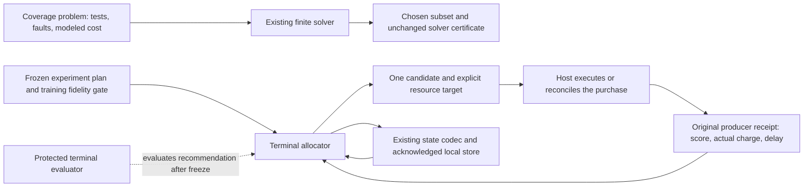

# Choose a subset, or buy one observation

Use a subset when the decision is *which tests to execute together*. Use an
acquisition when the decision is *which experiment to observe next, and at what
resource target*. Neither decision is a permutation of every candidate.

COLEMAN supplies two small, independent interfaces: the existing finite coverage
solver now produces an actual `SubsetAction`, and a terminal allocator produces
an actual `AcquisitionAction` for equal allocation or deterministic successive
halving. Both are usable as Python components without a runner, CLI or MCP.



## Selecting tests under a coverage budget

Import `select_coverage_subset` from `coleman.selection.subsets` and pass an
existing `CoverageProblem`. The result retains its full `CoverageResult` and an
`action`. `action.selected` is the actual unordered chosen set. It is an empty
set when selecting nothing is feasible; infeasible or refused computations
produce an `AbstainAction`, retaining the original solver status and reason.

The solver's objective is still weighted **union** coverage, counting an
outcome once when several selected tests cover it. Candidate costs are still
additive modeled quantities. Shared setup interactions do not become additive
because the action is a subset. Exact-search certificates, restricted scope,
interruption and computational limits retain their existing meanings; see the
[finite coverage guide](finite-coverage.md).

The action boundary supports at most 4096 explicitly declared members. Larger
solver inputs are refused by this adapter. A caller can declare and fingerprint
an intentional restricted problem; COLEMAN never silently truncates the pool or
calls the resulting restricted optimum a full-universe optimum. This adapter
manufactures neither subset rewards nor joint/inclusion propensities.

## A complete terminal-allocation cycle

This standalone base-package example compares two CI recipes on one purchased
terminal build each. Its source is a small constructed validation pool. The
executor reads only the chosen recipe; the allocator receives the resulting
receipt, not the source table.

```python
from decimal import Decimal

from coleman.acquisition.contracts import (
    AcquisitionReceipt, AllocationPlan, Candidate, Fidelity,
)
from coleman.acquisition.session import TerminalAllocator
from coleman.core.identity import Reference
from coleman.core.numeric import Scalar, ScalarSpec
from coleman.core.primitives import fingerprint
from coleman.core.quantities import Quantity
from coleman.core.units import UnitSemantics

resource = UnitSemantics(unit="build_replays", meaning="constructed-build-replay-v1")
objective = ScalarSpec(
    dimension=Reference(id="missed-fault-fraction", version="1"),
    semantics=UnitSemantics(unit="1", meaning="missed-faults-at-two-tests-v1"),
    role="objective", minimum=0, maximum=1,
)
# Host-owned constructed data, frozen before allocation. It is not in learner state.
pool = {"recipe-A": 0.0, "recipe-B": 0.5}
plan = AllocationPlan(
    schema_version=1,
    reference=Reference(id="two-ci-recipes", version="1"),
    source_fingerprint=fingerprint(pool),
    candidates=tuple(Candidate(reference=Reference(id=key, version="1")) for key in pool),
    fidelities=(Fidelity(
        reference=Reference(id="terminal-build", version="1"),
        resource=Quantity(value=Decimal(1), semantics=resource),
    ),),
    method="equal_allocation_v1", billing="stateless_rerun",
    budget=Quantity(value=Decimal(2), semantics=resource),
    outcome=objective, direction="minimize",
)
allocator = TerminalAllocator(plan)
while (purchase := allocator.inspect().next_purchase) is not None:
    observed = pool[purchase.action.chosen.id]  # Only the purchased member is read.
    receipt = AcquisitionReceipt(
        schema_version=1, purchase=purchase,
        producer=Reference(id="constructed-ci-executor", version="1"),
        outcome=Scalar(spec=objective, value=observed, status="observed"),
        charge=Quantity(value=Decimal(1), semantics=resource), delay_steps=0,
    )
    allocator.accept(receipt)
report = allocator.inspect()
assert report.status == "completed" and report.winner is not None
print(report.winner.id, report.known_charge.value)
```

Output: `recipe-A 2`. This recommendation minimizes purchased terminal scores;
it is not a cumulative-reward, optimal-information-value or full-pool superiority
certificate. With elimination, the terminal recommendation concerns surviving
candidates only. An eliminated candidate's terminal outcome remains unobserved.

## What the larger CI example actually observes

[The executable CI pool](https://github.com/jacksonpradolima/coleman/blob/release/v5/examples/acquisition/ci_pool.py)
uses four recipes and four constructed builds. Each recipe runs two tests per
build. The objective is the fraction of builds whose known fault those tests
miss. The resource unit is one replay of one recipe on one build.

| Recipe | Selected tests per build | One-build proxy | Two-build proxy | Four-build terminal |
| --- | --- | --- | --- | --- |
| A | t1, t2 | 0 | 0 | 0 |
| B | t1, t3 | 0 | 0.5 | 0.25 |
| C | t2, t3 | 1 | 0.5 | 0.75 |
| D | t3, t4 | 1 | 1 | 1 |

This table explains the complete constructed source to the reader. In an actual
run, the planner sees only purchased entries. Successive halving buys A/B/C/D
at target 1, keeps A/B, buys those at target 2, keeps A and buys A at terminal 4.
Ties use stable candidate IDs. C/D targets 2/4 and B target 4 are never read by that
learner. A separate protected evaluator may inspect terminal truth **after**
configuration and recommendation are frozen.

The schedule is declared rather than inferred from a cost budget: every
nonterminal stage retains `ceil(active/2)`, and the last stage identifies the
best purchased terminal survivor. Fidelities must be strictly increasing
positive cumulative targets. This finite schedule is inspired by
[Jamieson and Talwalkar's successive-halving formulation (AISTATS 2016)](https://proceedings.mlr.press/v51/jamieson16.html),
which distinguishes terminal identification from cumulative reward. COLEMAN's
fixed finite schedules, setup interactions, empirical fidelity gate and stopping
rules do not inherit that paper's convergence or budget guarantees.

| Method and billing profile | Actual replay charge | Maximum admitted budget | Unused budget |
| --- | --- | --- | --- |
| Equal allocation, all terminal targets | 16 | 16 | 0 |
| Halving, incremental continuation | 8 | 16 | 8 |
| Halving, stateless full reruns | 12 | 16 | 4 |

Incremental work is `4×1 + 2×(2−1) + 1×(4−2) = 8`. Stateless work is
`4×1 + 2×2 + 1×4 = 12`. Equal allocation buys `4×4 = 16`. These are matched
**budget ceilings**, not matched actual spending. The example meters actual
build reads, rather than copying a quote into the actual-cost field. It makes no
adaptive-win claim. Run it with `python examples/acquisition/ci_pool.py`.

## Qualify a proxy before eliminating

An early score is not a terminal label. A multi-fidelity halving plan requires a
`FidelityQualification` with explicit distinct development/evaluation logical partition IDs
and source fingerprints, an original producer for each development case, every
early target, terminal scores and an admitted maximum absolute training error.
All training pairs must be observed and share the plan's objective. Failing the
training gate rejects the plan; the host can freeze a separate terminal-only
equal-allocation plan as its conservative fallback.

Passing this empirical gate does **not** bound held-out error. The tiny example's
training cases demonstrate contract use, not adequate empirical validation for
adoption. A prefix ranking can reverse on a new evaluation path, eliminating the
true terminal winner. That is a valid negative result, not permission to consult
unbought terminal truth or retune the schedule after seeing it. Freeze method,
resource schedule, qualification, source scope and any projections using the
[protected evaluation workflow](protected-evaluation.md). Source fingerprints
are identities, not authentication or proof that an external provider respected
partition boundaries.

No external benchmark adapter is selected here. The complete public constructed
CI pool is admitted for both methods without a hidden projection. Larger source
pools must be explicitly admitted in full or use a predeclared hashed,
training-only projection shared by the compared methods. In particular, a
stateless HPO provider must pay for complete reruns; its prefix cannot be treated
as a resumed optimizer without owning and restoring that optimizer's full state.
Hyperband and bandits with knapsacks remain separate formulations.

## Actual charges, missingness and stopping

`Purchase.quoted_charge` reserves the next declared increment or full rerun plus
any first shared setup. No request is released when its quote exceeds the
remaining observed budget. `SetupCharge` explicitly models a once-per-run shared
group: four terminal requests of 4 units with one shared setup of 3 quote
`7, 4, 4, 4`, totaling 19. Arbitrary overlapping joint cost functions are outside
this profile.

`AcquisitionReceipt.charge` records actual nonnegative resource use in exactly
the budget's units/meaning. It is never inferred from the objective score.
Budgets and single actual receipts are bounded at 10^12 declared units; the full
ledger has at most 640 purchases from at most 64 candidates and 10 fidelities.
New resource fields canonicalize Decimal quantum while preserving exact numeric
value and units, making complete state codecs reversible. No old quantity,
coverage artifact or result meaning changes.

| Receipt or boundary | Retained evidence and outcome |
| --- | --- |
| Observed zero score or actual zero charge | Valid observed zero; continue if the schedule permits |
| Permitted negative objective | Valid observed score; minimize/maximize as declared |
| Null score with unknown/unavailable/not_applicable status | Retain its distinct status and any actual charge; stop `outcome_missing` |
| Null actual charge | Retain unknown amount; stop `cost_unknown`; known subtotal excludes it |
| Actual charge exceeds the quote or total budget | Retain the real observed charge; stop `cost_overrun` |
| Quote exceeds remaining observed budget | Start no purchase; stop `budget_exhausted` |
| Terminal stage finishes | Stop `completed`, with one stable-ID tie-broken survivor recommendation |

The external executor can exceed a quote; the planner cannot physically enforce
an unknown producer charge. Unknown or overrun receipts stop further work
without inventing a completed experiment. `delay_steps` retains producer-reported
application-step delay; this sequential reference waits for each receipt. It
provides neither parallel in-flight scheduling nor wall-clock deadline claims.

## Resume and acknowledge without duplicating accepted charges

`AllocationState` contains the exact plan and complete ordered receipt ledger.
The plan reference is the logical run identity: identical complete plans produce
identical purchase IDs and represent retries/continuations of that run. Give each
intentional independent repetition a distinct `plan.reference` and independent
store, even when its candidate pool and hyperparameters match. This prevents
producer deduplication from accidentally joining independent repetitions.

The next request, accepted shared groups, completed increments and every
elimination are derived deterministically from that ledger. There is no RNG or
hidden executor cache. The CI executor obtains a previous prefix aggregate from
the original accepted receipt and reads only newly purchased builds when using
incremental billing.

`AllocationState.from_json(state.to_json())` verifies every transition before
continuation. An identical delivered receipt returns the same state and adds no
charge. Conflicting duplicates, substituted requests, data after stopping,
nonfinite values and incompatible units fail. Schema 1 requires explicit version 1;
unknown/future versions fail. It does not infer a migration from old runner or
coverage checkpoints. Existing artifact readers continue to work unchanged.

JSON bytes alone are not an acknowledgement. The
[checkpoint binding example](https://github.com/jacksonpradolima/coleman/blob/release/v5/examples/acquisition/checkpoint.py)
uses the existing `ComponentCodec`, `LocalStateStore` and `TerminalAllocator`
state owner. Initialize the complete ledger, read its acknowledged pending
purchase, execute or reconcile outside the store callback, then commit that
exact receipt against the accepted predecessor. Reopening reconstructs the same
request or elimination. Concurrent writers and identical command retries use
the store's existing accepted-head and retained-receipt semantics. An interrupted
blob write leaves the previous accepted head; an orphan file never certifies
completion. See [state recovery](state-recovery.md) for the complete host lifecycle.

Delivery deduplication concerns **accepted ledger charges**. It cannot make a
remote CI run exactly once. Persist a pending request before execution and use
its logical purchase ID to reconcile an uncertain external effect with its
producer. The checkpoint example has publication-only frontiers: it does not
invent replay causal protection for arbitrary direct-owner state or authenticate
physical resource meters.
