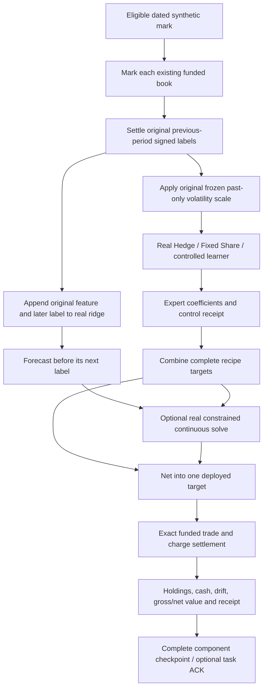
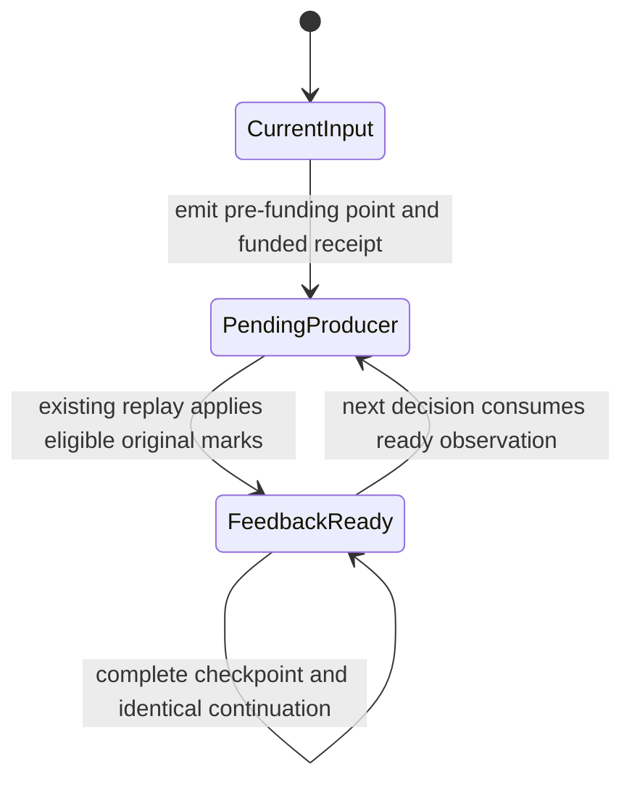
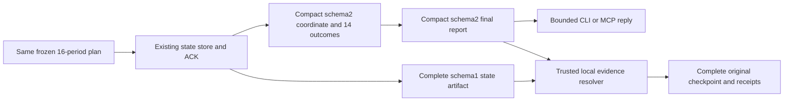

# Build an auditable synthetic portfolio experiment

COLEMAN can connect online recipe learning to a separately funded allocation
book. This example shows the whole connection: dated inputs, original forecasts,
past-only loss scales, expert coefficients, constrained asset targets, actual
modeled holdings and paid charges. It uses authored synthetic prices, without
accounts, credentials, market downloads or live execution.

The reusable accounting lives in `coleman.problems.portfolio`. The optional
reference application in `examples/synthetic_portfolio` calls the existing Hedge,
Fixed Share, controlled-mixture, append-only ridge and continuous solver APIs.
It adds domain interpretation and accounting rather than another learner,
scheduler or optimization engine. Native CI/TCPCI workflows remain independent.

## Start with concrete inputs

Each price is a positive exact rational in **synthetic credits per asset unit**.
Asset units are divisible; cash and charges are exact synthetic credits. UTC
event and availability clocks are explicit. Prices are exogenous: a candidate's
action does not change another candidate's observations.

| Period | UTC date | Asset A | Asset B | Use |
| --- | --- | ---: | ---: | --- |
| 0 | 2026-01-01 | 100 | 100 | Initial funded decisions |
| 1 | 2026-01-02 | 102 | 99 | Development; labels from period 0 become available |
| 2 | 2026-01-03 | 101 | 103 | Development; past scale becomes estimable |
| 3 | 2026-01-04 | 105 | 101 | Development |
| 4 | 2026-01-05 | 108 | 100 | Development |
| 5 | 2026-01-06 | 110 | 98 | Development selection closes |
| 6 | 2026-01-07 | 111 | 97 | Protected descriptive suffix starts |
| 7 | 2026-01-08 | 106 | 102 | Authored reversal |
| 8 | 2026-01-09 | 101 | 107 | Reversal continues |
| 9 | 2026-01-10 | 97 | 110 | Protected descriptive suffix |
| 10 | 2026-01-11 | 98 | 109 | Protected descriptive suffix |
| 11 | 2026-01-12 | 102 | 105 | Protected descriptive suffix |
| 12 | 2026-01-13 | 100 | 108 | Protected descriptive suffix |
| 13 | 2026-01-14 | 104 | 103 | Protected descriptive suffix |
| 14 | 2026-01-15 | 103 | 106 | Protected descriptive suffix |
| 15 | 2026-01-16 | 105 | 104 | Protected descriptive suffix |

The complete 16-row table is `model.PRICE_ROWS`. A row's source fingerprint binds
that row, its units and index, without including future rows in the decision
input. Changing a future row cannot change an earlier decision. Source hashes
establish content integrity; they do not authenticate an external market feed.

Three virtual recipes suggest complete two-asset targets: 80/20, 20/80 and a
75/25 versus 25/75 rule driven by the **already observed** prior return spread.
Their original targets sum to one. The example's explicit target adapter applies
a factor of 49/50, leaving a 2% cash reserve for recurring charges during holds.
That reserve is part of the declared portfolio mapping, not a learner projection
or a financial risk guarantee.

Every candidate and virtual recipe starts with its **own 100-credit cash book**
and zero holdings. The proportional fee is 0.001 credits per absolute credit of
netted executed trade. The recurring fee is zero at initialization, then 0.001
credits per period. No fees are inferred from a missing field.

## Follow one decision cycle



At each cutoff, the previous period's actual label becomes available first. The
ridge receives the exact feature vector retained when that label was forecast;
it never trains on the current period's future outcome. It uses a penalized
constant feature and the observed lagged A-minus-B return spread, with fixed
regularization one and no hidden preprocessing or recursive estimator substitute.

Recipe feedback is a **signed net wealth return**: the later marked virtual-book
wealth divided by its original pre-execution wealth, minus one. It includes that
recipe's own earlier modeled charges. Its range is not declared to be [0, 1].
Before producing each decision, the example freezes a two-observation, per-recipe
sample standard deviation using only available previous returns. The shipped
signed-volatility transform maps the later raw outcome to a separate bounded
surrogate, `clip((1 - outcome / (2 * past_scale)) / 2, 0, 1)`. It records the scale,
raw value, intermediate result, clipping and original decision clocks.

Insufficient or zero scale produces an unavailable loss. It does not produce an
epsilon, an observed zero, or a fictitious complete feedback panel. Until every
recipe has a valid bounded loss, mixture coefficients stay at their declared
prior. Raw labels and ridge updates remain independently meaningful.

A separate no-skill boundary fixture makes this distinction concrete: flat
100-credit prices and an explicitly zero-fee schedule give each actual funded
recipe and the equal baseline exactly 100 credits and observed zero returns.
Two past zero returns produce an observed zero scale, followed by an unavailable
surrogate loss. No complete panel, coefficient update or movement penalty is
invented. Keeping the fixed baseline is valid. This constructed zero-fee edge
case does not change the paid schedule in the main reversal experiment.

The composed route passes the real pre-label ridge prediction and combined recipe
target to the small strictly convex quadratic solver. The objective is a declared
target-distance plus forecast tilt, with simplex and 0.1–0.9 mathematical asset
boxes. The solver's actual proposal, accepted point and certificate stay intact.
A separate documented target adapter sets the second exact asset fraction to
`1 - first`, then applies the 49/50 exposure factor. Thus the numerical solver
output and the exact funded target are visibly different records, rather than a
claim that rounding or funding happened inside the mathematical solver.

## Know which comparisons are running

| Candidate | Actual component | Coefficient controls | Funded execution |
| --- | --- | --- | --- |
| `equal` | Fixed equal asset target | Not applicable | Rebalance every period |
| `buy-and-hold` | Fixed initial equal asset units | Not applicable | Hold units; debit recurring cash only |
| `periodic-rebalance` | Causal ridge and constrained solver | Not an expert mixture | Release a target every two periods; hold units between releases |
| `hedge` | Shipped constant Hedge | Reference exponential update | Own netted book |
| `fixed-share` | Shipped excluding-origin Fixed Share | Reference share | Own netted book |
| `plain` | Controlled Hedge projection | Unrestricted explicit boxes | Own netted book |
| `anchored` | Controlled Hedge projection | Declared target share | Own netted book |
| `bounded` | Controlled Hedge projection | Expert coefficient boxes | Own netted book |
| `movement` | Controlled Hedge projection | Boxes and hard movement allowance | Own netted book |
| `cadence` | Controlled Hedge projection | Boxes, movement, two-panel cadence | Own netted book |
| `penalized` | Controlled Hedge joint L1 output | Same cadence/boxes/movement plus positive L1 strength | Own netted book |
| `anchored-bounded-interval-l1` | Controlled Hedge joint L1 output | Target share, boxes, explicit two-day intervals, daily exact movement ledger and L1 | Own netted book |
| `constrained-fixed` | Actual continuous solver, forecast zero | Not an expert mixture | Same funded target adapter |
| `composed-online` | Full controlled mixture + real ridge + continuous solver | Full interval/L1 combination | Same independently funded accounting |

All methods see the same eligible exogenous prefix and declared calendar. Their
holdings, value paths and fees belong to them individually. The periodic baseline
updates the ridge on each eligible label and releases holdings every two periods;
it is not described as an independently refitted statistical study.

The controlled operation order is exponential update, declared-target share,
then the joint constrained output. L1 solves
`0.5 * ||p - proposal||² + lambda * ||p - previous_emission||_1` under the original
coefficient boxes and movement allowances. Under cadence it applies once per
released block, never once per held panel. The checkpoint retains the actual
emitted origin, selected law, pending panels, release clocks and exact period
movement usage. Each released receipt also exposes the exact objective evaluated
at the emitted point: half-squared proposal distance, coefficient full-L1,
`lambda * L1`, and their total. Objective terms have squared coefficient-fraction
units; paid charges stay in synthetic credits. Held/empty panels have no objective
attempt, and failed attempts have unavailable objective terms. A projection has
a not-applicable penalty; an L1 profile with lambda zero has a real zero term.

**Lambda is not a paid fee.** Expert coefficient movement is not executed-book
turnover. Constant coefficients can still cause trades because prices drift and
recipes change their own targets. A numerical coefficient bound establishes no
consumer-level limit on holdings, trades, forecast error or financial risk.

## Fund the book before interpreting its performance

Let `V` be the current cash plus held units marked at current prices; `h_i` the
held marked asset amounts; `w_i` the proposed post-charge asset fractions; `c` the
proportional rate; and `F` the recurring fee. The exact funded target solves

```text
W + c * sum(abs(w_i * W - h_i)) + F = V
```

The left side is strictly increasing for `0 <= c < 1` and nonnegative weights
whose sum is at most one. The implementation enumerates the finite rational
breakpoints `h_i / w_i`, solves each linear segment and checks exact conservation.
It does not approximate funding by clipping, renormalizing or silently borrowing.
Cash after settlement is `W * (1 - sum(w_i))`. A hold retains units and must fund
the recurring fee from existing cash; otherwise it explicitly refuses execution.

A two-asset hand calculation uses different, explicitly declared fees from the
larger experiment, making it independently checkable:

| Step | Exact result in synthetic units |
| --- | --- |
| Start cash 100; A=10, B=20; target halves; rate 1/100; recurring 0 | Net value `10000/101`; fee `100/101`; units A=`500/101`, B=`250/101`; cash zero |
| Later A=12, B=18; mark before any rebalance | Gross value `10500/101`; drifted asset weights `4/7`, `3/7` |
| Hold those units with recurring 0 | Zero trades and proportional fee; net `10500/101` |
| Rebalance to the same halves | Full absolute traded notional `1500/101`; fee `15/101`; net `10485/101`; units A=`3495/808`, B=`1165/404`; cash zero |

The final rebalance changes A by `-5/8` asset units and B by `165/404` units.
Negative trades are valid sells; negative cash and short holdings are unsupported.
Opposing recipe targets combine into one net asset target **before** this ledger
computes trades. Virtual recipes' counterfactual charges remain modeled feedback;
they are never charged again to the deployed candidate.

For example, two equally weighted recipes can swap targets `(1, 0)` and `(0, 1)`
while their combined target stays `(1/2, 1/2)`. At unchanged prices, an already
funded equal deployed book trades zero and pays zero proportional charges.
With a separate 1/100 fee and 100-credit opening books, each switching virtual
recipe trades full absolute notional `20000/101` and pays `200/101`. Those
modeled recipe charges belong to their own paths, not to the unchanged deployed
book. This arithmetic is checked independently of the target-combination helper.

## Run it through the library

From a checkout with the `ci` extra installed:

```python
from pathlib import Path
from examples.synthetic_portfolio.experiment import Experiment, ExperimentState
from examples.synthetic_portfolio.reporting import publish

experiment = Experiment(strength=0.05)  # predeclared demonstration value
for period in range(8):
    experiment.step(period)

checkpoint = ExperimentState.from_json(experiment.export_state().to_json())
resumed = Experiment(strength=0.05)
resumed.restore_state(checkpoint)
for period in range(8, 16):
    resumed.step(period)

manifest = publish(resumed.export_state(), Path("synthetic-results"))
print(manifest)
```

The checkpoint restores the entire predictor, pending original features/scales,
reference and controlled learner states, virtual and deployed paths, receipt
deduplication and chronological frontier. Repeating `step(7)` returns the exact
retained period without a new label, control update, charge or publication. It
does not submit a physical trade or claim exactly-once external effects.

The versioned reader also checks the declared strength against each named
controller's complete configuration, configuration digest and logical owner.
Reference learners and the predictor must match this fixed example profile.
Supported strengths range from zero through 100 coefficient units; changing a
law requires a fresh run. These consistency checks do not authenticate a source
or authorize continuation under a different implementation.

Each live experiment accepts sequential calls. Independent staged owners may
restore the same complete checkpoint in different thread contexts. The adapter
validates through each fresh component's public concrete snapshot schema before
its existing strict restore; it shares no live learner and drops no state.

The same domain also accepts an explicit current `PricePanel` with a frozen
source digest and `rows=None`. This keeps a complete future source outside the
consumer. `apply_feedback` applies the original previous producer's later mark;
its feedback-ready phase can be checkpointed before `step` emits another action.
The direct fixed-tape convenience route uses these same operations.

## Let the existing replay own delivery and eligibility

```python
from datetime import timedelta
from coleman.replay.codec import read_continuation
from examples.synthetic_portfolio import model
from examples.synthetic_portfolio.replay import (
    PortfolioReplayHost, PortfolioReplayState,
    feedback, opportunity, start,
)

host, replay = start()  # replay owns source history; host owns no future rows
record = replay.emit(replay.prepare(opportunity(replay, 0)), execution="offline_identity_v1")
for index in range(1, 16):
    at = model.START + timedelta(days=index)
    replay.admit_feedback((feedback(record, model.PRICE_ROWS[index]),))
    replay.advance(eligible_through=at, apply_at=at)
    if index == 8:
        saved = read_continuation(
            replay.export_continuation().to_json(), state_type=PortfolioReplayState
        )
        host = PortfolioReplayHost(source_fingerprint=host.experiment.source_fingerprint)
        replay = host.resume(saved)
    record = replay.emit(
        replay.prepare(opportunity(replay, index)), execution="offline_identity_v1"
    )
assert host.experiment.rows is None
```

This bridge uses the existing source selection, closed drains, duplicate
delivery, correction audit and replay continuation. It creates no second queue,
scheduler or learner. The consumer sees only current selected marks and the
original previous action's later aggregate mark observations. Those marks are
exogenous synthetic source facts, not invented realized rewards.

The wire retains the complete typed state; no statistics or history are omitted
for speed. Within one host, only the exact owned immutable snapshot with unchanged
canonical bytes and component frontier can reuse its completed validation. Copies,
constructed models, JSON and a fresh owner take full validation. Use `host.resume`
to select that fresh owner's trusted concrete snapshot class before the existing
replay restores the same versioned fields. An artifact never selects Python code.

The replay `VectorAction` is the actual binary64 constrained **mathematical
point before funding**. It does not claim to encode exact non-dyadic holdings.
The exact funded target, cash, actual units and fees remain in the separate domain
receipt. This continuous bridge does not broaden the separately qualified finite
prequential-action evaluation contract.



The bounded reference uses a fixed daily synchronous calendar. A missing current
mark refuses a decision; future labels remain pending until eligibility. Late
corrections after an applied label remain audit evidence and never retrain the
live model. Processing a late label by backdating that calendar is unsupported.
The same mathematical/domain state is compared against the direct and optional
task routes, including a restart in the feedback-ready phase.

`trajectory.json` retains the complete exact versioned records. Parquet provides
one row per candidate and period: status, currency, exact gross/net value,
full absolute executed notional, separate proportional/recurring paid charges,
nullable coefficient movement, separate control-objective terms and settlement
digest. Exact rational columns use
text to avoid decimal rounding. A non-mixture method has null coefficient movement
(not applicable); an actual mixture hold has numeric zero.

The completion manifest is written last and contains both artifact hashes.
Completion covers 16 declared decisions and 15 eligible later labels at the last
cutoff, including the last scheduled charge; it is not liquidation or a claim
that the final future label is known. That original pending label stays in the
checkpoint. Partial trajectories and refused settlements cannot publish a
completed result.
The existing immutable writer provides cooperative concurrent same-content
publication and process-interruption atomicity; it does not claim power-loss
durability. Byte reproducibility is qualified for the pinned PyArrow writer.

## Select on development, inspect the suffix honestly

```python
from pathlib import Path
from examples.synthetic_portfolio.selection import develop, run_protected

selection = develop()  # actual six-period own-book trials: .025, .05 and .1
result = run_protected(selection, Path("synthetic-protected"))
assert result.status == "descriptive_only"
assert result.fallback == "equal"
```

The declared rule picks the full-combination candidate's greatest **development**
net value, breaking exact ties toward the smallest strength. All three original
trial states, costs, losers and selected settings are retained. The complete
candidate family and warm states are frozen before an actual protected-access
receipt is reserved and before suffix execution starts. Contrasts include penalty
versus cadence, penalty versus movement limits and every method versus equal.
Repeated inspection produces another visible protected-access receipt.

The protected-result reader checks each frozen configuration through the fixed
example's typed contract: its mode, selected strength, cash reserve and funding
adapter must describe the retained state. The declared warm-state digest is
shared consistently across the comparison family. That digest and the selection
digest remain content references; they do not authenticate execution or replace
the original development artifact and access audit.

One authored dependent tape is not a population of independent histories. Its
serial protocol deliberately does not call the independent paired inference
engine or produce confidence/alpha claims. The frozen equal-weight fallback
remains in place for adoption. Negative outcomes, cost-dominated adaptation,
ties, zero scales and insufficient evidence are useful results; no adaptive win
is required. A retrospective best final book would be a nondeployable hindsight
diagnostic, never an approved policy selected on protected outcomes.

## Use the optional shared task host

The small provider wheel maps the same example files into
`coleman_synthetic_portfolio`; its only runtime dependency is the matching COLEMAN
installation. It creates no new scheduler. Build/install ordinary noneditable
wheels from the same source revision, then declare the concrete recipe and
request outside the checkout. The command uses the optional `cli` extra with
Click; the accounting and experiment APIs do not need it. Use a fresh wheel
directory so the install selects one SDK and one provider:

```bash
COLEMAN_WHEELS=$(mktemp -d)
python -m build --wheel --outdir "$COLEMAN_WHEELS/sdk" .
python -m build --wheel --outdir "$COLEMAN_WHEELS/provider" examples/synthetic_portfolio/provider
python -m pip install 'coleman[cli]' "$COLEMAN_WHEELS"/sdk/coleman-*.whl \
  "$COLEMAN_WHEELS"/provider/coleman_synthetic_portfolio_reference-*.whl
python -I -m coleman_synthetic_portfolio.run --recipe > portfolio-recipe.json
python -I -m coleman_synthetic_portfolio.run --task-request > portfolio-request.json
```

`coleman-portfolio-example --help` exposes the same flags and the default
`synthetic-portfolio-artifacts` directory. Declaration flags create no experiment
artifacts; `--recipe` takes precedence over `--task-request` when both are set.
Direct JSON/Parquet publication additionally needs `ci` (install the same SDK
wheel with `coleman[ci,cli]`); the base library remains independent of both extras.

An operator separately approves the installed recipe/image using the existing
[task-host procedure](typed-execution.md). Pass that approval at host startup;
neither recipe JSON nor a conversation grants executable import authority. The
existing `coleman-task` and optional `coleman-task-mcp` transports consume the same
typed request. CLI/MCP do not enter the portfolio mathematical imports.

The concrete executor uses the existing `LocalStateStore`, component codecs,
compare-and-swap commits, durable ACK receipts and shared resource guards. It
accepts one complete eight-period block at a time. An interruption after the
first ACK resumes the original complete eight-period frontier, including a held
cadence block; an interruption before an ACK cannot advertise that stage as
committed. Completion requires the exact terminal current ACK. Periods are
logical work units; publication generations and stochastic observations are
different quantities. This deterministic example owns no RNG.

Callers needing both an opened store and its checked state can use
`Layout.open_with_checkpoint()`. `Layout.reconcile_with_checkpoint(store)` pairs
the real retained receipt/progress with the complete snapshot read in that same
operation. The manifest, source, execution bindings and fresh head must agree;
concurrent advancement follows the existing reload/refusal rules. These are
explicit combined reads, with no cache or caller-provided validation token.
Separate `open`, `checkpoint` and `reconcile` calls still perform fresh reads.
The installed continuation example selects these combined operations while
retaining the full sixteen periods, actual interruption, competing writers,
retained-command checks and complete direct-state comparison.

The named `portfolio-staged-batch-v2` command binds the exact expected ACK,
complete collection definition, original source and configuration. The period
count comes from the fully restored staged experiment. A stale head refuses
before observing another period. Retrying an accepted command reuses its
original receipt; reconciliation keeps older commands under their original
intent rather than rewriting their meaning.

### Receive a compact result and inspect its full evidence

The selected `synthetic-funded-portfolio@2` recipe publishes **schema2**
coordinate results and final reports. The full schema1 checkpoint stays in its
original acknowledged state artifact. A compact result contains all fourteen
terminal book summaries and exact references to that complete evidence:

| Result field | Meaning |
| --- | --- |
| `outcomes` | Each candidate's terminal net wealth, total proportional/recurring paid charges and full executed absolute notional, in synthetic credits |
| `snapshot.component` | Actual selected state-codec/owner binding, complete canonical blob SHA-256 and byte count |
| `snapshot.manifest_fingerprint` | Exact current acknowledged manifest identity; its byte count is explicit |
| `proof` | Original plan/coordinate/work bindings and the actual retained terminal receipt |
| Final report item | Complete compact coordinate result plus its exact published JSON SHA-256 and byte count |

The summary's executed notional and charges exclude coefficient movement and
mathematical penalties. All period-level coefficients, signed outcomes, control
objectives, actual trades, original observations and pending labels remain in
the full referenced checkpoint. No trajectory is shortened or declared complete
from an unacknowledged file.



The task CLI and MCP keep their existing **1 MiB** interactive request/reply
ceiling and the plan's **16 MiB aggregate job-output** ceiling. Compact
publications avoid copying the multi-megabyte checkpoint into both the coordinate
and final JSON, including the immutable writer's temporary publication names.
An oversized interactive reply still refuses; no reader truncates it. Actual
installed qualification must establish the complete compact reply's size and
library/CLI/MCP equality for this fixed plan.

From an approved local task service, resolve the complete original evidence:

```python
from coleman_synthetic_portfolio.readback import read_full_task_result

completion = service.report(job_id)  # The same compact typed completion as CLI/MCP.
checkpoints = read_full_task_result(service, job_id)
assert checkpoints[0].experiment.next_index == 16
# Every original exact settlement and pending label remains available here.
first_equal = checkpoints[0].experiment.periods[0].candidates[0].settlement
print(first_equal.net_value.fraction)
```

The resolver derives paths from the trusted service workspace and owned job/
coordinate identities. It verifies the complete coordinate bytes, hashes,
lengths, selected current state, original bindings, terminal ACK and all summaries
against the actual full checkpoint. It updates no learner and accepts no new
state command. This local artifact operation is separate from a remote file
download; neither tool JSON nor a content hash grants filesystem/import authority.

The explicit `LEGACY_COORDINATE_RESULT` and `LEGACY_FINAL_RESULT` codecs continue
to read the earlier schema1 inline artifacts. Schema1 and schema2 publication
readers reject one another's wire rather than guessing or silently converting
it. The checkpoint schema and exact accounting remain unchanged. Reading an old
artifact does **not** resume an old task under a new provider image: automatic
operational migration is unsupported. Keep the old approved installation to
continue its old lineage, or create a fresh plan under the new approved recipe.

## Respect the support boundary

| Mechanism | Qualified profile |
| --- | --- |
| Task results | Complete compact schema2 report; full schema1 state via exact ACK artifact and trusted local resolver; original interactive/output caps retained |
| Holdings, cash, net and gross | Funded divisible long-only assets, nonnegative cash, no contributions or withdrawals |
| Leverage and shorting | Unsupported; signed generic solver coordinates do not supply financing |
| Borrow, collateral, margin, funding interest | Unsupported |
| Fees | Explicit proportional netted trade rate in [0,1), separate nonnegative recurring credit charge |
| Spread, liquidity, market impact, lots and exchange execution | Unsupported |
| Missing or stale quote | Unknown/stale valuation retained; execution requires an observed mark exactly at the cutoff, otherwise refuses |
| Missing fee or recipe data | Refuse or retain the explicitly supported fixed/held fallback; never synthesize zero |
| Fee availability | The declared schedule must be available by the execution cutoff; retrospective future rates cannot authorize trading |
| Prices | Strictly positive rational synthetic-credit/unit; zero/negative instrument-price conventions require a different profile |
| Arithmetic | Reduced exact rationals, at most 4096 bits per numerator/denominator; capacity errors stay explicit |
| State | Strict schema 1, at most 16 MiB/depth 64; exact profile/tape/law required for continuation |
| Legacy artifacts | Existing TCPCI readers and meanings unchanged; no implicit conversion or checkpoint migration |
| Unknown versions | Reject; retain original bytes and select a compatible reader or explicit reviewed migration |

The complete book receipt history can reach its byte ceiling before the
128-receipt count ceiling. Local delivery then refuses the proposed change and
keeps the previous readable snapshot, fees, inventory and delivery ledger intact.
It does not discard older receipts to make another action fit.

This is a constructed domain reference, not market-data admission, a historical
backtest, a matched ex-ante risk experiment or evidence that any method profits.
In particular, the generic QP objective is not a validated financial risk model.
Historical source validation and richer financial funding models need separately
qualified adapters and evidence.

## Read the scientific boundaries

[Helmbold, Schapire, Singer and Warmuth](https://www.schapire.net/papers/HelmboldScSiWa98.pdf)
study multiplicative online portfolio selection and comparison with a constant
rebalanced portfolio. This example's bounded recipe-loss learner, controls,
costs and forecast composition have their own semantics; that paper's wealth
guarantees are not transferred to this adapter.

[Boyd and colleagues](https://web.stanford.edu/~boyd/papers/cvx_portfolio.html)
separate forecasts, optimization, transaction costs and holding costs in a
multi-period trading framework. That separation motivates the visible boundaries
here; the small distance QP does not implement their full risk/funding model.

[Freund and Schapire](https://www.schapire.net/papers/FreundSc95.pdf) analyze
bounded full-information mixture losses. The signed wealth return, its clipped
surrogate, expert coefficients and actual funded wealth remain distinct. Read
[expert mixtures](expert-mixtures.md), [continuous allocation](continuous-decisions.md)
and the [portfolio API](api/synthetic-portfolio.md) for the implemented contracts.
