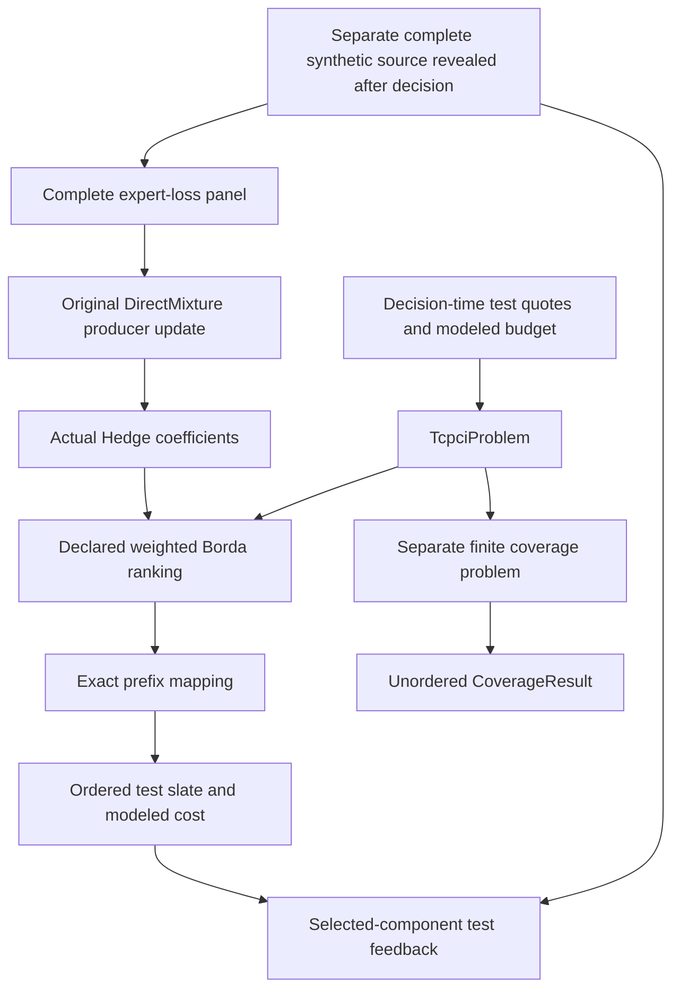

# Model a CI prioritization decision

Describe the tests and the available budget, obtain a complete ranking, then map
it to an affordable ordered prefix. The mapping is usable without a runner,
workspace, native agent, CLI, MCP server or installed provider registration.
You can compose it with a learner or a finite solver when their contracts fit.

The [complete runnable example](https://github.com/jacksonpradolima/coleman/tree/release/v5/examples/tcpci)
uses actual Hedge and finite coverage. It carries the planning input, original
proposals, mapped actions and permitted feedback through three decisions.
Everything in that example is authored synthetic data; it executes no test
command and makes no claim that adaptation improves CI performance.

This work extends the CI prioritization lineage of the
[original TCPCI study (IEEE Transactions on Software Engineering)](https://doi.org/10.1109/TSE.2020.2992428).
The example below is a contract demonstration, not a reproduction of that
study's experimental results.

## Start with an explicit input table

| Stable test ID | Display label | Estimated serial work | Quote source | Quote availability |
| --- | --- | --- | --- | --- |
| A, version 1 | unit | 2 s | authored planning table and its digest | unknown |
| B, version 1 | integration | 2 s | authored planning table and its digest | unknown |
| C, version 1 | smoke | 1 s | authored planning table and its digest | unknown |

The modeled budget is **3 s**. These quantities mean estimated serial work;
they are neither measured wall time nor money. Display labels do not establish
identity and need not be unique. The complete versioned input includes:

- `TestCase`: exact identity, label, nullable duration quote/status and supplied
  quote provenance/availability;
- `BudgetPrefix`: the complete versioned rule and its units, meaning and horizon;
- `TcpciProblem`: the semantic ranking request, full test table, budget and rule;
- `TcpciMapping`: the full original problem, executed slate, estimated cost and
  remaining budget, all checked again when read.

Use `ranking_request(problem)` to obtain the core `DecisionRequest`, then pass
the complete ranking proposal to `map_ranking(problem, proposal)`. A solver or
learner may produce that ranking; no particular algorithm is required.

Unknown availability remains unknown. This example deliberately uses an
**untimed** opportunity. A timed opportunity requires known quote availability
at or before its information cutoff. Missing duration quotes can be retained as
input, but this mapping profile refuses to guess them when selecting a prefix.

## A prefix is different from a subset

The rule `exact-decimal-estimated-serial-prefix-stop-v1` adds exact decimal
quantities at a scale of 10⁻¹² seconds. It includes a test when its cumulative
quoted work is within budget, and stops at the **first** unaffordable test.
It does not skip that test to fit a later one.

For ranking **A → B → C**, A consumes 2 s. B would bring the total to 4 s, so the
result is **[A]**, with 2 s estimated cost and 1 s remaining. C is not inserted,
even though its quote would fit that remainder. A zero budget and an empty
prefix are valid; observed zero-duration tests remain distinguishable from
unknown duration.

The coverage solver answers a separate question. With A covering capabilities
{x, y}, B covering {y, z}, C covering {z}, and weights {x: 0.5, y: 0.3, z: 0.2},
the actual bounded solver selects the **unordered set {A, C}**, costing 3 s and
covering weight 1. The example retains its `CoverageResult` independently. It
does not turn that set into a fabricated ranking-prefix result.

The pure exact-decimal rule also differs from the retained native reader's
binary32-projected duration semantics. Native output meanings and compatibility
routes are described in [compatibility and migration](v5-compatibility.md).
A different boundary result is not silently normalized into the old profile.

## Keep proposals, execution and feedback connected



An original deterministic ranking can carry probability one. After the action
changes from a ranking to a slate, this profile records sampling as
**invalidated/unavailable**. It does not invent the induced slate probability.
Do not use that unavailable probability as importance-weighting evidence.

The selected-test `FeedbackBatch` binds the complete
`mapping.executed.fingerprint`, and includes only actually selected members.
An empty slate produces explicit `AbsentFeedback`, not zero-filled test rows.
The example checks the declared feedback horizon separately.

**Retain the full mapping and its fingerprint as well.** The core executed
record does not include every quote, objective definition or accounting field
in `TcpciProblem`. Different planning contexts can therefore have the same core
executed fingerprint but different complete mappings and costs. A feedback
fingerprint alone is not proof of the quote/source/cost association. The full
example report retains both original context and all typed records.

## Compose the real learner without changing its meaning

Two fixed experts supply rankings:

| Expert | Complete order |
| --- | --- |
| fast-first | C → A → B |
| risk-first | B → A → C |

Actual `Hedge` starts with coefficients (0.5, 0.5), rate log(2) and a declared
[0, 1] loss. `DirectMixture` retains each original coefficient producer. A named
weighted Borda recipe computes ranking scores from those coefficients, treating
stored binary64 weights as exact fractions for score comparisons and breaking
ties by test ID. Scores, coefficients and rankings are distinct quantities;
none is a calibrated test-failure probability.

Only after a decision does the example reveal a complete authored verdict panel.
The expert loss is **missed synthetic failures divided by the three-test
catalogue size**. This is a declared bounded surrogate, not native NAPFD/APFDc.
A source panel without failures has genuine zero loss. The original full expert
panel updates the original coefficient producer; selected test verdicts do not
replace it.

This complete source exists because the example is constructed. A real CI run
that observes only selected tests cannot silently supply the unobserved expert
losses. It needs a justified complete feedback route, a compatible different
learner or an explicit unsupported/fallback disposition.

| Opportunity | Resulting ranking | Selected prefix | Modeled cost | Actual Hedge updates |
| --- | --- | --- | --- | --- |
| 0 | A → B → C | [A] | 2 s | 1 |
| 1 | A → B → C | [A] | 2 s | 2 |
| 2 | C → A → B | [C, A] | 3 s | 3 |

All selected verdicts and full source outcomes remain synthetic. Physical
elapsed time is reported as `null`, not an invented zero. Three authored panels
are not three independent research observations, and these changing rankings
are not evidence that Hedge beats a baseline.

## Run the complete example outside the checkout

Install your reviewed wheel into a separate environment. Base dependencies are
sufficient; CI, analytics and MCP extras are unnecessary for this composition.
Use the actual wheel path rather than installing an unrelated package by name.

```sh
python -m venv /tmp/coleman-tcpci-env
uv pip install --python /tmp/coleman-tcpci-env/bin/python /path/to/coleman.whl
mkdir -p /tmp/coleman-tcpci-example
cp examples/tcpci/ci.py examples/tcpci/model.py /tmp/coleman-tcpci-example/
cd /tmp/coleman-tcpci-example
/tmp/coleman-tcpci-env/bin/python -I -B ci.py
/tmp/coleman-tcpci-env/bin/python -I -B ci.py --full > proof.json
```

The first command prints the input table, three rankings/slates, selected
feedback, expert losses, update counts and the separate coverage choice. The
full report adds the complete original coefficient producers, planning/mapping
bodies, both mapping and executed fingerprints, feedback batches and complete
learner successor states. Serialization
is deterministic for these same constructed inputs; it is not an execution
attestation or a durable checkpoint receipt.

To inspect and recheck the first mapping from that generated report:

```python
import json
from pathlib import Path

from coleman.core.decisions import Decision
from coleman.problems.tcpci import TcpciMapping, TcpciProblem, map_ranking

report = json.loads(Path("proof.json").read_text())
original = report["evidence"][0]["mapping"]
problem = TcpciProblem.model_validate(original["problem"])
proposal = Decision.model_validate(original["executed"]["proposal"])
rechecked = map_ranking(problem, proposal)
assert rechecked.to_json() == TcpciMapping.model_validate(original).to_json()
print(rechecked.estimated_cost.value, rechecked.estimated_cost.semantics.unit)
```

This prints `2 s`. Reading a complete mapping checks its accounting again;
future schemas, incompatible units and altered claims refuse instead of being
implicitly migrated.

Use the [typed execution guide](typed-execution.md) when you additionally need
durable jobs, acknowledged continuation and trusted installed providers. That
outer service is optional. The independent problem mapping does not import it,
and its stateless mapping is not itself a checkpoint engine.
