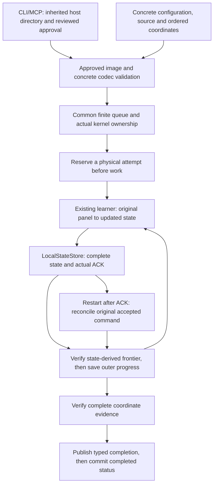

# Run an adaptive component as a durable task

Use a learner directly when you need its mathematical update. Add a durable task
when a job must survive a disconnected client, retain bounded attempts, verify
its installed implementation or continue accepted state after interruption.
Native TCPCI workflows and generic tasks share one scheduler, metadata store,
resource guard and execution loop. Their inputs, work units and scientific
interpretations remain separate.

This guide uses the v5 integration source and its separately packaged public
Hedge reference executor. Install the reviewed source wheel and the two example
wheels in a fresh Python 3.14 stdlib `venv`; the stable v4 release does not provide
these new task commands. Follow [component installation](core-installation.md)
for the locked environment and [the example source](https://github.com/jacksonpradolima/coleman/tree/release/v5/examples/typed_executor)
for the provider/support wheel build. The base task route needs Pydantic and
packaging, without the CI, analytics or MCP extras. MCP is an optional transport.

## Begin with explicit inputs

The example combines three declared experts over one constructed loss trajectory.
It exercises the existing constant-rate Hedge implementation; it adds no new
learning rule or performance claim.

| Input | Complete example | Meaning |
| --- | --- | --- |
| Experts | `expert-a`, `expert-b`, `expert-c`, each at version `1` | Fixed named coefficient coordinates |
| Initial coefficients | `(0.5, 0.25, 0.25)` | Dimensionless simplex coefficients, distinct from probabilities of success |
| Learning rate | `log(2)` | Declared constant Hedge parameter |
| First loss panel | `(0, 1, 1)` | Fully observed constructed losses, unit `1`, explicit bounds `[0, 1]` |
| Second loss panel | `(1, 0, 0)` | Same schema and original expert order |
| Third loss panel | `(0.25, 0.75, 0.5)` | Same schema; zero is observed, not unavailable |
| Source | Complete versioned `HedgeInputs` definition | Exact original panels and virgin complete learner state |
| Work target | Three accepted full panels | Inner learner update count, independent of storage publications |
| Publication batch | Two panels per transition | Operational batching; it changes neither panel order nor mathematical updates |
| Operational limits | One coordinate, two physical attempts, three worker starts, 60 seconds per start | Separate finite ceilings; attempts are not independent observations |
| Scientific protocol | Explicit `None` | Constructed mechanism demonstration, without protected inference or adoption |

Missing, unavailable, nonfinite, out-of-range or differently interpreted losses
refuse through the selected concrete codec and learner. No missing observation
is replaced by zero. For other problems, provide the actual feedback, units,
eligibility and objective definitions instead of renaming these CI loss rows.

## Keep the mathematical cycle independent



The provider implements selected `ValueCodec` roles and a small structural
`Executor`. Preparation returns coordinate operations, an optional actual
progress verifier and a stage boundary around the common loader. It owns no
queue, worker loop, resource sampler or SQLite job transaction. The boundary
may reuse verified final evidence without loading work, or call that loader
once; a second call refuses before additional coordinate effects.

The [expert-mixture guide](expert-mixtures.md) explains the update and its
scientific assumptions. A direct `Hedge` instance needs no plan, workspace,
registration, installed-image scan, transport or checkpoint store.

## Approve an installed executor explicitly

The operator selects a reviewed static recipe and captures the actual installed
provider, selected dependencies and resource bytes. Capturing reads metadata and
files; it does not import the provider, install packages or fetch URLs. Stored
workspace settings and submitted plans are equality constraints, never approval.

Run the following blocks in one host process started with `python -I -B`, outside
the checkout, after installing the reviewed wheels. `operator-recipe.json` is the
reviewed static `recipe.json` supplied with the external example, copied by the
operator before startup. It is not a per-request tool argument.

```python
from pathlib import Path

from coleman.application.executor_capture import capture_executor_identity
from coleman.core.identity import Reference
from coleman.tasks.identity import ApprovedExecutor, ExecutorRecipe, HostBootstrapProfile

with Path("operator-recipe.json").open("rb") as stream:
    recipe = ExecutorRecipe.from_json(stream.read(16 * 1024 + 1))
image = capture_executor_identity(recipe)
approval = ApprovedExecutor(recipe=recipe, implementation=image.binding)
profile = HostBootstrapProfile(
    schema_version=1,
    contract="coleman-tasks-v1",
    artifact_type="host_bootstrap",
    reference=Reference(id="constructed-ci-task-host", version="1"),
    executors=(approval,),
)
Path("host-bootstrap.json").write_text(profile.to_json(), encoding="utf-8")
```

This initial capture profile supports an immutable standard directory-wheel
installation on CPython, optimization zero, no bytecode writes and the standard
import/cache context. The durable host requires a trusted local POSIX filesystem
with kernel locks and no-follow directory operations. Existing cache files are
captured too. Editable installs,
ambiguous/shared namespaces, unsupported import hooks, changed resources and
unapproved entry points refuse. Keep the installation unchanged for a job's
lifetime. The capture establishes installed-image consistency under a trusted
host; it does not attest publishers, mutable live Python objects, undeclared
dynamic/system dependencies, every ABI, hardware or hostile-code isolation.

Create this environment with `python3.14 -m venv --without-pip .venv-task`, then
install the reviewed wheels and locked dependencies into that interpreter.
`uv pip` can install into an existing stdlib venv. Environments created by
`uv venv` or `virtualenv` add an extra `_virtualenv` import finder and are refused
by this initial profile. Supporting another startup context requires explicit
compatibility qualification; do not remove its finder or relax image checks to
make a saved approval pass.

## Freeze a plan, submit once and inspect the result

Only the current operator approval may load its selected provider. Bootstrap
checks the exact static entry point and concrete codec declarations before
preparation, source work or restoration.

```python
from coleman.application.executor_capture import load_approved_executor
from coleman.application.tasks import TaskService

load_approved_executor(approval, expected=image)
from coleman_typed_hedge.sample import planning_request

service = TaskService(Path("task-workspace"), bootstrap_profile=profile)
preview = service.plan(planning_request())
plan = service.saved_plan(preview.plan_id)
assert preview.target_work_units == 3
assert plan.coordinates[0].seed is None
assert plan.source == planning_request().source
```

Planning concretely decodes configuration, inputs and every coordinate outside
SQL. It freezes the complete installed identity, source/objective/protocol,
ordered coordinate identities, codec roles, seed applicability and work/resource
caps. It does not construct a live learner or restore a checkpoint.

```python
import sqlite3
from time import monotonic, sleep

from coleman.tasks.requests import TaskExecuteRequest

request = TaskExecuteRequest(
    schema_version=1,
    contract="coleman-tasks-v1",
    artifact_type="execute_request",
    request_id="constructed-ci-run-1",
    plan_id=preview.plan_id,
)
deadline = monotonic() + 60
view = None
while monotonic() < deadline:
    try:
        view = service.execute(request) if view is None else service.status(view.job.job_id)
    except sqlite3.OperationalError as error:
        code = getattr(error, "sqlite_errorcode", 0)
        if not isinstance(code, int) or code & 0xFF not in (sqlite3.SQLITE_BUSY, sqlite3.SQLITE_LOCKED):
            raise
    else:
        if view.job.state not in {"queued", "running"} and not view.worker_active:
            break
    remaining = deadline - monotonic()
    if remaining > 0:
        sleep(min(0.025, remaining))
else:
    raise TimeoutError("The bounded example did not finish")
assert view.job.state == "completed", view
job_id = view.job.job_id
assert service.execute(request).job.job_id == job_id
completion = service.report(job_id)
result = service.decode_result(job_id)
```

An identical request returns the same logical job, including after restart or
expiry. Reusing its key with another payload or execution family conflicts.
Disconnecting a CLI/MCP client does not cancel the independently owned worker.
An acknowledgement timeout can follow a committed admission: retry the same
request instead of inventing another key.

The observer retries only numeric SQLite BUSY/LOCKED errors, including their
extended codes, within the same observation window. Each storage operation
keeps its one-second wait. Schema/storage failures propagate; the observer never
replays a transaction body or changes a job's resource allowance.

```python
from coleman.learning.reference import Hedge
from coleman_typed_hedge.sample import configuration, inputs

config = configuration()
source = inputs(config)
trajectory = source.trajectories[0]
direct = Hedge(config.reference, owner=trajectory.reference)
for panel in trajectory.panels:
    direct.observe(panel)

row = result.results[0]
assert row.checkpoint.learner.to_json() == direct.export_state().to_json()
assert row.checkpoint.learner.payload.update_count == 3
assert row.proof.frontier.position == 3
assert row.proof.receipt.accepted_head.generation == 2
assert completion.result.body == result.to_json()
assert view.eta_seconds is None and view.eta_status == "unavailable"
print(result.interpretation)
```

The final coefficients are approximately `(0.56369735, 0.19929711, 0.23700554)`.
The output retains the complete learner state, source/plan/image bindings and
actual acknowledgement declarations. The shared `TaskCompletion` adds the exact
ordered coordinate catalogue and concrete result codec. Physical attempt events
live in a separate ledger; they do not change the mathematics or create a paid
cost. The interpretation is `constructed_mechanism_only`, without uncertainty
estimates or an automatic adoption decision.

## Resume accepted work, without an implicit reset

Inner state acceptance and outer job progress are distinct commits. If the
process dies after state ACK, the selected verifier reopens the actual current
store, checks its complete bindings and original command, derives logical work
from the decoded learner state and advances outer metadata. It does not apply
the panel again. A storage generation counts publications, so it cannot replace
the learner's work count.

Use `service.resume(job_id)` explicitly after interruption. The runtime rechecks
the current approved image and complete codecs before restoration. Missing
accepted state, an older head, outer progress ahead of accepted state or changed
code refuses; there is no fresh learner disguised as continuation. A physical
attempt reserved before a crash may have performed no mathematics, and replayable
computation can repeat before acceptance. Distributed exactly-once effects are
not promised.

`TaskService(Path("task-workspace"))` can inspect known metadata, cancel work or
read the outer completion without provider approval. It cannot schedule queued
generic tasks, decode an unavailable provider's concrete result or reconstruct
approval from SQL. Opening with a different profile or generic cap policy
refuses. Cancelled workers retain capacity until their actual lock is released;
expired bytes retain output reservations until successful cleanup.

## Use the same service from a CLI or MCP client

The distinct commands preserve the existing native command grammars and seven
application plus fourteen workflow tools:

```bash
python -I -B -m coleman.application.task_cli --workspace task-workspace --bootstrap host-bootstrap.json discover
python -I -B -m coleman.application.task_cli --workspace task-workspace --bootstrap host-bootstrap.json plan --request - < planning-request.json
python -I -B -m coleman.transports.task_mcp --workspace task-workspace --bootstrap host-bootstrap.json
```

Start the CLI or MCP host from the operator-owned directory containing its
workspace and reviewed bootstrap file. Both startup paths must resolve within
that directory; an absolute outsider, sibling prefix or escaping symlink refuses
before approval contents are read or a workspace is created. Clients cannot
replace this directory through request JSON. Programmatic `TaskService` callers
retain their existing explicit operator-selected root contract. This protects a
fixed host namespace and still requires the documented trusted filesystem.

The optional MCP host exposes nine `task_*` tools over the same `TaskCommands`
edge. Requests and replies have a 1 MiB interactive ceiling; larger retained
artifacts require explicit library/host access. Tool JSON accepts no workspace,
owner, bootstrap file, shell command, module, installation URL or exporter
endpoint. Host setup supplies those security decisions independently.

The `coleman-task` and `coleman-task-mcp` console aliases are also available.
For those aliases, set `PYTHONDONTWRITEBYTECODE=1` before the interpreter starts
and keep optimization zero. Setting the flag later cannot undo caches created
by startup imports; those bytes can change the approved image and cause a
correct compatibility refusal. The explicit `python -I -B -m` commands above
establish the supported interpreter profile from startup.

## Keep compatibility and effects explicit

Generic tasks require `coleman-tasks-v1`, integer schema version `1` and exact
artifact types. Unknown/future versions reject rather than guessing a migration.
Native `ExperimentPlan`, `JobRecord`, report/checkpoint formats and runtime v1/v2
retain their own readers and interpretations. Known mixed metadata routing adds
a 64 MiB/depth-64 ceiling; generic artifacts additionally require at most 16 MiB.
The original native-only readers retain their previous wire behavior, including
larger padded JSON. New mixed execution does not claim every historically
accepted native payload fits its bounded route.

Use a fresh explicitly selected task workspace for new experiments. Its five
SQLite tables/schema version `1`, owner/request key space and aggregate
queue/job/plan/output/memory pools are shared with native jobs created under the
same compatible source. Per-task work caps have their own named units. Old
runtime/checkpoint identities are never upgraded by reading metadata; continue
historical work under its [pinned original environment](v5-compatibility.md).

The reference provider declares local acknowledged state. A consumer that also
changes an external system must supply stable effect keys, actual inspection
and an explicit recovery protocol. Perform those effects outside effect-free
state staging. An unknown effect outcome remains unknown until reconciliation;
a learner checkpoint is not authority to repeat irreversible work. No broker,
live order, remote agent execution or extra effect engine is introduced here.
