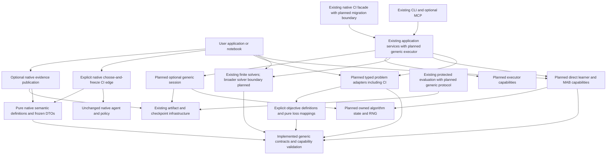
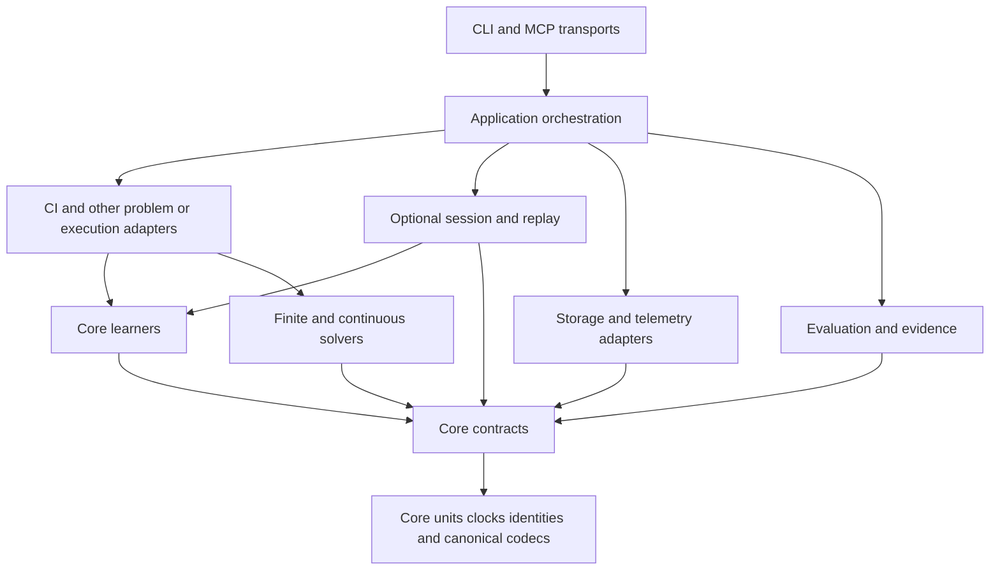
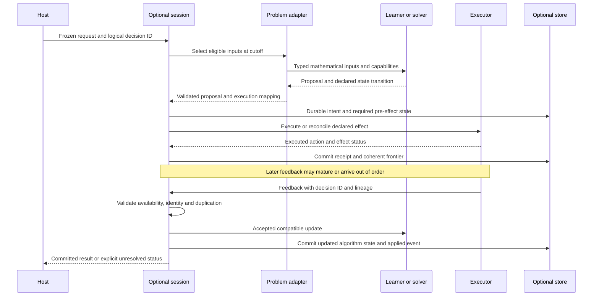
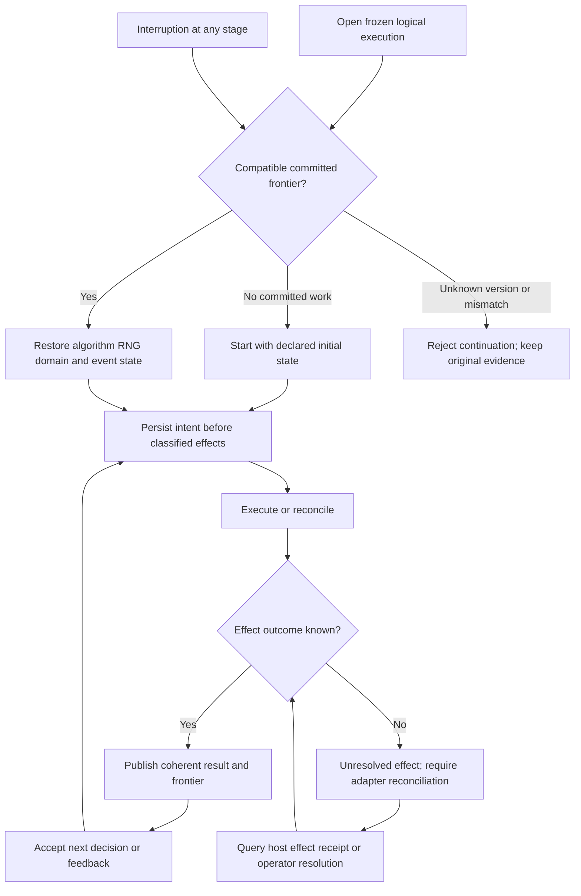

# Adaptive decision architecture

COLEMAN v5 is designed to let an application reuse adaptive learning, decision
solvers and experiment infrastructure independently. CI test prioritization and
selection remain a first-class application. A researcher should also be able to
use a learner in a notebook, solve a finite allocation problem, or compose an
experiment without constructing a CI environment.

**Status:** this page specifies the v5 architecture. The v5 integration source
now implements [generic decision contracts and direct-use protocols](decision-contracts.md)
in a lightweight core, together with [explicit objective and loss mappings](objectives.md).
It also provides [source-pinned native ranking semantics and explicit decision capture](native-policy-semantics.md)
without changing the legacy policy mechanisms or automatically enriching runner output.
Generic learners, adapters and durable sessions below
remain planned until individually qualified. The original implementation baseline
is COLEMAN **4.20.0**, commit
`1edbee874129aa85e26e592d9649826e85e1ac6b`. Examples explicitly identified as
existing use that source. Proposed namespaces and call sequences below are design
contracts to qualify in subsequent work, except for the explicitly linked
implemented contract, objective and native-evidence layers. No v5 release wheel has been published.

Read the [compatibility and migration policy](v5-compatibility.md) alongside this
specification. Use the [current getting-started guide](getting-started.md) for the
implemented CI workflow.

## Start with the decision, then choose the components

Describe what may be chosen, what can be observed afterwards, and what resources
or state change. These determine whether a method is applicable. Calling a problem
a bandit, supplying context, or using an algorithm's name does not establish its
feedback assumptions or a performance guarantee.

An application chooses among four consumption modes:

| Mode | Required inputs and work | Optional outer components |
| --- | --- | --- |
| Learning only | A declared mathematical input/loss contract, learner update and algorithm state | Domain mapping, experiment history, artifacts and evaluation |
| MAB only | Available discrete actions, the actual selection mechanism, chosen-action feedback and learner-owned RNG/state | Logged replay, a durable session and protected comparisons |
| Solver only | A typed problem, objective, feasible set and bounded solve call | Any learner, event loop, workspace or transport |
| Complete experiment | Explicit composition of problem, learner/solver and executor | Persistence, recovery, evaluation, telemetry, CLI and MCP |

The first three modes require no RunSpec, dataset file, database, workspace,
DomainRecord, protected-evaluation manifest or global registry initialization.
Units, bounds and timing actually needed by the selected mathematics remain
explicit. A user-owned learner can satisfy a small structural protocol or use a
thin wrapper; inheritance from a framework-wide `Problem` or `Agent` is unnecessary.

Conceptually, direct learning supplies a loss vector to an update and inspects
new weights; direct MAB asks for one action, supplies that action's outcome and
exports/restores its algorithm/RNG state; direct solving supplies a problem and
receives a checked result. The [contract guide](decision-contracts.md) now publishes
the direct structural protocol signatures and an executable CI contract cycle.
The actual generic learning methods remain separate implementation work.

Use the [objective guide](objectives.md) to keep raw outcomes, physical resources,
bounded losses and user-declared preferences distinct. Its conversion, loss and
causal-scale operations are directly callable; declaring mixture controls does
not implement the later controlled learner or a durable session.

## Components and responsibility

Each boundary has one purpose. Application code can compose stages using ordinary
typed calls; no mandatory pipeline language, graph engine or service locator is
introduced.

| Boundary | Owns | Does not implicitly own |
| --- | --- | --- |
| Problem adapter | Domain observations, available actions, objectives, feasibility and feedback mapping | Algorithm state, a transport or scientific admission |
| Objective and loss definitions | Quantity interpretations, explicit conversions, causal scales, preferences and constraint declarations | A learner update, durable acceptance or real-world efficacy |
| Learner adapter | Supported decision/update capabilities, algorithm statistics, RNG and state codec | Workspace construction, durable delivery deduplication or external effects |
| Solver | Declared finite/continuous optimization, limits and result certificates/status | Learning, executing the proposal or manufacturing missing inputs |
| Execution adapter | Work or effects, proposed-to-executed action mapping, outcome receipts and reconciliation limits | A regret guarantee, universal retry safety or automatically observed counterfactuals |
| Optional session | Accepted event identity, ordering, applied-event deduplication and a committed frontier | Changing past decisions after a correction without a new replay lineage |
| Optional storage adapter | Atomic publication, reads, durability and conflict detection under its documented backend assumptions | Authenticating a source or proving an external effect occurred once |
| Application service | Frozen plans, registered trusted implementations, attempts, cancellation and orchestration | Mandatory dependencies for direct mathematical calls |
| Transport | CLI/MCP input validation and calls into the shared service | Its own learner, solver or orchestration rules |
| Evaluator | Frozen estimands, eligibility, dependence units, comparisons and stated uncertainty | Converting arbitrary scores into calibrated probabilities or causal effects |
| Native semantic evidence | Source-pinned legacy definitions and an explicitly captured pre-evaluation ranking | A generic learner, completed feedback, a propensity, a state checkpoint or automatic historical enrichment |

Capability-required pending decision information must have one declared owner.
For a direct MAB it may live in the learner or an explicit caller-supplied decision
token; a session may retain its durable envelope without creating a competing
mathematical state. A raw update is not automatically idempotent. Delivery safety
belongs to the optional session or to a caller that implements an equivalent
explicit acceptance protocol.



Here an arrow means a call or dependency toward the component used. Storage,
session, evaluation and transport can be absent when the host directly calls a
learner or solver. Existing finite solver APIs are independently callable from
the base wheel. Select the explicit `ci` or `analytics` extra for the outer
operations that require those dependencies; see the
[component installation guide](core-installation.md) for complete isolated
examples and the supported runtime envelope.

## Action and feedback capabilities

Context is orthogonal to feedback visibility. A complete table of retrospective
CI outcomes can support offline scoring without making those outcomes available
at a live decision. Likewise, an observed scalar for a selected slate supplies
neither every member's outcome nor the outcomes of unselected slates.

Use these separate action shapes:

| Action | Required shape and invariant |
| --- | --- |
| Complete ranking | A permutation of the declared candidate set; scheduling/execution is a separate operation |
| Discrete choice | One available, versioned alternative, or explicit abstention |
| Subset/slate | A selected set or ordered slate with explicit cardinality/resource constraints; not a full ranking called top-k |
| Simplex mixture | Nonnegative weights summing to one over named experts/recipes; weights alone do not describe a random draw |
| Continuous feasible vector | Named coordinates, bounds, feasible-set version and unit/meaning per coordinate; signed values only where permitted |
| Information acquisition | A bounded observation/fidelity request with its resource charge, delay and terminal/cumulative objective |

The following matrix specifies the **architectural support envelope**. “Required”
means a v5.0 implementation/qualification obligation, not an implemented method.
“Legacy” means only the documented v4 CI boundary. “Unsupported” means no generic
learner may accept that pair by coercion. Static solving without subsequent
feedback is separately supported and does not require a learner.

| Action \ feedback | Complete comparable vector | Observed component feedback | Aggregate chosen-action feedback | Absent feedback |
| --- | --- | --- | --- | --- |
| Complete ranking | Legacy offline CI evaluation; generic full-information ranking learner unsupported | Legacy scheduled-test reward semantics only; generic ranking semi-bandit unsupported | Generic ranking learner unsupported | Existing fixed/random ranking execution; no adaptive update |
| Discrete choice | Generic full-vector discrete learner unsupported; an explicit adapter may expose only the selected outcome to a qualified chosen-only method | Required genuine chosen-action UCB/Exp3; unused full-vector members are not imputed | Required genuine chosen-action UCB/Exp3 with declared bounded scalar outcome | Fixed choice/abstention only; no adaptive update |
| Subset/slate | Generic online full-information subset learner unsupported; modeled coverage belongs to the static solver route | Required real subset/acquisition baseline within its qualified visibility contract; general combinatorial semi-bandit guarantees unsupported | General slate bandit unsupported | Existing finite coverage solving; no adaptive update |
| Simplex mixture | Required Hedge and one precisely specified Fixed Share reference with complete eligible bounded expert losses | Unsupported for those full-information references | Unsupported for those full-information references | Fixed/equal mixture only; no adaptive update |
| Continuous feasible vector | A loss vector alone is unsupported; required projected first-order updates use a separately typed convex objective/gradient oracle | Unsupported without a separately qualified oracle/estimator | General bandit convex optimization unsupported | Static constrained solve when all required objective inputs are supplied |
| Information acquisition | Generic online full-vector acquisition learner unsupported; complete modeled scores belong to a separate static problem | Required equal-allocation/successive-halving baseline with purchased observation/fidelity feedback | Unsupported unless that exact aggregate observation is admitted by the implemented baseline | Stop/abstain or a declared nonadaptive purchase plan |

Pairwise preference feedback is an additional distinct shape. Generic preference
learning remains evidence-gated research. No row above may turn an ordering,
scalar reward or chosen-item result into an observed pairwise preference.
For continuous methods, the full-information oracle supplies the declared loss
function or its required gradient at the appropriate point; an arbitrary vector
of outcome measurements is not that oracle. Static modeled costs/weights are
inputs to a solve, not feedback received from an executed action.
Delayed feedback and revisions also require an explicit capability; synchronous
updates do not automatically inherit guarantees after arbitrary delays.

Composition validation checks action shape, available identities/versions,
feasibility, feedback visibility, units and loss bounds, information cutoff,
maturity/receipt, state ownership and required sampling information **before**
execution. Unknown or incompatible capabilities return a typed unsupported
disposition or validation error. Infeasibility, resource exhaustion, abstention,
missing feedback and insufficient comparative evidence remain different results.
A fallback is applied only when declared and feasible; its execution is recorded.

### What the native policy code actually does

The existing native public names describe ranking adaptations. The
[native semantics catalog](native-policy-semantics.md#the-37-native-ranking-mechanisms)
retains all 37 names with exact agent routes, constructor defaults, feedback,
counter units, RNG/lifetime limits, source pins and explicit migration
dispositions. These definitions do not qualify generic methods through a name.

| Source observation at the 4.20 baseline | Architectural consequence |
| --- | --- |
| [`Agent.choose()`](https://github.com/jacksonpradolima/coleman/blob/1edbee874129aa85e26e592d9649826e85e1ac6b/coleman/agent/base.py) first shuffles all names and later calls `policy.choose_all`; attempt increments are rank-weighted across the ranking | Native actions and counters do not already form a standard single-pull MAB contract |
| [`EXP3Policy.choose_all()`](https://github.com/jacksonpradolima/coleman/blob/1edbee874129aa85e26e592d9649826e85e1ac6b/coleman/policy/mab/adversarial.py) sorts every action by computed weights/probabilities; EXP3IX inherits this selection | Those values are ranking scores in this execution path, not logged probabilities of an actual sampled chosen action |
| [`CombinatorialUCBPolicy` and `CombinatorialThompsonPolicy`](https://github.com/jacksonpradolima/coleman/blob/1edbee874129aa85e26e592d9649826e85e1ac6b/coleman/policy/combinatorial/policies.py) return the full order; concatenating its first k and remaining items retains that order | A native top-k label does not supply an independent subset action or a qualified semi-bandit estimator |
| [`PortfolioUCBPolicy`](https://github.com/jacksonpradolima/coleman/blob/1edbee874129aa85e26e592d9649826e85e1ac6b/coleman/policy/portfolio/policies.py) chooses a candidate ranking policy, passes the shared agent and scores bounded deltas of total value estimates | This is a ranking-policy selector, not asset portfolio construction, independent virtual books or generic full-information expert aggregation |
| [`DuelingUCBPolicy` and `PairwiseThompsonRankingPolicy`](https://github.com/jacksonpradolima/coleman/blob/1edbee874129aa85e26e592d9649826e85e1ac6b/coleman/policy/dueling/policies.py) update pair counters from the produced ranking | Their current update is not externally observed preference feedback |
| [`LinUCBPolicy`](https://github.com/jacksonpradolima/coleman/blob/1edbee874129aa85e26e592d9649826e85e1ac6b/coleman/policy/contextual/linucb.py) returns a full ranking and updates each action from native value estimates and context | Context support does not establish the standard chosen-action contextual-bandit observation model |
| [`RNFailReward`](https://github.com/jacksonpradolima/coleman/blob/1edbee874129aa85e26e592d9649826e85e1ac6b/coleman/reward/rnfail.py) emits a ranking-aligned zero/one learning vector from detected failure ranks | An unscheduled test's zero learning credit must not become an observed passing verdict in a generic dataset |
| [`bounded_reward()`](https://github.com/jacksonpradolima/coleman/blob/1edbee874129aa85e26e592d9649826e85e1ac6b/coleman/policy/mab/shared.py) transforms out-of-range values and maps nonfinite input to zero | Preserve legacy behavior under its version; generic contracts reject nonfinite values and require an explicit versioned transform |

The bounded four-build factory recipe completes 34 names and retains three
explicit failures: SlMAB, SWLinTS and SWContextualEpsilonGreedy. The new capture
edge refuses these unsupported factory routes before choosing; raw factory
behavior is unchanged. SlidingWindowUCB's mean fallback and shared multi-window
policy state are explicit. FRRMAB retains a restricted variability envelope,
without a universal fixed-seed trace guarantee.

`coleman.native.semantics` and `coleman.native.decisions` depend on the lightweight
core, not the native policy package. `coleman.native.capture` checks the explicit
CI capability and wraps exactly one actual choose before evaluation. Optional
publication uses the existing artifact writer. `Environment` is unchanged;
ordinary runner output and historical files do not acquire these records
automatically. No native algorithm, reward formula or old artifact is rewritten.
New sampled-action learners have distinct capability identities and qualification.

For comparison, full-information expert weighting requires the complete eligible
loss vector; the original Hedge formulation distinguishes mixture allocation and
mixture loss from a chosen-action estimator. See [Freund and Schapire, *Journal of
Computer and System Sciences*](https://www.schapire.net/papers/FreundSc95.pdf).
Constant-rate and decreasing-rate versions also have different properties; see
[Mourtada and Gaïffas, *JMLR*](https://jmlr.org/papers/v20/18-869.html).
Actual adversarial MAB sampling and chosen-only feedback are specified separately
in [Auer et al., *SIAM Journal on Computing*](https://homepages.math.uic.edu/~lreyzin/papers/auer02.pdf).
These papers motivate boundaries; they do not certify COLEMAN's implementations.

## Typed data, time and identity

Generic mathematical inputs remain small. The optional experiment envelope adds
the information needed for audit and recovery:

| Value | Producer → consumer | Invariants |
| --- | --- | --- |
| Eligible input view | Problem adapter → learner/solver | Source/input fingerprints, cutoff and versioned availability rule; future information excluded |
| Supplied forecast/signal | User model or provider adapter → learner/solver | Units, meaning, target interval, availability and producer identity; not implicitly learned or calibrated |
| Learner output | Learner → application/solver | Expert/action version, declared semantics and predecision state binding; mixture, score and probability distinct |
| Proposal | Learner/solver → execution adapter | Feasible-set/objective version, proposed action and selection mechanism when relevant |
| Executed action | Execution adapter → feedback/session | Actual action/effect status, overrides, execution identity and available sampling evidence |
| Feedback | Executor/source → learner through optional session | Producing decision, origin, observed members, units, maturity, receipt and revision lineage |
| Evidence record | Outer application → result/artifact adapters | Existing Measurement/DomainRecord semantics, provenance, schema version and logical identity |

A decision's information cutoff cannot be later than its decision time. Event,
source availability, first local receipt, target interval and feedback maturity
are separate quantities. Unknown historical receipt is not replaced by a download
time and presented as a historical fact. Pending, not-yet-mature and unavailable
feedback must not become an observed zero.

`0`, a permitted finite negative value, unknown/null, unavailable and not applicable
retain their distinct contracts and explicit units. Nonfinite input and
bool-as-number reject in the new contracts. Seconds do not silently become
milliseconds; a reward transform does not change a raw monetary or physical
measurement's meaning. Reuse the existing canonical JSON and measurement rules;
do not normalize legacy signed float zero using the finite solver's distinct
decimal-zero convention.

Logical task/decision/component identities identify the modeled computation.
Content digests identify exact serialized content. Attempt IDs identify physical
retries/workers. A new core identity generation cannot silently replace the old
RunSpec run ID, artifact key or checkpoint binding. See the
[compatibility policy](v5-compatibility.md) for each existing surface.

Filtering, projection, constraint repair or an execution override preserves the
proposal and executed action separately. The adapter must establish whether the
actual sampling mechanism is preserved, recomputed or unavailable. A normalized
score is not sufficient evidence for a propensity. Unsupported approximations
cannot enable off-policy inference or a sampled-action theorem.

```mermaid
flowchart LR
    Source[Owned observations and source clocks] --> Cutoff[Eligible view at decision cutoff]
    Cutoff --> Signal[Optional supplied signal with units and availability]
    Signal --> Learning[Optional learner output]
    Cutoff --> Solve[Optional constrained solve]
    Learning --> Solve
    Solve --> Proposed[Proposed action]
    Learning --> Proposed
    Proposed --> Execute[Execution adapter]
    Execute --> Actual[Executed action and effect receipt]
    Actual --> Feedback[Later typed feedback and revision lineage]
    Feedback --> Learning
    Actual --> Records[Optional raw records and provenance]
    Feedback --> Records
    Records --> Compare[Optional frozen comparison and fallback]
```



## Dependency direction and staged extraction

Start with one maintained distribution and logical modularity. The implemented
`coleman.core` namespace contains minimal contracts, temporal/numeric primitives
and direct-use structural protocols. Independently usable learning methods remain
planned. It may have internal submodules;
there is no requirement to publish one wheel per abstraction. Existing import
paths remain subject to the explicit compatibility policy.

The currently supported Python minimum is **3.14**. Changing it or introducing
another distribution needs resolver, wheel ownership, import and support-matrix
evidence. Install examples must identify this repository's built wheel: the bare
PyPI project name is not a reliable instruction for installing this repository.
The integration metadata now separates the base Pydantic/packaging closure
from explicit `ci` and `analytics` extras, with independent transport/telemetry
SDK extras. [Component installation](core-installation.md) describes the exact
source-wheel routes and their installed-package qualification boundaries.

The target import graph uses arrows from importer to dependency. This is a DAG;
runtime orchestration imports capabilities, never the reverse.



The original source baseline identified the following extraction seams. Shared
primitive leaves and lazy compatibility exports now separate their imports;
native algorithms and generic executor/session delivery remain distinct work:

| Current edge | Staged change and verification |
| --- | --- |
| `policy.base → coleman.agent → coleman.bandit`; those package initializers pull native metric classes | Extract independent learner protocols/math; keep the native Agent adaptation at the CI boundary. Cold core imports must not load these native packages |
| `observations.contracts → evaluation.protected.temporal`; importing a submodule also executes evaluation package initializers | Put shared clocks/temporal primitives below observation/evaluation consumers; retain compatible wrappers and wire meanings |
| `selection.contracts` owns shared Immutable/Quantity helpers used by allocation and workflows | Extract common primitives once, keep compatibility imports, and check decimal/serialization goldens rather than duplicating numeric rules |
| `selection/allocation` contracts import `results.domain` and `results.versioned`; `results.__init__` also exposes the sink interface | Move shared canonical/identity/version primitives below both consumers with compatible reexports; core must not depend on a results-pipeline namespace or execute its initialization |
| `selection.__init__` and `allocation.__init__` import artifact publication modules alongside solvers | Separate pure solver import paths from optional artifact/storage paths; test both documented direct and compatibility imports |
| `workflows.contracts/planning` import protected evaluation, native BudgetSpec/RunSpec and corpus contracts | Keep v1 native workflows at the adapter boundary; add typed generic executor/plan contracts without making RunSpec a core algorithm parameter |
| `application.workflow_native` constructs Environment and native runner agents | Retain as the native executor; the application dispatches a host-registered typed executor instead of moving its native imports into core |
| Native policies share `policy.base._rng`; workflow recovery wraps it with PCG64 state in an isolated process | New learners own declared streams and codecs; preserve the separately qualified native isolated-worker path rather than sharing it across threads |

The enforceable boundary is explicit: core modules may import only their core
dependencies and individually declared numerical backends. They must not import
`coleman.agent`, `bandit`, `policy`, `reward`, `scenarios`, `runner`, `environment`,
`cli`, `transports`, `application`, `results`, `selection`, `allocation`, evaluation, artifact/storage backends,
telemetry or provider SDKs. Generic solvers/learners depend on core contracts; core
contracts never import their consumers. Any selected optional numerical backend
needs its own declared install/import envelope.

Extraction must add AST/import-graph checks for direct edges and subprocess cold
imports for transitive imports and package initializers. Installed checks run
outside the checkout with optional integrations absent, no network discovery or
storage initialization. Cycles and forbidden edges fail the gate; allowlists
name specific transitional legacy modules rather than exempting the new core.
Decision contracts and packaging use AST plus noneditable-wheel cold-import
checks, with separate resolver/install checks for base and declared optional
profiles. Passing a contract/import check does not qualify a future learner, an
unlisted dependency combination or a lower Python version. See
[component installation](core-installation.md) for the supported consumption routes.

## Two executable baseline slices before extraction

Two existing examples establish a small public vertical seam. Build and install
the repository wheel noneditably, copy the examples outside the checkout, and run
from that external directory with the installed environment's Python:

```bash
python resources.py allocation-output
python ci.py ci-output
```

The source files are
[`resources.py`](https://github.com/jacksonpradolima/coleman/blob/1edbee874129aa85e26e592d9649826e85e1ac6b/examples/scenario-payoffs/resources.py)
and
[`ci.py`](https://github.com/jacksonpradolima/coleman/blob/1edbee874129aa85e26e592d9649826e85e1ac6b/examples/scenario-payoffs/ci.py).
Their output directories must remain under the invocation directory. They use
real finite allocation, artifacts, and, for `ci.py`, real native runner/reward/
metric/Parquet components. They do not download a dataset or execute subject test
commands. These are baseline examples, not the planned generic runtime or the
substantive v5 portfolio adapter.

### Synthetic allocation without CI

`resources.py` declares two joint scenarios with assumed weight `0.5` each. It
starts from a balance of `10 credit`, no holdings and zero occupied runner slots,
with capacity `2 slot`. It calls the existing `select_allocation` directly.

| Complete plan | Slot use | Gross increments in idle/busy, credit | Transaction cost, credit | Expected net increment, credit |
| --- | --- | --- | --- | --- |
| `no_action` | 0 | 0 / 0 | 0 | 0 |
| `stable` | 1 | 2 / 2 | 0 | 2 |
| `variable` | 1 | 10 / -8 | 0 | 1 |

The finite model selects `stable` with status `optimal` after complete bounded
enumeration. The negative `-8` remains a valid modeled increment; it is not a
missing value or a learning reward. `optimal` concerns only these supplied plans
and weights. No plan is executed, no external state changes and no empirical
profitability or confidence claim follows.

The host constructs the problem before solving. This example has no event/source
clock and does not pretend its scenarios were historically available forecasts.
The solver owns no RNG or durable state. It returns a versioned exact result;
the separately called artifact adapter publishes that content. A solver checkpoint
contains verified completed evaluations, not invented feedback or an execution
receipt. A bounded stop preserves its explicit termination and certified incumbent.

### Native CI through the same finite seam

`ci.py` uses the same credit increments, but supplies complete plans consuming
`0`, `3` and `4 s` under a `5 s` modeled serial-runner capacity. Its model selects
`stable` and then passes **3 seconds**, not 2 credits, into the existing fixed-time
CI budget.

| Edge | Producer → consumer | Units/time/state |
| --- | --- | --- |
| Model → finite solve | Owned fixture → `select_allocation` | Credits and modeled seconds; assumed scenario weights, no historical availability claim |
| Chosen plan → native configuration | Example host → RunSpec/RunnerExtension | A fixed `3 s` budget; exact problem/result/adapter bindings retained |
| Native input → ranking | Constructed Parquet → native Greedy/RNFail agent | BuildId 1; test names, durations `1 s` and `2 s`, verdicts 0 and 1; first-build seeded shuffle retained |
| Ranking → scheduling/evaluation | Agent → native metric bandit | Complete ranking, then actual budget-constrained scheduled test set; both tests fit regardless of warmup order |
| Evaluation → learning | Native metric → RNFail/RewardAgent | Native ranking-aligned learning credits; no redefinition as generic observed full-vector labels |
| Actual native observation → records | Monitor → existing sinks | Native metrics/rows plus a separate modeled expected-payoff DomainRecord; publication availability is sampled after the solve and reused on identical record retries |
| Committed records → recovery | Native environment → existing checkpoint machinery when enabled | Native frontier, agent/bandit and output reconciliation; legacy trust/concurrency limits preserved |

The example checks that the native available time is 3 seconds and the executed
set is exactly `unit-test` and `integration-test`. It expects one separate modeled
record with expected net payoff 2 credits. Native NAPFD/APFDc and RNFail keep their
existing meanings. Its native fixture is offline constructed evidence, not a
prospective speedup study. The one-build slice verifies wiring and accounting;
multi-build learning and interrupted stochastic continuation need their own
qualification tests.

The v5 extraction must keep this native behavior through the qualified CI adapter
and add a runtime-free solver path using the same core contracts. The later
synthetic portfolio reference adds independent virtual books, holdings/cash,
turnover/fees, state transitions and later feedback. It must also show supplied
signals → learner → constrained solve → independently checked executed accounting,
and compare matched component ablations. The finite baseline above does not
already implement that system.

## Interaction, interruption and recovery

The following is the proposed optional durable interaction. A caller may omit the
session/storage participants and perform direct calls with caller-owned delivery
responsibility.



A committed frontier binds the compatible algorithm/RNG state, accepted/applied
events, domain/executor state, result inventory and any durable outbox/receipt
required by its effect class. A local backend must qualify its publication and
recovery protocol; a collection of unrelated successful writes is not an atomic
commit. Incomplete attempts are not marked complete because an output directory
or partial result exists.



Replayable pure/offline computation is the default executor class. An external job,
purchase or trade needs an adapter-declared idempotency/reconciliation contract;
a local event ID does not prove exactly-once physical effects. A crash after a
remote effect but before its receipt can leave an unresolved effect. Such work
must not be blindly retried or reported completed. No live broker, credential,
trading or arbitrary remote-command execution is introduced by this architecture.

The runtime serializes ownership or uses an explicitly qualified compare-and-swap/
reservation protocol for a logical execution. Independent worker/attempt IDs do
not by themselves provide concurrency safety. Native process-global policy RNG
requires its existing isolated-worker wrapper; it is not a thread-safe generic
session. Existing artifact atomic publication, native output reconciliation and
checkpoint limits are reused with their documented scope, rather than relabeled
as universal transactional storage.

Corrections preserve earlier live decisions and their available information.
Retrospective recomputation creates a declared new lineage restored before the
correction and replays its dependent states. It cannot mix a corrected outcome
with unchanged downstream state and claim an equivalent historical run.

## Delivery boundaries and qualification

The required v5.0 foundation comprises the typed contracts, explicit units and
objectives, native policy audit, lightweight import/package boundary, causal
replay, owned state, registry lifecycle and frozen evaluation protocol. Qualified
simple methods, generic durable execution, the CI migration boundary, constrained
allocation, real chosen-action and subset/acquisition capabilities, the synthetic
portfolio reference and independent/null benchmarks follow their prerequisites.
Human documentation, operational/security evidence and final installed/migration
checks complete release qualification.

Advanced tracking/rates, contextual and pooled learning, preference inference,
off-policy estimation, stateful control and ecosystem interoperability have
separate research entry gates. The continuing application program tracks all 18
literature families, beginning with forecasting, solver choice, HPO and model
routing. Historical data admission, portfolio replay and execution-aware intraday
research are separate continuing tasks. None automatically expands the mandatory
v5.0 implementation scope.

Every qualified capability needs independent arithmetic/reference evidence,
versioned fixtures, its stated numerical tolerances and action/feedback rejection
cases. Stateful paths additionally need real interruption/resumption, duplication,
conflict/concurrency and RNG equivalence checks. Independent direct-use examples
and complete CI/non-CI flows run through a noneditable installed wheel outside
the repository. New core import checks cover CLI/MCP/CI/storage absence. Agreement
with a reference proves specified mechanics; scientific benefit needs matched,
frozen evaluation with appropriate independent units and conservative fallback.

The [release integration route](v5-release-integration.md) uses `release/v5` with
issue branches targeting it. Stable v4 maintenance remains on `main`. Intermediate
merges publish neither stable releases nor automatic prereleases. Alpha/beta/RC
version selection is rehearsed locally in isolated repositories; any later
prerelease publication needs its own explicit qualification decision. One final
stable v5 publication is a distinct release gate after integration into `main`.
Routing must be dry-run before downstream breaking merges. The architecture
delivery changes release configuration, documentation and
verification only; it does not extract algorithms or silently bump installed
package metadata to claim a completed v5.

For existing implementation detail, continue with
[versioned measurements](domain-results.md),
[point-in-time observations](point-in-time-observations.md),
[finite coverage](finite-coverage.md),
[scenario allocation](scenario-payoffs.md),
[durable experiments](durable-experiments.md) and the
[shared application API](application-api.md). The
[public v5 roadmap](https://github.com/jacksonpradolima/coleman/issues/353) records
implementation dependencies and acceptance evidence. Continuous constrained
allocation is a separate capability from finite enumeration; its financial
interpretation must retain objective, cost and execution assumptions, as in
[Boyd et al., *Multi-Period Trading via Convex Optimization*](https://web.stanford.edu/~boyd/papers/cvx_portfolio.html).
