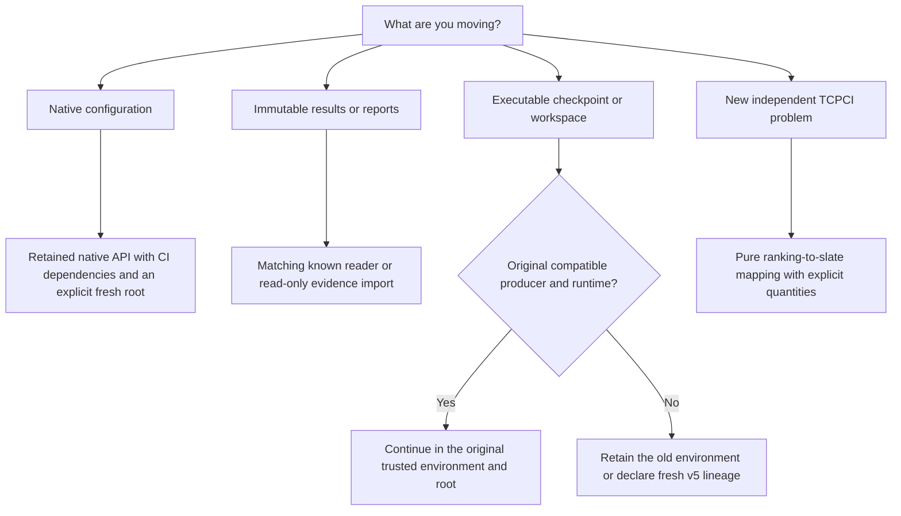

# Moving existing experiments to v5

Choose the route that matches what you are moving: a configuration, immutable
evidence, or executable state. An existing test-ranking experiment keeps its
original action, observed feedback, reward and units. Installing a different
package version does not turn that experiment into a generic bandit experiment.

The integration source retains native APIs and readers alongside independently
usable [decision contracts](decision-contracts.md), [expert learners](expert-mixtures.md),
[finite coverage](finite-coverage.md) and [owned state](state-recovery.md).
The [TCPCI problem mapping](tcpci-problems.md) is a separate pure API; it does not
require a native job, `RunSpec`, table or `Environment`. Existing native
execution remains an outer application rather than a learner superclass.

These are integration-source routes, not an announcement of a stable v5 release.
The package remains **4.20.0** until the release process publishes the qualified
v5 asset. Follow [component installation](core-installation.md) and the
[verified-wheel installation guide](getting-started.md#1-install-in-a-virtual-environment).
The bare PyPI project named `coleman` has a different owner. Do not install v4
and v5 into one environment or share their mutable workspace/checkpoint roots.

## Choose a route before opening state

For an **unchanged supported native configuration**, retain its packs, defaults,
seed repetitions, policy/reward names and budget meaning. Use the native
[library API](api/experiment-api.md) or [CLI](api/cli.md) with `[ci]` dependencies
and deliberately select fresh output/checkpoint locations. A configuration's
12-hex run ID is not an identity of all dataset bytes or installed code.
`RunResult.metrics` remains empty; per-build native files contain observations.
A run directory or manifest alone does not certify successful completion.

For **old results**, use their matching native schema or the explicit
[domain-result reader](domain-results.md). Keep the original bytes. Native
`fitness` is **NAPFD** and native `cost` is **APFDc** in the NAPFD route: both are
dimensionless, higher-is-better scores. APFDc is neither seconds nor money.
`APFDcMetric` intentionally exposes the same score through `fitness` and `cost`.
A duration cost or a minimizing loss such as `1 - NAPFD` needs a separately
named quantity/transform; reading an old column does not perform that conversion.

For **old executable state**, preserve the original trusted wheel, lock,
configuration, input, runtime and root. A changed producer/runtime needs its
original environment or a declared fresh run. There is no automatic pickle or
mutable-workspace converter. Read-only import never extracts a checkpoint or
authorizes resume. Seed equality cannot replace complete RNG/cache state.

For **new independent calls**, start with the [TCPCI mapping guide](tcpci-problems.md).
Ranking, an ordered selected slate, scores, probabilities and feedback are
distinct. Modeled serial seconds are not observed physical execution time.
The new namespace is an additive overlay, not a reinterpretation of old native
policy names or another migration format.

## What the inventory promises

The [versioned evidence ledger](assets/tcpci-compatibility-v1.json) contains
**38 stable rows**: 15 Python/configuration/transport surfaces and 23 evidence or
state surfaces, including additive versioned foundations. A row can cover a
package's explicit exports and documented source-extension types. It is not a
count of functions, tools or successfully executing algorithms.

| Disposition | Meaning |
| --- | --- |
| **Retained** | Keep the named contract, units and import/serialized namespace. |
| **Shimmed** | Keep the bounded native facade; new generic signatures remain independent. This label introduces no removal date or runtime deprecation warning. |
| **Breaking** | Use a distinct profile/generation or the original trusted execution route; no silent state adoption. |
| **Read-only** | Validate/inspect/import evidence without granting execution or upgrading provenance. |

The ledger distinguishes **qualified-in-source** bounded existing evidence,
**pinned-original** continuation, and **interface-only** optional backend or
extension evidence. Those statuses do not promise every platform, configuration
or external service. Final installed/commit qualification is separate from this
static index. Current source files are referenced by path; retained fixture bytes
are pinned without creating a digest cycle with this guide or a future commit.

The ledger also pins a **measured original numeric reference** from the trusted
v4 wheel: Random and UCB across ratio 0.5/1, fixed-time 3 seconds and subset-size
2. Its eight cases contain 32 per-build rows, 22 selected fields and complete
three-member ranking digests on an authored synthetic tape. Timing, process
resources and execution IDs are excluded. A current installed-wheel comparison
must be qualified separately; freezing this reference alone establishes neither
current parity nor whole-Parquet equivalence, empirical efficacy or authenticated
execution attribution.

### Python, configuration and transports

| ID | Surface | Route and limits |
| --- | --- | --- |
| P01 | Native library API | **Shimmed.** Native RunSpec calls stay at the edge; returned metrics remain empty and per-build artifacts are the observation source. No generic aggregation or old-state adoption. |
| P02 | Spec exports, models and resolution | **Shimmed.** Preserve lazy exports, documented module classes, native defaults, pack merge order, grid/zip and seed expansion. The 12-hex run ID hashes normalized configuration, not every input/runtime. |
| P03 | YAML, packs, sweeps, extensions and hooks | **Shimmed.** Native YAML never registers a provider. Most model sections forbid extras; AlgorithmSpec and explicit extensions keep their existing extension behavior. No silent default regeneration. |
| P04 | Runner source extensions and process helpers | **Shimmed.** Retain source-extension signatures and tested callback/worker behavior. Arbitrary subclasses/process combinations, monkeypatches and binary/pickle ABI need independent qualification. |
| P05 | Native hook contexts, payloads and dispatch | **Shimmed.** Retain configured order, fail_fast and worker-owned loading. duration_seconds stays seconds; hook RunResult differs from API RunResult. |
| P06 | Agents, bandits, environments and scenarios | **Shimmed.** These are native ranking/application interfaces, not generic learner superclasses. Custom constructor/state extensions can require the pinned original environment. |
| P07 | Native policy catalog and routes | **Retained.** Keep exact legacy mechanisms, names and routes. Moving to corrected generic semantics is a separate, intentionally breaking identity transition. Preserve 34 factory completions, 3 expected errors and 41 agent routes; FRRMAB single-trace reproducibility is unqualified. |
| P08 | Rewards and evaluation exports | **Shimmed.** In the NAPFD native route, fitness is NAPFD and cost is APFDc: dimensionless and higher-is-better. APFDcMetric sets fitness=cost. Neither field is seconds, money or generic loss. |
| P09 | Budgets, selection and input conventions | **Shimmed.** Ratio, fixed-time seconds and subset-size remain distinct. Preserve native null-duration coercion and HCS normalization; strict new mappings declare/refuse different input semantics. |
| P10 | Native CLI and corpus commands | **Shimmed.** Keep six original coleman commands and eight corpus commands/exit behavior. Generic task scripts are separate; no migrate or legacy command exists. |
| P11 | Ephemeral application-v1 | **Retained.** Seven-command ephemeral registered native/finite-solver service. Restart is not resume; import rebinds a caller-owned evidence handle. Task application-v1 fixtures are a different namespace. |
| P12 | Native workflow-v1 | **Retained.** Strict native workflow facade retains Random/UCB, RNFail, NAPFD/APFDc scope. Historical runtime1 reads do not admit execution; native reconnect filters only views, not shared resource accounting. |
| P13 | Optional MCP tools | **Retained.** Original server has 7 tools; workflows adds 14 (total 21). The separate task server has 9. No tasks parameter is added to create_server and client prose supplies no authority. |
| P14 | Telemetry, monitoring and dashboards | **Retained.** Keep metric names and seconds/MiB/%/attempt scope. NoOp/fake-stack tests do not qualify live OTLP delivery or dashboard services. Host resources are not subject-test physical costs. |
| P15 | Native analytics | **Retained.** Retain native schemas/escaping and APFDc maximization. Generic analysis selects its own contract; plotting/dependency availability proves no probability or efficacy. |

### Evidence, workspaces and continuation

Content digests bind bytes and declarations. They do not authenticate a producer,
establish independent observations or make a pickle safe to execute.

| ID | Surface | Route and limits |
| --- | --- | --- |
| E01 | Native result tables and ranking fields | **Retained.** Keep original native columns/units and retained Parquet bytes unchanged and queryable. The measured numeric reference covers selected fields and rankings, not full rerun Parquet bytes. Missing provenance/sidecars are not invented. |
| E02 | Sinks, writer and monitor | **Retained.** Local Parquet/DuckDB domain commits are synchronous; native row and sidecar are not one transaction. Null/ClickHouse domain operations refuse. Mocked clients do not qualify live server commits. |
| E03 | DomainRecord and provenance | **Retained.** Keep v1 canonical bytes, logical-key/content-digest distinction, explicit units/status/omission and conflicts. Derivatives retain original source/transform; no attribution upgrade. |
| E04 | FrozenNativeDecision | **Retained.** Additive pre-evaluation record preserves sampling=not_recorded/loss=not_defined. Publication is exact-retry idempotent, choosing is stateful. Reading cannot authenticate old execution. |
| E05 | ArtifactWriter and manifests | **Retained.** Mutable exports stay single-writer; immutable identical bytes retry/conflicts refuse. Complete-last is contract-specific; directory/manifest existence is not universal completion. |
| E06 | Resolved configuration and provenance | **Read-only.** Preserve original redactions/bytes. Configuration-derived run ID is not full data/runtime identity; re-execution needs original evidence or explicit fresh lineage. |
| E07 | Native pickle and progress markers | **Breaking.** Historical native pickle continuation requires original trusted producer/runtime/root. Low-level load has no producer guard; new generic state never auto-unpickles or adopts it. |
| E08 | Native result/checkpoint pairing | **Retained.** Matching native codec/root only. Ambiguous/unowned tails refuse without deletion; preserve other coordinates and exact committed step. No concurrent same-run ownership guarantee. |
| E09 | Workflow PCG64 envelope | **Breaking.** Current isolated native wrapper retains coleman_workflow_rng_v1, full PCG64/cache/binding/minimum. Ordinary legacy pickle is not that envelope; no reseeding or thread-safe global RNG. |
| E10 | Mutable workspace and mixed routing | **Breaking.** Five tables/user_version 1 do not grant execution or code approval. New mixed route: 64 MiB/depth 64/task 16 MiB; old native-only reader retains padded JSON behavior. No historical workspace converter. |
| E11 | Native plans, reports and attempts | **Read-only.** Runtime1 remains readable/base-only; new durable native execution requires runtime2 fixed ci closure. No checkpoint adoption, partial-to-complete upgrade or attempts-as-independent-observations. |
| E12 | Portable evidence and downloads | **Read-only.** Read-only portable evidence retains false native run/seed/treatment/source verification declarations, including nonserialized properties. Caller/exposure lineage stays retained; no checkpoint execution. |
| E13 | Finite coverage | **Retained.** Preserve exact quantities, selected set, incumbent/certificate and checkpoint scope. Supplied eligibility/model knowledge is not future verdict truth; not a ranking learner or continuous optimizer. |
| E14 | Scenario allocation | **Retained.** Preserve exact signs/units/scenario weights/cache/fallback. Declared weights are not calibrated probabilities; no hidden recalibration or native reward rename. |
| E15 | Point-in-time observations and signals | **Retained.** Preserve availability/revision/receipt lineage and missingness. Legacy LastRun/BuildId cannot supply missing causal clocks or hindsight eligibility. |
| E16 | Causal replay | **Retained.** Additive replay retains contained core/observation/objective v1. Unknown receipt stays pending; exact concrete host/codec/state/implementation and original clocks required. No freeform ID rewrite. |
| E17 | Typed algorithm/RNG/retained state | **Retained.** Additive profiles preserve replay1 bytes/readers and full RNG/cache. Known retained migration needs a quiescent seal; direct codec pending-tail permissions stay separate. No reseeding/truncation. |
| E18 | Acknowledged component collections | **Breaking.** Explicit new root/profile/runtime/complete owner inventory. SQLite COMMIT is ACK, prepared manifest is not. Missing completed-A/active-B state refuses before fresh work. Logical/native/attempt/storage counters differ. |
| E19 | Protected and prequential evidence | **Retained.** Base records/descriptive and bounded inference remain separate from paired-t inference, which requires `[analytics]`. Retain exact frozen method/full family/source/access/baseline and conservative outcomes. Import/retry/cached disclosure never resets exposure or creates independent observations. |
| E20 | Corpus sources and conversion | **Retained.** Source-specific terms/hash/producer/units/missingness/exclusions/projection stay explicit. Readability is not admission or a fresh source. Recapture has a new identity. |
| E21 | Repeated/baseline/stress experiments | **Retained.** Only declared bounded experiment/method/input scope. Preserve independent units, costs and negative/inconclusive findings. New implementation needs qualification; benchmark pass is not efficacy. |
| E22 | Resource ledger and replay | **Retained.** Reserved/estimated/observed occupancy, setup/queue/elapsed and retries remain distinct. Estimated feasibility is not observed physical execution; reuse the existing ledger. |
| E23 | Pilot/shadow state and adoption | **Retained.** Bounded CI/source/protocol/latest-ACK and conservative adoption only. Not a broker or arbitrary irreversible executor; external outcomes need separate reconciliation. |

E19's installation route follows the frozen inference method. Base installation
supports records, descriptive assessment and bounded-Hoeffding inference. The
`paired_t_holm_bonferroni_ci_v1` path requires the reviewed wheel's `[analytics]`
extra, including its declared NumPy/SciPy closure. Installing that extra supplies
implementation dependencies; it does not establish independent observations,
normal differences, source admission or permission to reuse protected outcomes.

## Preserve native semantics when translating inputs

The [native semantics catalog](native-policy-semantics.md) retains 37 policy
aliases and six reward definitions. The frozen factory inventory contains
**34 completions and three expected failures**: `SlMAB`, `SWLinTS` and
`SWContextualEpsilonGreedy`. Separately declared manual agent routes remain
separate. A compatible facade must not silently substitute another algorithm
or “repair” these factory outcomes.

Native EXP3 rankings are not recorded sampled-arm decisions. A new sampled or
mixture implementation requires its own capability and identity. FRRMAB's single
deterministic trace is unqualified; original same-host numerical and hash-seed
limitations remain recorded. Source pins and portable codec bytes do not imply
universal Linux/BLAS floating-point or tie equivalence.

Native loaders keep their existing behavior, including name-to-string casting,
null-duration-to-zero coercion and HCS variant punctuation replacement. A strict
new problem mapping must instead require or explicitly qualify the missing input;
it cannot call an old substituted zero an observed zero or globally change the
legacy loader. Keep original names, source lexemes and declared projection
where a conversion provides them.

For [WTS/VTS](hcs-parquet-etl.md), WTS learns on its declared max-cost/any-nonpass
union and projects the ranking to actual variants; VTS maintains separate variant
learning. The HCS native route uses its declared binary32 duration projection before budgets,
while analytical evidence retains decimal seconds. Per-variant denominators,
sparse cells, excluded variants and the original decimal/projected-float boundary
difference remain explicit. Do not hide that difference with a wider tolerance,
a pooled denominator or invented passing feedback.

## Keep readers separate from execution admission

Historical `InstalledRuntime` version 1 keeps its **base-only** meaning and bytes.
The known reader can inspect it. New durable native plans/baselines use
`SelectedInstalledRuntime` version 2 with fixed `ci` selection. Native execution
checks that actual closure before checkpoint loading; a v1 plan refuses with the
original-runtime or fresh-CI-plan alternative. A newer runtime image does not
migrate the old checkpoint.

`LocalCheckpointStore.load()` is a trusted native pickle loader, not a metadata
compatibility inspector. The qualified workflow wrapper adds root/frontier checks
and full PCG64/cache binding, with the outer runtime check before native loading.
Do not invoke pickle merely to discover whether historical state is compatible.
Current isolated native continuation is distinct from adopting arbitrary old
pickles, moving their root, or running process-global RNG state concurrently.

The shared metadata store still has five tables and SQLite `user_version=1`.
Known native/task routing does not turn an old workspace into a newly approved
execution. Its mixed reader admits at most **64 MiB**, lexical depth **64**, and
at most **16 MiB** for the typed task arm. Original native-only readers retain
old wire behavior, including otherwise valid padded JSON beyond that mixed
ceiling. Choose the matching reader rather than stripping padding or guessing an
unknown namespace/version. Preserve original bytes when a route refuses them.

Use a fresh explicitly selected root for new generic work. If an explicit
converter is ever supplied, it must operate on a stopped/owned consistent source,
write a separate target, preserve identity/ownership/frontiers/exposure and
publish completion last. Byte-copying a live database or renaming its directory
is not a migration. No converter is supplied by this ledger.

## Use the named installation and ownership profile

The initial [generic installed-executor route](typed-execution.md) is
`directory-wheel-closure-v1`: trusted immutable directory wheels, supported local
POSIX CPython, bytecode writes disabled, optimization zero, standard cache location
and standard import machinery. The worked installed invocation uses `-I -B`.
Create its environment with standard-library `venv`. The retained negative for
`uv venv` has an extra `_virtualenv._Finder` and refuses before provider load;
installing with `uv pip` into a stdlib venv is a different operation.

This is not a global ban on UV or an added startup rule for legacy native calls.
Their installed tests retain their own runtime. Do not remove a finder or edit a
retained image digest to make approval pass. Changed metadata, source/cache or
effective dependency bytes need a new independent approval and compatible fresh
lineage. A stored matching profile or imported evidence never supplies current
operator approval. Provider-free metadata inspection is separate from execution.

Retain the latest independently acknowledged minima. If A is completed and B has
an intermediate ACK, reusing A must preserve B's active frontier. Missing A's
completed receipt or B's retained state refuses before a new reservation or fresh
advancement. Keep logical learner updates, native build ordinals, storage
generations and physical attempt counts separate.

## Read portable evidence without upgrading its claims

Known application/workflow v1 evidence remains readable. Preserve upstream source
and protected-access history on import, retry and cached disclosure.
`native_run_ids_verified` and `native_execution_bindings_verified` remain false
where declared; some are deliberately nonserialized properties so old bytes and
digests remain unchanged. Consistent native rows can still carry swapped seed or
treatment assertions. Integrity/reproduction is not authenticated attribution.

Optional integrations retain their actual evidence scope. Original MCP exposes
seven tools, `workflows=` adds fourteen, and the generic task server is a separate
nine-tool entry point. Core/library use needs no MCP or model endpoint.
ClickHouse client mocks and telemetry NoOp/fake-stack tests preserve interfaces;
they do not qualify live server commits, OTLP delivery or dashboards. NullSink
and ClickHouse explicitly refuse domain-record operations. Never invent zero
physical charges from missing instrumentation.

## Act on a refusal

| Input or condition | Supported next step |
| --- | --- |
| Missing optional dependency | Install the reviewed GitHub/local wheel with the named extra. Do not install the unrelated bare PyPI project. |
| Old native configuration or unmapped extension | Use its retained native facade and supported profile, or the original pinned environment. Keep its requested algorithm and defaults; no implicit substitute. |
| Old result without units/sidecars or unknown schema | Select its matching native reader. Keep unknown/missing data unknown and preserve the source bytes; do not guess a conversion. |
| Incompatible executable checkpoint/workspace | Retain the original trusted environment/root or create explicit fresh lineage. Do not relabel a reset as resume. |
| Unsupported generic startup/image | Use the documented stdlib-venv profile or independently qualify a new named profile; never remove import hooks to force acceptance. |
| Excessive mixed metadata | Use the matching original native-only inspection route where applicable, or the original environment. Do not truncate or rewrite evidence. |
| Missing acknowledged state | Preserve metadata/attempts and the missing coordinate's minimum; recover the original compatible state or start a declared fresh lineage. |

The [architecture](v5-architecture.md), [state guide](state-recovery.md),
[durable workflow guide](durable-experiments.md), [dataset index](datasets.md) and
[release integration guide](v5-release-integration.md) describe the adjacent
contracts. This page selects among those routes; it introduces no new scheduler,
checkpoint engine, inference procedure or automatic production switch.
